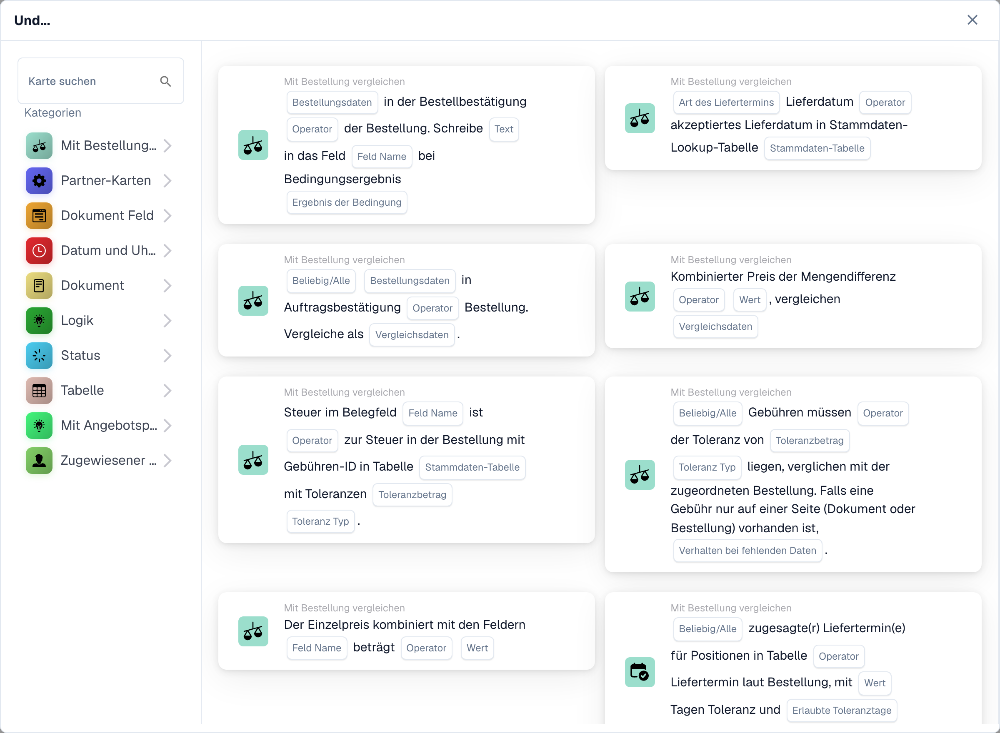

# API-Integrationsmuster

**Pattern-Typ:** Integration **Komplexität:** Mittel **Geschätzte Einrichtung:** 45–60 Minuten **Typische Anwendungsfälle:** Externe Datenabfrage, Preisvalidierung, Stammdaten-Lookup

***

Dieses Pattern bauen Sie im **Workflow-Builder** (Workflow Dashboard → Workflow List → Add Workflow). Klicken Sie auf **Karte hinzufügen**, um die Kartenbibliothek zu öffnen, und wählen Sie die von diesem Pattern verwendeten Karten — `CALL_API`, `CONDITION_HTTPS_REQUEST_STATUS`, `ACTION_SET_FIELD_TO_TEXT` und `CONDITION_COMPARE_TWO_DOCFIELD_VALUES`:

<figure><figcaption><p>Verfügbare Karten der ausgewählten Kategorie. Füllen Sie die Platzhalter vor der Verwendung aus. Einzelne Feldbeschriftungen dieser Kartenversion sind in der Oberfläche derzeit noch englisch. Die Erläuterungen auf dieser Seite sind übersetzt.</p></figcaption></figure>

***

## Pattern-Überblick

Dieses Pattern zeigt, wie Sie DocBits in externe APIs integrieren, um Daten aus externen Systemen abzurufen, zu validieren und zu speichern. Es ist eines der häufigsten Workflow-Patterns, um DocBits mit Preissystemen, Validierungsdiensten, ERP-Systemen und anderen externen Datenquellen zu verbinden.

**Was dieses Pattern macht:**

1. Ruft eine externe API auf, um Daten abzurufen
2. Validiert die API-Antwort
3. Speichert Antwortdaten in Dokumentfeldern
4. Trifft Entscheidungen anhand der abgerufenen Daten
5. Leitet Dokumente entsprechend weiter

***

## Wann dieses Pattern verwenden

Verwenden Sie dieses Pattern, wenn Sie Folgendes benötigen:

* ✅ Echtzeit-Preise aus externen Systemen abrufen
* ✅ Lieferanteninformationen gegen die Stammdatenbank validieren
* ✅ Produktdetails aus Katalogsystemen nachschlagen
* ✅ Wechselkurse aus Währungsdiensten beziehen
* ✅ Adressen per Geocoding-Dienst überprüfen
* ✅ Bestände aus Lagersystemen prüfen
* ✅ Steuersätze aus Steuerdiensten validieren

**Verwenden Sie dieses Pattern nicht, wenn:**

* ❌ die Daten bereits in den DocBits-Stammdaten vorliegen (verwenden Sie stattdessen den Stammdaten-Lookup)
* ❌ das externe System keine API hat (verwenden Sie stattdessen das DocOperator-Script-Pattern)
* ❌ sich die Daten selten ändern (erwägen Sie einen manuellen Import)

***

## Vollständiges Workflow-Beispiel

### Szenario: Rechnungspreis gegen aktuelle Preis-API validieren

**Geschäftliche Anforderung:**

* Lieferant sendet Rechnung
* Rechnung weist einen Stückpreis von 52,00 € aus
* Wir müssen prüfen, ob das mit der aktuellen Lieferantenpreisliste übereinstimmt
* Weicht der Preis um mehr als 5 % ab, zur Prüfung eskalieren

**Verwendete Workflow-Karten:**

1. CALL\_API – Aktuellen Preis aus der Lieferanten-API abrufen
2. CONDITION\_HTTPS\_REQUEST\_STATUS – Prüfen, ob der API-Aufruf erfolgreich war
3. ACTION\_SET\_FIELD\_TO\_TEXT – API-Preis in einem Dokumentfeld speichern
4. CONDITION\_COMPARE\_TWO\_DOCFIELD\_VALUES – Rechnungspreis mit API-Preis vergleichen
5. ACTION\_ASSIGN\_TO\_USER – Anhand des Vergleichsergebnisses weiterleiten
6. tasks\_create – Bei Bedarf eine Prüfaufgabe erstellen

***

## Schritt-für-Schritt-Umsetzung

### Schritt 1: Externe API aufrufen

**Karte:** CALL\_API oder ACTION\_CALL\_EXTERNAL\_API

**Konfiguration:**

```json
{
  "api_endpoint": "https://api.supplier-system.com/v1/pricing",
  "method": "POST",
  "headers": {
    "Authorization": "Bearer YOUR_API_KEY",
    "Content-Type": "application/json"
  },
  "request_body": {
    "product_id": "{{DOCUMENT_FIELD:Product_Code}}",
    "supplier_id": "{{DOCUMENT_FIELD:Supplier_Code}}",
    "quantity": "{{DOCUMENT_FIELD:Quantity}}",
    "currency": "EUR"
  }
}
```

**Erwartete Antwort:**

```json
{
  "success": true,
  "data": {
    "product_id": "ABC123",
    "unit_price": 50.00,
    "currency": "EUR",
    "valid_until": "2025-12-31",
    "discount_applicable": true
  }
}
```

**Leitfaden-Referenz:** [Call API-Leitfaden](../then/action/call-api-guide.md)

***

### Schritt 2: API-Antwort validieren

**Karte:** CONDITION\_HTTPS\_REQUEST\_STATUS

**Konfiguration:**

```
Operator: IS EQUAL TO
Status Code: 200
```

**Logik:**

```
IF API returns 200 (success):
  → Continue to store data
ELSE:
  → Route to "API Error" handling workflow
  → Send email notification
  → Create manual review task
```

**Leitfaden-Referenz:** [Leitfaden Bedingungskarten – HTTP-Status](../and/condition-cards-complete-guide.md)

***

### Schritt 3: API-Antwort in Dokumentfeldern speichern

**Karte:** ACTION\_SET\_FIELD\_TO\_TEXT (oder ein gleichwertiger Feld-Setter)

**Konfiguration:**

**Feld 1: Current\_API\_Price**

```
Field Name: Current_API_Price
Field Value: {{API_RESPONSE:data.unit_price}}
Field Type: Number
```

**Feld 2: API\_Price\_Valid\_Until**

```
Field Name: API_Price_Valid_Until
Field Value: {{API_RESPONSE:data.valid_until}}
Field Type: Date
```

**Feld 3: API\_Discount\_Available**

```
Field Name: API_Discount_Available
Field Value: {{API_RESPONSE:data.discount_applicable}}
Field Type: Boolean
```

**Ergebnis:** Die Daten aus der API sind nun in Dokumentfeldern zur späteren Verwendung gespeichert

**Leitfaden-Referenz:** [Leitfaden Feldmanipulation – API-Datenspeicherung](../then/document-field/field-manipulation-guide.md)

***

### Schritt 4: Rechnungspreis mit API-Preis vergleichen

**Karte:** CONDITION\_COMPARE\_TWO\_DOCFIELD\_VALUES

**Konfiguration:**

```
Field 1: Invoice_Unit_Price (from OCR extraction)
Field 2: Current_API_Price (from API response)
Operator: Calculate variance percentage
Tolerance: 5%
```

**Berechnung:**

```
Variance % = |(Invoice_Price - API_Price)| / API_Price × 100

Example:
  Invoice Price: €52.00
  API Price: €50.00
  Variance = |52 - 50| / 50 × 100 = 4%

  Is 4% ≤ 5% tolerance? YES ✅
  Result: PASS
```

**Leitfaden-Referenz:** [Leitfaden Bedingungskarten – Feldvergleich](../and/condition-cards-complete-guide.md)

***

### Schritt 5: Anhand des Validierungsergebnisses weiterleiten

**Szenario A: Preis innerhalb der Toleranz (Pass)**

**Karten:**

* ACTION\_SET\_FIELD\_TO\_TEXT
  * Feld „Price\_Validation\_Status" = „PASS" setzen
  * Feld „Price\_Variance\_Percent“ = „4%“ setzen
* ACTION\_APPROVE\_DOCUMENT
  * Dokument automatisch freigeben

**Szenario B: Preis außerhalb der Toleranz (Fail)**

**Karten:**

* ACTION\_SET\_FIELD\_TO\_TEXT
  * Feld „Price\_Validation\_Status“ = „FAIL“ setzen
  * Feld „Price\_Variance\_Percent" = „12%" setzen (Beispiel)
* tasks\_create
  * Aufgabentitel: „Review Price Variance - \{{DOCUMENT\_NUMBER\}}"
  * Aufgabenbeschreibung: „Invoice price (€\{{Invoice\_Unit\_Price\}}) exceeds API price (€\{{Current\_API\_Price\}}) by \{{Price\_Variance\_Percent\}}"
  * Priorität: Hoch
* ACTION\_ASSIGN\_TO\_USER
  * Zuweisen an: Einkaufsleitung
* ACTION\_SEND\_EMAIL\_TO\_GROUPS
  * Benachrichtigung an das Einkaufsteam senden

**Leitfaden-Referenzen:**

* [Zuweisungs-Leitfaden](../then/assignee/assignment-user-guide.md)
* [Leitfaden Aufgabenzuweisung](../then/task/task-assignment-guide.md)
* [Leitfaden E-Mail senden](../then/action/send-email-groups-guide.md)

***

## Vollständiges Workflow-Diagramm

```
DOCUMENT ARRIVES (Invoice with Product ABC123, Price €52)
│
├─ STEP 1: Call Pricing API
│  Card: CALL_API
│  Request: Get current price for ABC123
│  │
│  ├─ SUCCESS (200) ✅
│  │  Response: {"unit_price": 50.00}
│  │  │
│  │  ├─ STEP 2: Check API Status
│  │  │  Card: CONDITION_HTTPS_REQUEST_STATUS
│  │  │  Result: 200 = Success
│  │  │  │
│  │  │  ├─ STEP 3: Store API Data
│  │  │  │  Card: ACTION_SET_FIELD_TO_TEXT
│  │  │  │  Action: Store €50 in "Current_API_Price" field
│  │  │  │  │
│  │  │  │  ├─ STEP 4: Compare Prices
│  │  │  │  │  Card: CONDITION_COMPARE_TWO_DOCFIELD_VALUES
│  │  │  │  │  Calculate: Variance = |52-50|/50 = 4%
│  │  │  │  │  │
│  │  │  │  │  ├─ IF Variance ≤ 5% (PASS) ✅
│  │  │  │  │  │  │
│  │  │  │  │  │  ├─ Set Status Field: "PASS"
│  │  │  │  │  │  └─ Auto-Approve Document
│  │  │  │  │  │     → END (Document Approved)
│  │  │  │  │  │
│  │  │  │  │  └─ IF Variance > 5% (FAIL) ❌
│  │  │  │  │     │
│  │  │  │  │     ├─ Set Status Field: "FAIL"
│  │  │  │  │     ├─ Create Review Task
│  │  │  │  │     ├─ Assign to Procurement Manager
│  │  │  │  │     └─ Send Email Notification
│  │  │  │  │        → END (Pending Review)
│  │  │  │  │
│  │  │  │  └─ [Field storage complete]
│  │  │  │
│  │  │  └─ [Status check complete]
│  │  │
│  │  └─ [API data retrieved]
│  │
│  └─ ERROR (Non-200) ❌
│     │
│     ├─ Set Error Status
│     ├─ Create "API Error" Task
│     ├─ Assign to IT Support
│     └─ Send Email to Admin
│        → END (API Error - Manual Review)
```

***

## Konfigurationsvorlagen

### Vorlage 1: Einfacher GET-Request (Lookup)

```json
{
  "card": "CALL_API",
  "endpoint": "https://api.example.com/lookup",
  "method": "GET",
  "headers": {
    "Authorization": "Bearer {{API_KEY}}"
  },
  "parameters": {
    "id": "{{DOCUMENT_FIELD:Lookup_ID}}"
  }
}
```

**Verwendung:** Einfacher Daten-Lookup per ID

***

### Vorlage 2: POST-Request mit Body (Validierung)

```json
{
  "card": "CALL_API",
  "endpoint": "https://api.example.com/validate",
  "method": "POST",
  "headers": {
    "Authorization": "Bearer {{API_KEY}}",
    "Content-Type": "application/json"
  },
  "body": {
    "document_number": "{{DOCUMENT_NUMBER}}",
    "supplier_id": "{{DOCUMENT_FIELD:Supplier_Code}}",
    "total_amount": "{{DOCUMENT_FIELD:Total_Amount}}",
    "currency": "{{DOCUMENT_FIELD:Currency}}"
  }
}
```

**Verwendung:** Dokumentdaten zur Validierung senden

***

### Vorlage 3: Komplexer Request mit verschachtelten Daten

```json
{
  "card": "CALL_API",
  "endpoint": "https://api.example.com/process",
  "method": "POST",
  "headers": {
    "Authorization": "Bearer {{API_KEY}}",
    "Content-Type": "application/json"
  },
  "body": {
    "document": {
      "type": "{{DOCUMENT_TYPE}}",
      "number": "{{DOCUMENT_NUMBER}}",
      "date": "{{DOCUMENT_FIELD:Invoice_Date}}"
    },
    "vendor": {
      "code": "{{DOCUMENT_FIELD:Supplier_Code}}",
      "name": "{{DOCUMENT_FIELD:Supplier_Name}}"
    },
    "items": [
      {
        "product": "{{TABLE_FIELD:Product_Code}}",
        "quantity": "{{TABLE_FIELD:Quantity}}",
        "unit_price": "{{TABLE_FIELD:Unit_Price}}"
      }
    ]
  }
}
```

**Verwendung:** Komplexe Dokumentverarbeitung mit Tabellendaten

***

## Fehlerbehandlung

### Häufige Fehler und Lösungen

#### Fehler 1: Verbindungs-Timeout

**Symptome:**

* API antwortet nicht
* Workflow bleibt wartend stehen

**Lösung:**

```
1. Check API endpoint URL (typo?)
2. Verify network connectivity
3. Check API service status
4. Implement timeout handling:

   IF CONDITION_HTTPS_REQUEST_STATUS = TIMEOUT:
     → Create "API Timeout" task
     → Assign to IT Support
     → Send email notification
     → Use fallback value (if available)
```

#### Fehler 2: 401 Unauthorized

**Symptome:**

* API gibt Status 401 zurück
* Authentifizierung fehlgeschlagen

**Lösung:**

```
1. Verify API key is correct
2. Check if API key expired
3. Ensure Authorization header formatted correctly
4. Implement auth error handling:

   IF CONDITION_HTTPS_REQUEST_STATUS = 401:
     → Create "API Auth Failed" task
     → Assign to Admin
     → Log error details
     → Stop workflow execution
```

#### Fehler 3: Ungültiges Antwortformat

**Symptome:**

* Antwort empfangen, aber nicht parsebar
* Erwartete Felder fehlen

**Lösung:**

```
1. Verify API documentation
2. Check response structure matches expectations
3. Implement response validation:

   IF API_RESPONSE:data.unit_price IS NULL:
     → Set default value
     → Create "Invalid Response" task
     → Log response for debugging
```

**Leitfaden-Referenz:** [Call API – Fehlerbehebung](../then/action/call-api-guide.md)

***

## Erweiterte Varianten

### Variante 1: Verkettung mehrerer APIs

**Szenario:** Daten von mehreren APIs erforderlich

```
Step 1: Call Supplier API → Get Supplier Details
Step 2: Call Product API → Get Product Info (using Supplier ID from Step 1)
Step 3: Call Pricing API → Get Price (using Product ID from Step 2)
Step 4: Validate & Store all data
```

***

### Variante 2: Bedingte API-Aufrufe

**Szenario:** API nur unter bestimmten Bedingungen aufrufen

```
IF DOCUMENT_TYPE = "Invoice" AND AMOUNT > 10000:
  → Call Pricing Validation API
  → Verify prices
ELSE:
  → Skip API call (not needed for small amounts)
```

***

### Variante 3: Caching von API-Antworten

**Szenario:** API-Aufrufe durch Caching der Antworten reduzieren

```
1. Check if "API_Last_Called" date is today
2. IF Yes:
     → Use cached value from "Cached_API_Price" field
3. IF No:
     → Call API
     → Store response in "Cached_API_Price"
     → Set "API_Last_Called" to today
```

***

## Leistungsaspekte

### Best Practices

✅ **Empfohlen:**

* API-Antworten nach Möglichkeit cachen
* Timeout-Einstellungen verwenden (30–60 Sekunden)
* Retry-Logik für vorübergehende Fehler implementieren
* API-Aufrufe zur Fehlersuche protokollieren
* API-Nutzung/-Kosten überwachen
* Zuerst mit Beispiel-Dokumenten testen

❌ **Nicht empfohlen:**

* APIs synchron für jedes Dokument aufrufen (Batch-Verarbeitung erwägen)
* Antwortfehler ignorieren
* Zugangsdaten fest im Workflow hinterlegen
* Unnötige API-Aufrufe tätigen
* Timeouts unbehandelt lassen

***

## Test-Checkliste

Vor dem Produktiveinsatz dieses Patterns:

* [ ] API-Aufruf mit gültigen Daten testen
* [ ] API-Aufruf mit ungültigen Daten testen
* [ ] Timeout-Szenario testen (was passiert, wenn die API langsam ist?)
* [ ] Authentifizierungsfehler testen
* [ ] Ungültiges Antwortformat testen
* [ ] Feldspeicherung testen (Daten korrekt gespeichert?)
* [ ] Vergleichslogik testen (korrekte Berechnung?)
* [ ] Routing testen (gehen Dokumente an die richtige Stelle?)
* [ ] Fehlerbehandlung testen (Fehler sauber behandelt?)
* [ ] Mit hohem Volumen testen (Leistung akzeptabel?)

***

## Praxisbeispiele

### Beispiel 1: Wechselkurs-Lookup

**API:** https://api.exchangerate-api.com/v4/latest/USD

**Arbeitsablauf:**

1. Rechnungswährung extrahieren: „GBP"
2. Wechselkurs-API aufrufen
3. Kurs GBP→EUR abrufen
4. EUR-Gegenwert berechnen
5. In Feld „Amount\_EUR" speichern
6. Verarbeitung mit EUR-Betrag fortsetzen

***

### Beispiel 2: Bonitätsprüfung des Lieferanten

**API:** Interner Bonitätsprüfdienst

**Arbeitsablauf:**

1. Lieferantencode extrahieren
2. Bonitätsprüf-API aufrufen
3. Bonitätsstatus abrufen: „APPROVED" oder „BLOCKED"
4. WENN GESPERRT:
   * Verarbeitung stoppen
   * Dringende Aufgabe erstellen
   * Finanzteam benachrichtigen
5. FALLS GENEHMIGT:
   * Normalen Workflow fortsetzen

***

### Beispiel 3: Anreicherung der Produktstammdaten

**API:** Produktkatalog-Dienst

**Arbeitsablauf:**

1. Produktcode aus der Rechnung extrahieren
2. Produkt-API aufrufen
3. Abrufen: Produktname, Kategorie, Sachkonto
4. In Dokumentfeldern speichern
5. Für die automatische Kontierung verwenden

***

## Verwandte Patterns

### Dieses Pattern passt gut zu:

* [**Datentransformations-Pattern**](data-transformation-pattern.md) – API-Antwortdaten transformieren
* [**Entscheidungslogik-Pattern**](decision-logic-pattern.md) – Anhand der API-Daten routen
* [**Aufgabenverwaltungs-Pattern**](task-management-pattern.md) – Aufgaben für API-Fehler erstellen
* [**PO-Matching-Muster**](po-matching-pattern.md) – API-Preise mit PO-Validierung kombinieren

***

## Verwandte Leitfäden

### Voraussetzungen

* [Call API-Leitfaden](../then/action/call-api-guide.md) – Dokumentation der API-Karte
* [Leitfaden Bedingungskarten](../and/condition-cards-complete-guide.md) – Bedingungslogik
* [Leitfaden Feldmanipulation](../then/document-field/field-manipulation-guide.md) – Feldoperationen

### Verwandte Karten

* **CALL\_API** – [Call API-Leitfaden](../then/action/call-api-guide.md)
* **ACTION\_HTTPS\_REQUEST** – [HTTPS-Request-Leitfaden](../then/action/https-request-guide.md)
* **CONDITION\_HTTPS\_REQUEST\_STATUS** – [Leitfaden Bedingungskarten](../and/condition-cards-complete-guide.md)
* **ACTION\_SET\_FIELD\_TO\_TEXT** – [Leitfaden Feldmanipulation](../then/document-field/field-manipulation-guide.md)
* **CONDITION\_COMPARE\_TWO\_DOCFIELD\_VALUES** – [Leitfaden Bedingungskarten](../and/condition-cards-complete-guide.md)

### Nächste Schritte

* API-Fehler beheben: [Fehlerbehandlung](api-integration-pattern.md#fehlerbehandlung) oben
* Aufgabenerstellung hinzufügen: [Aufgabenverwaltungs-Pattern](task-management-pattern.md)
* Daten transformieren: [Datentransformations-Pattern](data-transformation-pattern.md)

***

## Support & Ressourcen

**Hilfe benötigt?**

* [Call API – Fehlerbehebung](../then/action/call-api-guide.md) lesen
* [API-Antwortcodes](../then/action/call-api-guide.md) prüfen
* API zuerst mit Postman testen
* Support des API-Anbieters kontaktieren

**Feedback:**

* Pattern-Probleme melden an: docs@docbits.com
* Verbesserungen vorschlagen
* Ihre Anwendungsfälle teilen

***

**Pattern-Version:** 1.0 **Zuletzt aktualisiert:** 23. Oktober 2025 **Schwierigkeit:** Mittel **Geschätzte Zeit:** 45–60 Minuten **Erfolgsquote:** Hoch (bei stabiler API)
