# Entscheidungslogikmuster

**Pattern-Typ:** Bedingtes Routing & Logik **Komplexität:** Mittel **Geschätzte Einrichtung:** 30–45 Minuten **Typische Anwendungsfälle:** Mehrpfad-Routing, bedingte Verarbeitung, Entscheidungsbäume, Umsetzung von Geschäftsregeln

***

Öffnen Sie im Standard-Designer **Karte hinzufügen** in der Gruppe **Und....** und wählen Sie **Logik**. Der Ausschnitt unten zeigt eine Bedingungskarte auf Grundlage einer Entscheidungstabelle in der Bibliothek, vor ihrer Auswahl und Konfiguration. Legen Sie die zu verwendende Tabelle und die Speicherung ihrer Ergebnisse für nachfolgende Karten fest. Die weiteren Bedingungen, Aktionen und Verbindungen dieses Musters müssen ebenfalls konfiguriert und geprüft werden. Die Bedingung verwendet die Tabellenergebnisse für das Dokument oder die Lieferantenorganisation.

<figure>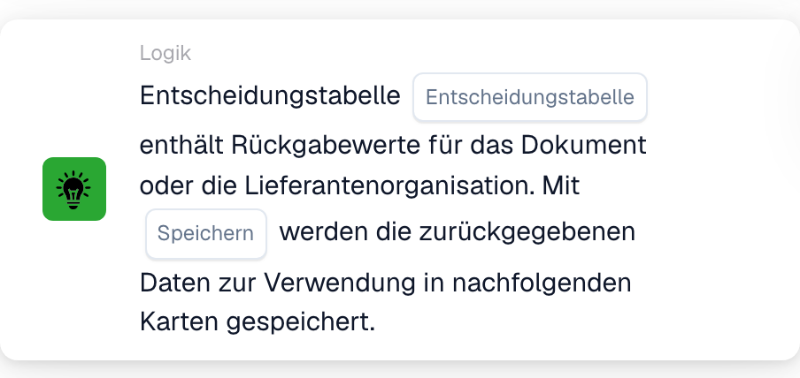<figcaption><p>Bedingungskarte der Kategorie „Logik“ in der Bibliothek, vor Auswahl und Konfiguration. Entscheidungstabelle und Speicherung der Ergebnisse müssen noch konfiguriert werden.</p></figcaption></figure>

***

## Pattern-Überblick

Diese fachlichen Schemata zeigen Regeln, die ausdrücklich zu konfigurieren sind. Sie ergänzen die oben gezeigte Kartenbibliothek vor Auswahl und Konfiguration. Verbinden Sie in Advanced jeden Pfad ausdrücklich. Definieren Sie in einer linearen Standard-Sequenz die Bedingungen, die ihre Aktionen erlauben.

#### Schema: Gesamtprozess

<figure>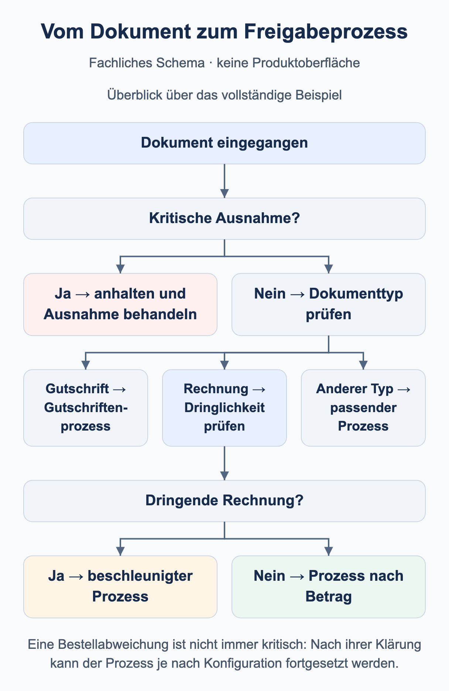<figcaption><p>Überblick über das vollständige Beispiel: Kritische Ausnahmen, Dokumenttyp und Dringlichkeit prüfen, bevor der Freigabeprozess gewählt wird. Jede Behandlung und jede Verbindung muss konfiguriert werden; das Schema zeigt kein automatisches Produktverhalten.</p></figcaption></figure>

Dieses Pattern zeigt, wie Sie in DocBits-Workflows komplexe Entscheidungslogik umsetzen. Mit Bedingungskarten leiten Sie Dokumente anhand von Dokumentattributen, Feldwerten und Geschäftsregeln über verschiedene Verarbeitungspfade.

**Was dieses Pattern macht:**

1. Wertet mehrere Bedingungen nacheinander oder parallel aus
2. Leitet Dokumente anhand von Bedingungen über verschiedene Pfade
3. Setzt Geschäftsregeln und Richtlinien um
4. Behandelt komplexe Entscheidungsbäume
5. Kombiniert mehrere Kriterien für Routing-Entscheidungen

***

## Wann dieses Pattern verwenden

Verwenden Sie dieses Pattern, wenn Sie Folgendes benötigen:

* ✅ Dokumente nach Betragsschwellen leiten
* ✅ Unterschiedliche Regeln für unterschiedliche Dokumenttypen anwenden
* ✅ Mehrstufige Freigabelogik umsetzen
* ✅ Komplexe Geschäftsrichtlinien abbilden
* ✅ Dynamisches Routing anhand mehrerer Kriterien erstellen
* ✅ Logik zur Ausnahmebehandlung umsetzen
* ✅ Freigabematrizen erstellen

**Verwenden Sie dieses Pattern nicht, wenn:**

* ❌ ein einfacher linearer Workflow genügt
* ❌ alle Dokumente denselben Pfad durchlaufen
* ❌ keine bedingte Verarbeitung erforderlich ist

***

## Typen von Entscheidungslogik

Die folgenden IF-THEN-, UND-, ODER- und verschachtelten Beispiele sind unabhängig. Ihre Schwellenwerte erläutern den jeweiligen Ansatz und bilden keine gemeinsame Freigabematrix. Die vollständige Matrix weiter unten verwendet vier überschneidungsfreie Bereiche. Unbekannte Werte oder Auswertungsfehler sind nicht automatisch Falsch: Definieren und testen Sie deren Behandlung gesondert.

### 1. Einfache IF-THEN-Logik

#### Schema: Einfache Bedingung

<figure>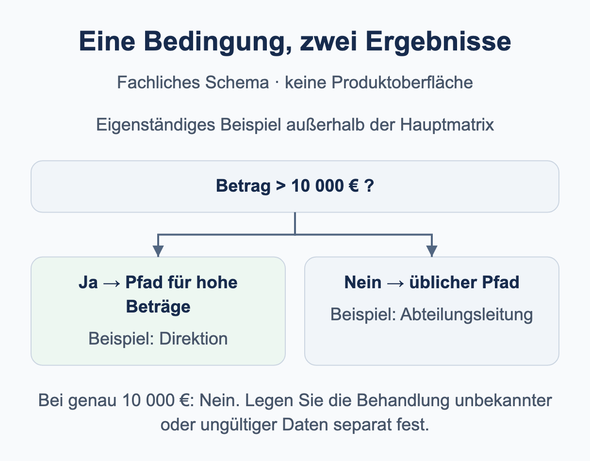<figcaption><p>Eigenständiges IF-THEN-Beispiel: Ein Betrag strikt über 10 000 € führt zur Direktion, sonst zur Abteilungsleitung. Bei Gleichheit gilt der zweite Zweig. Die Ziele müssen konfiguriert werden.</p></figcaption></figure>

Visuelle Erläuterung: [Einfache Bedingung](#schema-einfache-bedingung).

<details>
<summary>IF-THEN-Grundprinzip: eine Bedingung, zwei Ergebnisse</summary>

```
IF condition:
  → Aktion A
ELSE:
  → Aktion B
```

</details>

**Beispiel:**

Visuelle Erläuterung: [Einfache Bedingung](#schema-einfache-bedingung).

<details>
<summary>IF-THEN-Beispiel: Betragsgrenze</summary>

```
IF Amount > €10,000:
  → Der Direktion zuweisen
ELSE:
  → Der Abteilungsleitung zuweisen
```

</details>

#### Schema: UND und ODER

<figure>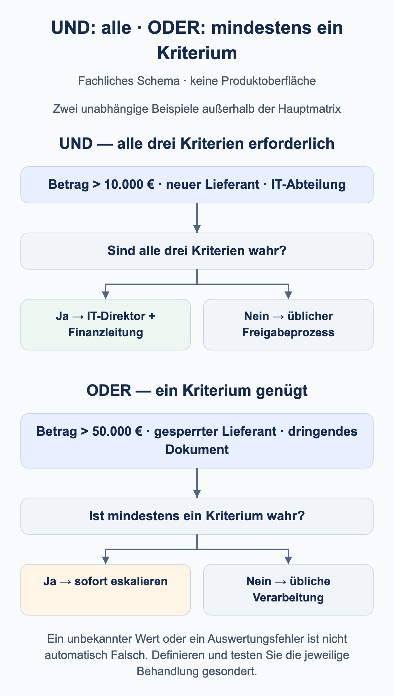<figcaption><p>Zwei unabhängige Beispiele: UND erfordert alle drei Kriterien; ODER erfordert mindestens eines. Ihre beispielhaften Schwellenwerte ersetzen nicht die Betragsbereiche der vollständigen Matrix. Die Ausgänge und die Behandlung unbekannter Werte oder Fehler müssen konfiguriert werden.</p></figcaption></figure>

### 2. Mehrere Kriterien (UND-Logik)

Visuelle Erläuterung: [UND und ODER](#schema-und-und-oder).

<details>
<summary>UND-Grundprinzip: alle Kriterien</summary>

```
IF condition1 AND condition2 AND condition3:
  → Aktion A
ELSE:
  → Aktion B
```

</details>

**Beispiel:**

Visuelle Erläuterung: [UND und ODER](#schema-und-und-oder).

<details>
<summary>UND-Beispiel: drei Kriterien</summary>

```
IF Amount > €10,000 AND Supplier = "New" AND Department = "IT":
  → IT-Direktion + CFO zuweisen (zwei Freigaben)
ELSE:
  → Üblicher Freigabeprozess
```

</details>

### 3. Alternative Kriterien (ODER-Logik)

Visuelle Erläuterung: [UND und ODER](#schema-und-und-oder).

<details>
<summary>ODER-Grundprinzip: mindestens ein Kriterium</summary>

```
IF condition1 OR condition2 OR condition3:
  → Aktion A
ELSE:
  → Aktion B
```

</details>

**Beispiel:**

Visuelle Erläuterung: [UND und ODER](#schema-und-und-oder).

<details>
<summary>ODER-Beispiel: Betrag, Sperre oder Dringlichkeit</summary>

```
IF Amount > €50,000 OR Supplier ist "Blocked" OR Document hat die Markierung "Urgent":
  → Sofort eskalieren
ELSE:
  → Übliche Verarbeitung
```

</details>

### 4. Verschachtelter Entscheidungsbaum

#### Schema: Verschachtelte Entscheidungen

<figure>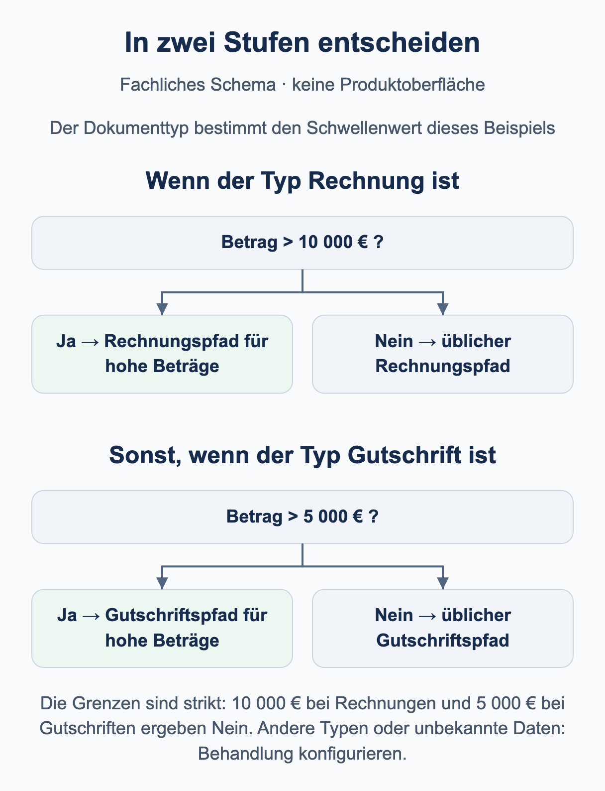<figcaption><p>Eigenständiges verschachteltes Beispiel: Der Dokumenttyp wählt einen Betragstest. Genau 10 000 € bei Rechnungen und 5 000 € bei Gutschriften erfüllen den Test „größer als“ nicht. Die Behandlung anderer Typen und unbekannter Daten muss festgelegt werden.</p></figcaption></figure>

Visuelle Erläuterung: [Verschachtelte Entscheidungen](#schema-verschachtelte-entscheidungen).

<details>
<summary>Grundprinzip verschachtelter Entscheidungen</summary>

```
IF condition1:
  IF condition2:
    → Aktion A
  ELSE:
    → Aktion B
ELSE:
  IF condition3:
    → Aktion C
  ELSE:
    → Aktion D
```

</details>

**Beispiel:**

Visuelle Erläuterung: [Verschachtelte Entscheidungen](#schema-verschachtelte-entscheidungen).

<details>
<summary>Verschachteltes Beispiel: Rechnung und Gutschrift</summary>

```
IF Document_Type = "Invoice":
  IF Amount > €10,000:
    → Rechnungspfad für hohe Beträge
  ELSE:
    → Üblicher Rechnungspfad
ELSE IF Document_Type = "Credit Note":
  IF Amount > €5,000:
    → Gutschriftspfad für hohe Beträge
  ELSE:
    → Üblicher Gutschriftspfad
```

</details>

***

## Vollständiges Workflow-Beispiel

### Szenario: Freigabematrix für Rechnungen

**Geschäftsregeln:**

1. Vor der Betragsprüfung kritische Ausnahmen, insbesondere gesperrte Lieferanten, anhalten und behandeln. Eine Bestellabweichung ist nicht immer kritisch: Nach ihrer Klärung durch den Einkauf kann der Prozess gemäß Konfiguration fortgesetzt werden. Danach den Dokumenttyp prüfen.
2. Dringende Rechnungen folgen dem hier beschriebenen beschleunigten Prozess statt den gewöhnlichen Betragsbereichen.
3. Für nicht dringende Rechnungen mit gültigem Betrag gelten diese Bereiche:
   * Betrag < 1.000 €: automatische Freigabe;
   * 1.000 € ≤ Betrag < 10.000 €: Freigabe durch die verantwortliche Person;
   * 10.000 € ≤ Betrag < 50.000 €: Lieferantenprüfung und Direktorfreigabe; bei einem nicht gesperrten Lieferanten, der jünger als 180 Tage ist, erst Direktorfreigabe, danach Freigabe durch die Finanzleitung; bei anderen Lieferanten zusätzlich das Risiko prüfen; bei hohem Risiko zunächst die Vorfreigabe der Abteilungsleitung und danach die Direktorfreigabe abwarten;
   * Betrag ≥ 50.000 €: Prozess der Geschäftsführung gemäß Pfad D.
4. Ein fehlender oder ungültiger Betrag führt hier zu einer ausdrücklich konfigurierten manuellen Prüfung. Dies ist eine Festlegung des Beispiels, kein automatisches Produktverhalten.
5. Nach Erstellung einer Aufgabe ihr Ergebnis abwarten. Eine Ablehnung beendet die Kette und wird gemäß Konfiguration behandelt; ein ausstehendes Ergebnis erlaubt keine Fortsetzung. Die Aufgabe für die Finanzleitung erst nach positiver Direktorfreigabe erstellen.

#### Schema: Betragsbereiche

<figure>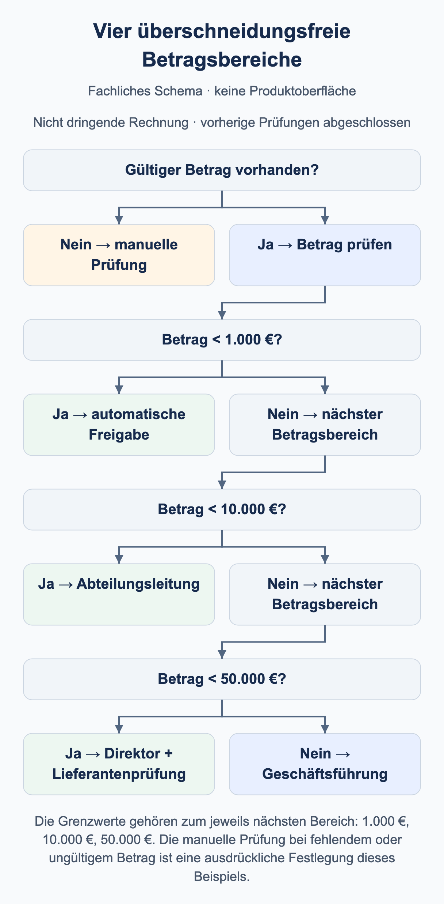<figcaption><p>Schwellenwerte der zweiten Stufe: unter 1.000 €; ab 1.000 € bis unter 10.000 €; ab 10.000 € bis unter 50.000 €; ab 50.000 €. Jeder Test folgt auf das negative Ergebnis des vorherigen Tests. Die manuelle Prüfung bei fehlendem oder ungültigem Betrag muss ausdrücklich konfiguriert werden.</p></figcaption></figure>

Die Grenzwerte 1.000 €, 10.000 € und 50.000 € gehören jeweils zum nächsten Bereich. Vorprüfungen, das Warten auf Ergebnisse und Verbindungen sind zu konfigurieren und zu testen. Eine erstellte Aufgabe belegt weder eine Freigabe noch einen Export.

**Beispielhafte Umsetzung:** Passen Sie technische Namen und Pseudocode an die tatsächlich verfügbaren Karten Ihrer Version an. Die Blöcke beschreiben eine zu konfigurierende Lösung und sind keine importierbare Datei. Technische Schlüssel, Variablen, Statuswerte, Platzhalter und referenzierte Workflownamen bleiben in ihrer Originalschreibweise; Erläuterungen und Aktionsbeschreibungen sind deutsch. Prüfen Sie Ausführungsergebnisse und Auswirkungen Ihrer Konfiguration.

Visuelle Erläuterung: [Gesamtprozess](#schema-gesamtprozess), [Betragsbereiche](#schema-betragsbereiche), [Lieferantenanalyse](#schema-lieferantenanalyse), [Automatischer Pfad](#schema-automatischer-pfad), [Aufgabe der Abteilungsleitung](#schema-aufgabe-der-abteilungsleitung), [Freigaben der Leitung](#schema-freigaben-der-leitung), [Regelsteckbrief](#schema-regelsteckbrief).

<details>
<summary>Pseudocode der vollständigen Matrix</summary>

```
VORPRÜFUNG: kritische Ausnahmen
  IF Critical_Exception = TRUE OR Supplier_Status = "BLOCKED":
    → Vor der Verzweigung stoppen und Ausnahme behandeln

SCHRITT 1: Bestellabweichung prüfen
  IF PO_Match_Status = "FAIL":
    → Zur Klärung an den Einkauf weiterleiten
    → Nach der Klärung gemäß Konfiguration unten fortfahren

SCHRITT 1b: Dokumenttyp prüfen
  IF Document_Type = "Credit Note":
    → Konfigurierter Gutschriftenprozess
  ELSE IF Document_Type ist nicht "Invoice":
    → Konfigurierter Prozess für diesen Dokumenttyp
  ELSE:
    → Unten fortfahren

SCHRITT 2: Dringlichkeitsmarkierung prüfen
  IF Urgent_Flag = TRUE:
    → Betragsprüfungen überspringen
    → Direkt zur höchsten Freigabeinstanz
    → priority = URGENT setzen
    → Frist: 1 Tag

SCHRITT 3: Betragsabhängige Verzweigung (Rechnung, sofern nicht dringend)
  IF Amount fehlt oder ungültig ist:
    → Manuelle Prüfung (ausdrückliche Regel dieses Beispiels)
    → Nicht in die Betragsbereiche einordnen

  ELSE IF Amount < €1,000:
    → Automatisch freigeben
    → Sofort exportieren

  ELSE IF Amount < €10,000:
    → Aufgabe für die Abteilungsleitung erstellen
    → Priorität: mittel
    → Frist: 3 Tage

  ELSE IF Amount < €50,000:
    Lieferantenstatus und Risiko PRÜFEN:
      IF Supplier_Status = "BLOCKED":
        → Stoppen und Ausnahme behandeln
      ELSE IF Supplier_Age < 180 Tage (neu):
        → Aufgabe für die Direktion erstellen (Aufgabe 1)
        → Vor Erstellung der CFO-Aufgabe (Aufgabe 2) auf Zustimmung der Direktion warten
        → Vor dem Fortfahren auf Zustimmung des CFO warten
        → Jede Ablehnung: Kette stoppen und gemäß Konfiguration behandeln
        → Ausstehend: nicht fortfahren
        → Priorität: hoch
        → Frist: jeweils 2 Tage
      ELSE IF Supplier_Risk_Rating = "HIGH":
        → Zusätzliche Prüfungen und Vorfreigabe durch die Abteilungsleitung
        → Vor der Direktorfreigabe auf Zustimmung der Abteilungsleitung warten
        → Ausstehend oder abgelehnt: Freigabekette nicht fortsetzen
      ELSE (bestehender Lieferant):
        → Nur eine Aufgabe für die Direktion erstellen
        → Priorität: hoch
        → Frist: 2 Tage

  ELSE (Amount ≥ €50,000):
    → Freigabepfad der Geschäftsleitung (siehe Pfad D)
```

</details>

***

## Schritt-für-Schritt-Umsetzung

### Schritt 1: Bedingungskarten definieren

**Bedingung 1: Betragsschwelle**

#### Schema: Parameter und Bedingungen

<figure>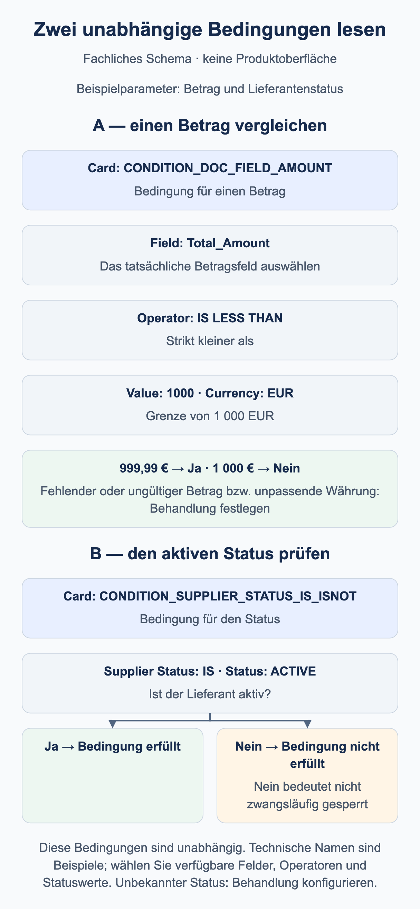<figcaption><p>Zwei unabhängige Bedingungen: ein Betrag strikt unter 1 000 EUR und ein aktiver Lieferant. Bei gleichem Betrag lautet das Ergebnis Nein; ein nicht aktiver Lieferant ist nicht zwangsläufig gesperrt. Die beispielhaften technischen Parameter müssen an die tatsächliche Konfiguration angepasst werden.</p></figcaption></figure>

Visuelle Erläuterung: [Parameter und Bedingungen](#schema-parameter-und-bedingungen).

<details>
<summary>Beispielparameter: Betragsgrenze</summary>

```
Card: CONDITION_DOC_FIELD_AMOUNT
Field: Total_Amount
Operator: IS LESS THAN
Value: 1000
Currency: EUR
```

</details>

**Bedingung 2: Dokumenttyp-Prüfung**

#### Schema: Dokumenttypen

<figure>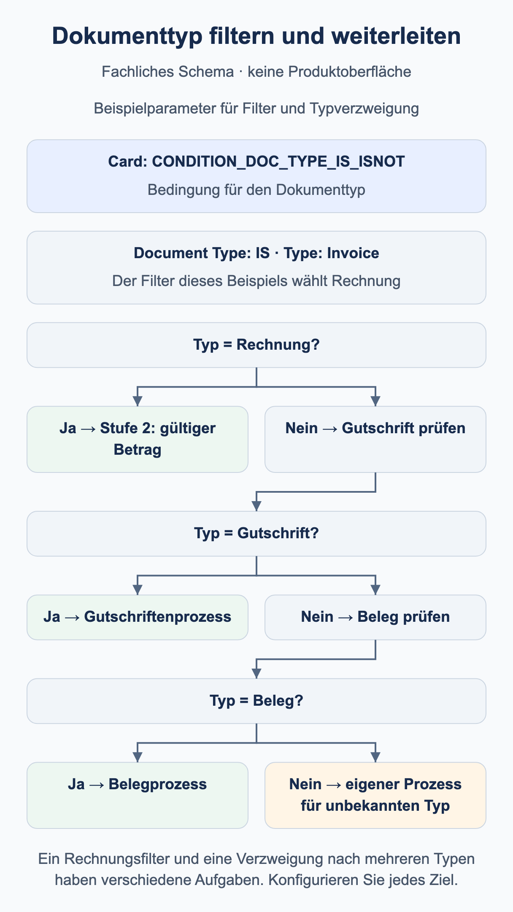<figcaption><p>Der Rechnungsfilter und die Typverzweigung ergänzen sich in diesem Beispiel. Die Verzweigung unterscheidet Rechnung, Gutschrift, Beleg und unbekannten Typ. Karten- und Workflownamen sind beispielhaft; jedes Ziel muss konfiguriert werden.</p></figcaption></figure>

Visuelle Erläuterung: [Dokumenttypen](#schema-dokumenttypen).

<details>
<summary>Beispielparameter: Dokumenttyp</summary>

```
Card: CONDITION_DOC_TYPE_IS_ISNOT
Document Type: IS
Type: Invoice
```

</details>

**Bedingung 3: Lieferantenstatus**

Visuelle Erläuterung: [Parameter und Bedingungen](#schema-parameter-und-bedingungen).

<details>
<summary>Beispielparameter: aktiver Status</summary>

```
Card: CONDITION_SUPPLIER_STATUS_IS_ISNOT
Supplier Status: IS
Status: ACTIVE
```

</details>

**Bedingung 4: Prüfung auf neuen Lieferanten**

Berechnen Sie für dieses Beispiel den Stichtag 180 Tage vor der Auswertung und vergleichen Sie das Datum der ersten Transaktion damit. „IS AFTER“ bedeutet strikt danach; Gleichheit ergibt Nein. Karten- und Feldnamen sowie der Platzhalter {{TODAY_MINUS_180_DAYS}} sind beispielhaft und keine bestätigten Produktoptionen. Wählen Sie das tatsächliche Feld und berechnen oder erfassen Sie den Stichtag. Prüfen Sie gesondert, ob das Datum gültig und nicht zukünftig ist; konfigurieren Sie die Behandlung fehlender oder ungültiger Werte.

#### Schema: 180-Tage-Vergleich

<figure><figcaption><p>Vergleichsbeispiel: Am 25. Oktober 2026 liegt der Stichtag beim 28. April 2026. „IS AFTER“ schließt Gleichheit aus: Der 29. April ergibt Ja, der 28. und 27. April ergeben Nein. Die Karten- und Feldnamen sowie der Platzhalter {{TODAY_MINUS_180_DAYS}} sind beispielhaft und keine bestätigten Produktoptionen: Wählen Sie das tatsächliche Feld und berechnen oder erfassen Sie den Stichtag. Die Datumswerte werden als gültig und nicht zukünftig vorausgesetzt; zukünftige Datumswerte sind gesondert zu prüfen. Die Behandlung fehlender oder ungültiger Werte muss weiterhin konfiguriert werden.</p></figcaption></figure>

Visuelle Erläuterung: [180-Tage-Vergleich](#schema-180-tage-vergleich).

<details>
<summary>Die vier beispielhaften Datumsparameter anzeigen</summary>

```
Card: CONDITION_DOC_FIELD_DATE
Field: Supplier_First_Transaction_Date
Operator: IS AFTER
Value: {{TODAY_MINUS_180_DAYS}}
```

</details>

**Leitfaden-Referenz:** [Leitfaden Bedingungskarten (komplett)](../and/condition-cards-complete-guide.md)

***

### Schritt 2: Entscheidungsbaum aufbauen

**Ebene 1: Dokumenttyp**

Visuelle Erläuterung: [Dokumenttypen](#schema-dokumenttypen).

<details>
<summary>Beispiel einer Verzweigung nach Dokumenttypen</summary>

```
Workflow: "Invoice Processing"

IF Document_Type = "Invoice":
  → Mit Ebene 2 fortfahren

ELSE IF Document_Type = "Credit Note":
  → Zu "Credit Note Processing" verzweigen

ELSE IF Document_Type = "Receipt":
  → Zu "Receipt Processing" verzweigen

ELSE:
  → An die Behandlung für "Unknown Document Type" weiterleiten
```

</details>

**Ebene 2: Betragsschwellen (nicht dringende Rechnungen, gültiger Betrag)**

Visuelle Erläuterung: [Betragsbereiche](#schema-betragsbereiche).

<details>
<summary>Pseudocode der vier Betragsbereiche</summary>

```
IF Amount < €1,000:
  → Zu "Auto-Approve Path" verzweigen

ELSE IF Amount < €10,000:
  → Zu "Manager Approval Path" verzweigen

ELSE IF Amount < €50,000:
  → Zu "Director Approval Path" verzweigen
  → Bedingungen der Ebene 3 prüfen

ELSE (Amount ≥ €50,000):
  → Zu "Executive Approval Path" verzweigen
  → Zwei oder drei Freigaben erforderlich
```

</details>

**Ebene 3: Lieferantenanalyse (für hochwertige Rechnungen)**

#### Schema: Lieferantenanalyse

<figure>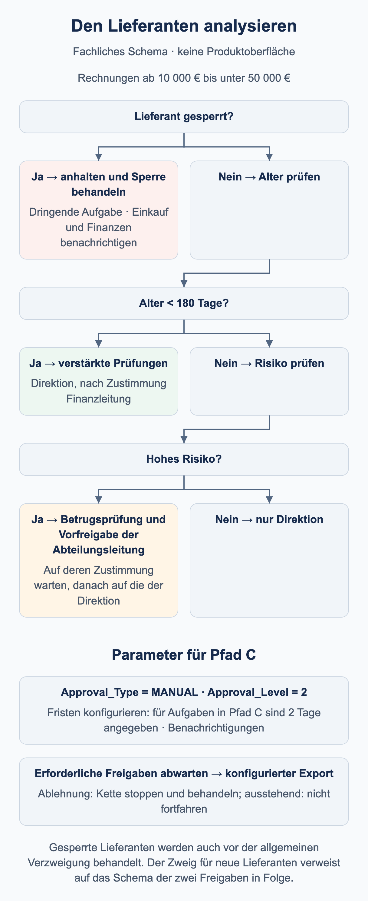<figcaption><p>Ausschnitt des Lieferantenprozesses: zuerst Sperre, dann Alter, dann Risiko prüfen. Der Zweig für weniger als 180 Tage verweist auf zwei Freigaben in Folge. Aufgaben, Fristen, Benachrichtigungen und Aktionen in Pfad C müssen konfiguriert werden.</p></figcaption></figure>

Visuelle Erläuterung: [Lieferantenanalyse](#schema-lieferantenanalyse).

<details>
<summary>Lieferantenanalyse: Sperre, Alter und Risiko</summary>

```
IF Supplier_Status = "BLOCKED":
  → Verarbeitung STOPPEN
  → Dringende Eskalationsaufgabe erstellen
  → Einkauf und Finanzen benachrichtigen

ELSE IF Supplier_Age < 180 Tage (neu):
  → Zusätzliche Freigabe erforderlich
  → CFO zur Freigabekette hinzufügen
  → Verstärkte Prüfung

ELSE IF Supplier_Risk_Rating = "HIGH":
  → Zusätzliche Prüfungen erforderlich
  → Betrugsprüfung
  → Vorfreigabe der Abteilungsleitung; auf Zustimmung warten
  → Direktorfreigabe; auf Zustimmung warten

ELSE:
  → Üblicher Prozess für hohe Beträge
```

</details>

***

### Schritt 3: Routing-Aktionen erstellen

**Pfad A: Automatische Freigabe (Betrag < 1.000 €)**

#### Schema: Automatischer Pfad

<figure>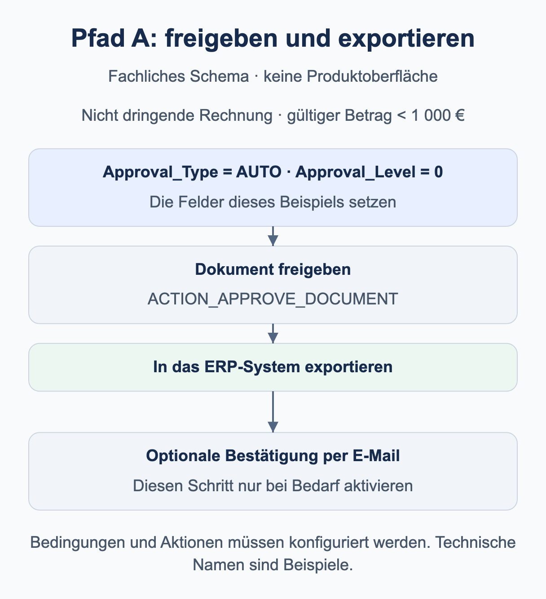<figcaption><p>Pfad A des Beispiels: Freigabefelder setzen, Dokument freigeben und anschließend exportieren. Die Bestätigung per E-Mail ist optional. Das Schema beschreibt zu konfigurierende Aktionen und keine beobachtete Ausführung.</p></figcaption></figure>

Visuelle Erläuterung: [Automatischer Pfad](#schema-automatischer-pfad).

<details>
<summary>Aktionen in Pfad A: automatische Freigabe</summary>

```
Aktionen:
1. Feld "Approval_Type" = "AUTO" setzen
2. Feld "Approval_Level" = "0" setzen
3. ACTION_APPROVE_DOCUMENT
4. Ins ERP exportieren
5. Bestätigungs-E-Mail senden (optional)
```

</details>

**Pfad B: Freigabe durch die verantwortliche Person (1.000 € ≤ Betrag < 10.000 €)**

#### Schema: Aufgabe der Abteilungsleitung

<figure>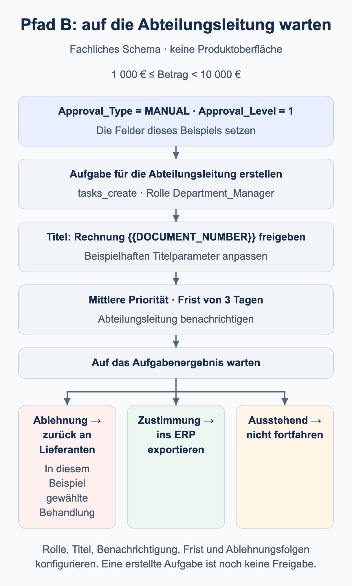<figcaption><p>Pfad B des Beispiels: Aufgabe für die Abteilungsleitung erstellen, benachrichtigen und das Ergebnis abwarten. Nur Zustimmung erlaubt den Export; eine Ablehnung führt hier zurück an den Lieferanten. Die Dreitagesfrist und Empfänger sind Konfigurationsentscheidungen.</p></figcaption></figure>

Visuelle Erläuterung: [Aufgabe der Abteilungsleitung](#schema-aufgabe-der-abteilungsleitung).

<details>
<summary>Aktionen in Pfad B: Aufgabe der Abteilungsleitung</summary>

```
Aktionen:
1. Feld "Approval_Type" = "MANUAL" setzen
2. Feld "Approval_Level" = "1" setzen
3. tasks_create:
   - Title: "Rechnung {{DOCUMENT_NUMBER}} freigeben"
   - Assign to: Department_Manager
   - Priority: Medium
   - Deadline: 3 Tage
4. Abteilungsleitung per E-Mail benachrichtigen
5. Auf Abschluss der Aufgabe warten
6. Bei Zustimmung: ins ERP exportieren
7. Bei Ablehnung: an den Lieferanten zurückgeben
```

</details>

**Pfad C: Freigabe durch den Direktor (10.000 € ≤ Betrag < 50.000 €)**

Visuelle Erläuterung: [Lieferantenanalyse](#schema-lieferantenanalyse), [Freigaben in Folge](#schema-freigaben-in-folge).

<details>
<summary>Aktionen in Pfad C: Prüfungen und erforderliche Freigaben</summary>

```
Aktionen:
1. Feld "Approval_Type" = "MANUAL" setzen
2. Feld "Approval_Level" = "2" setzen
3. Supplier_Age und Supplier_Risk_Rating prüfen:
   IF neu (< 180 Tage):
     - Aufgabe 1 erstellen: Direktorfreigabe
     - Vor Erstellung der Aufgabe 2 (CFO-Freigabe) auf Zustimmung zu Aufgabe 1 warten
     - Vor dem Fortfahren auf Zustimmung zu Aufgabe 2 warten
     - Ausstehend: nicht fortfahren
     - Jede Ablehnung: Kette stoppen und gemäß Konfiguration behandeln
     - Beide Zustimmungen erforderlich
   ELSE IF Supplier_Risk_Rating = "HIGH":
     - Zusätzliche Risikoprüfungen und Vorfreigabe der Abteilungsleitung
     - Vor der Direktorfreigabe auf Zustimmung der Abteilungsleitung warten
     - Vor dem Export auf Zustimmung der Direktion warten
     - Ausstehend oder abgelehnt: stoppen und Ergebnis gemäß Konfiguration behandeln
   ELSE:
     - Aufgabe erstellen: nur Direktorfreigabe
4. Priorität: hoch
5. Frist: 2 Tage für Freigabeaufgaben in Pfad C; Fristen für Risikoprüfungen separat konfigurieren
6. Benachrichtigungen per E-Mail senden
7. Auf Abschluss warten
8. Bei Zustimmung aller: exportieren
9. Bei einer Ablehnung: an den Lieferanten zurückgeben
```

</details>

#### Schema: Freigaben in Folge

<figure>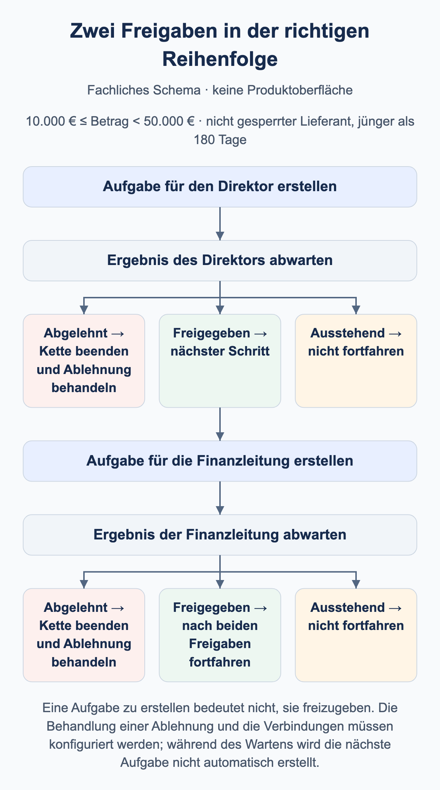<figcaption><p>Beispiel aufeinanderfolgender Freigaben: Die Aufgabe für die Finanzleitung erst nach der Freigabe durch den Direktor erstellen und anschließend ihr Ergebnis abwarten. Erst nach beiden Freigaben fortfahren. Eine Ablehnung beendet die Kette und wird gemäß Konfiguration behandelt; ein ausstehendes Ergebnis erlaubt keine Fortsetzung.</p></figcaption></figure>

Eine Ablehnung kann gemäß Konfiguration zu einer Rückgabe an den Lieferanten oder einem anderen Prozess führen. Das Schema fordert nur, die betroffene Freigabekette anzuhalten; es schreibt nicht in jedem Fall eine manuelle Prüfung vor.

**Pfad D: Freigabe durch die Geschäftsleitung (≥ 50.000 €)**

#### Schema: Freigaben der Leitung

<figure>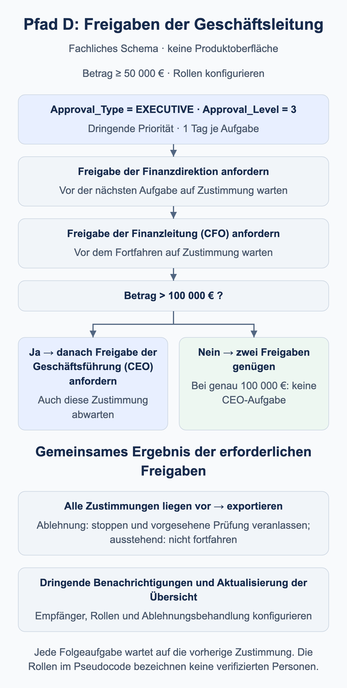<figcaption><p>Pfad D des Beispiels: ab 50 000 € zwei Freigaben in Folge, eine dritte erst über 100 000 €. Jede Folgeaufgabe wartet auf die vorherige Zustimmung. Rollen, Fristen, Benachrichtigungen und Ablehnungsfolgen müssen konfiguriert werden.</p></figcaption></figure>

Visuelle Erläuterung: [Freigaben der Leitung](#schema-freigaben-der-leitung).

<details>
<summary>Aktionen in Pfad D: Geschäftsleitung</summary>

```
Aktionen:
1. Feld "Approval_Type" = "EXECUTIVE" setzen
2. Feld "Approval_Level" = "3" setzen
3. Freigaben in Folge:
   - Aufgabe 1: Finanzdirektion
   - Aufgabe 2: CFO
   - Aufgabe 3: CEO (bei > €100,000)
4. Priorität: dringend
5. Frist: jeweils 1 Tag
6. Dringende Benachrichtigungen senden
7. Übersicht für die Geschäftsleitung aktualisieren
8. Auf alle Freigaben warten
9. Bei Zustimmung aller: exportieren
10. Bei einer Ablehnung: Prüfung durch die Geschäftsleitung
```

</details>

***

## Erweiterte Entscheidungslogik-Patterns

Die folgenden Patterns sind unabhängige Varianten. Punktzahl, Abteilungsschwellen und zeitliche Regeln kommen nicht automatisch zur vorherigen Matrix hinzu. Wählen und konfigurieren Sie die für Ihren Fall passenden Regeln.

### Pattern 1: Punktzahlbasiertes Routing

**In diesem Beispiel eine ganzzahlige Risikobewertung berechnen und entsprechend routen:**

Die fünf bekannten Beiträge können nur bestimmte Vielfache von fünf erzeugen. Die Werte 51 und 76 sind Bereichsgrenzen, keine mit diesen Gewichten erreichbaren Punktzahlen. Unbekannte Daten dürfen nicht automatisch als null Punkte behandelt werden; definieren Sie dafür einen eigenen Ausgang.

#### Schema: Risikobewertung

<figure>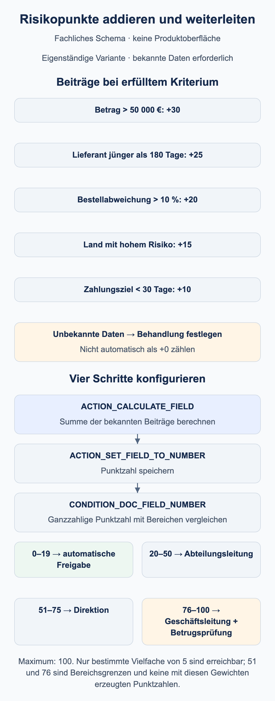<figcaption><p>Eigenständige Variante: Die fünf bekannten Beiträge ergeben eine ganze Punktzahl von 0 bis 100 und anschließend einen Pfad. Die Grenzen 51 und 76 trennen Bereiche; diese Punktzahlen entstehen mit den fünf Gewichten nicht. Die Behandlung unbekannter Daten muss separat festgelegt werden.</p></figcaption></figure>

Visuelle Erläuterung: [Risikobewertung](#schema-risikobewertung).

<details>
<summary>Risikopunkte und ihre Bereiche berechnen</summary>

```
Berechnung der Risikopunkte:
  Score = 0

  IF Amount > €50,000: Score += 30
  IF Supplier_Age < 180 Tage: Score += 25
  IF PO_Variance > 10%: Score += 20
  IF Supplier_Country = "High Risk Country": Score += 15
  IF Payment_Terms < 30 Tage: Score += 10

  Bereich der Gesamtpunktzahl: 0-100

Verzweigung:
  IF Score < 20: automatisch freigeben
  IF Score 20-50: Freigabe der Abteilungsleitung
  IF Score 51-75: Direktorfreigabe
  IF Score > 75: Freigabe der Geschäftsleitung + Betrugsprüfung
```

</details>

**Umsetzung:**

Visuelle Erläuterung: [Risikobewertung](#schema-risikobewertung).

<details>
<summary>Beispielhafte Umsetzung der Risikobewertung</summary>

```
1. ACTION_CALCULATE_FIELD: Risikopunkte berechnen
2. ACTION_SET_FIELD_TO_NUMBER: Punktzahl speichern
3. CONDITION_DOC_FIELD_NUMBER: Punktzahlgrenzen prüfen
4. Nach Punktzahl weiterleiten
```

</details>

***

### Pattern 2: Abteilungsbasierte Matrix

**Unterschiedliche Freigaberegeln je Abteilung:**

#### Schema: Matrix nach Abteilung

<figure>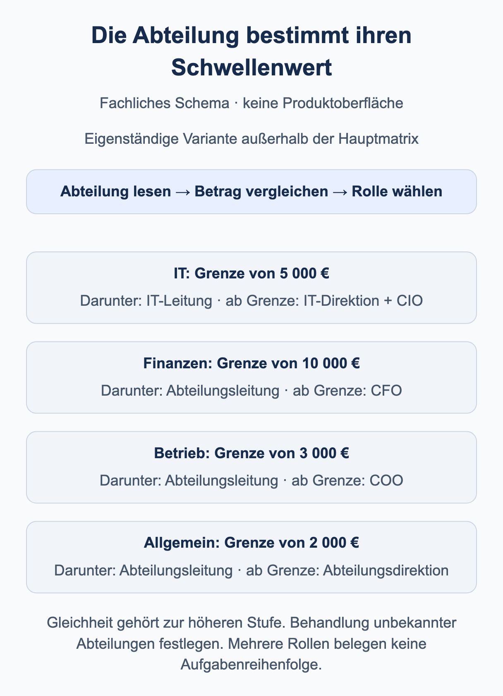<figcaption><p>Eigenständige Matrix nach Abteilung: Die Grenze variiert für IT, Finanzen, Betrieb und den allgemeinen Fall. Bei Gleichheit gilt die höhere Stufe. Mehrere Rollen müssen konfiguriert werden; ihre Nennung belegt keine Freigaben in Folge.</p></figcaption></figure>

Visuelle Erläuterung: [Matrix nach Abteilung](#schema-matrix-nach-abteilung).

<details>
<summary>Matrix der Grenzen je Abteilung</summary>

```
Abteilungsmatrix:

  IT-Abteilung:
    Amount < €5,000: IT-Leitung
    Amount ≥ €5,000: IT-Direktion + CIO

  Finanzabteilung:
    Amount < €10,000: Abteilungsleitung Finanzen
    Amount ≥ €10,000: CFO

  Betriebsabteilung:
    Amount < €3,000: Abteilungsleitung Betrieb
    Amount ≥ €3,000: COO

  Allgemein:
    Amount < €2,000: Abteilungsleitung
    Amount ≥ €2,000: Abteilungsdirektion
```

</details>

**Umsetzung:**

Visuelle Erläuterung: [Matrix nach Abteilung](#schema-matrix-nach-abteilung).

<details>
<summary>Beispielhafte Umsetzung der Abteilungsmatrix</summary>

```
1. Feld Department prüfen
2. Abhängig von der Abteilung die Betragsgrenze prüfen
3. An die passende Freigabeinstanz weiterleiten
4. Unterschiedliche Grenzen je Abteilung
```

</details>

***

### Pattern 3: Zeitbasierte Logik

**Unterschiedliche Regeln je nach Zeitpunkt:**

Die Varianten sind unabhängig. Legen Sie Kalender, Zeitzone und genaue Zeitgrenzen fest. Außerhalb der aktuellen Buchungsperiode bedeutet nicht zwangsläufig frühere Periode: Fehlende oder ungültige Daten sowie künftige oder andere Perioden benötigen eigene Behandlungen.

#### Schema: Zeitvarianten

<figure>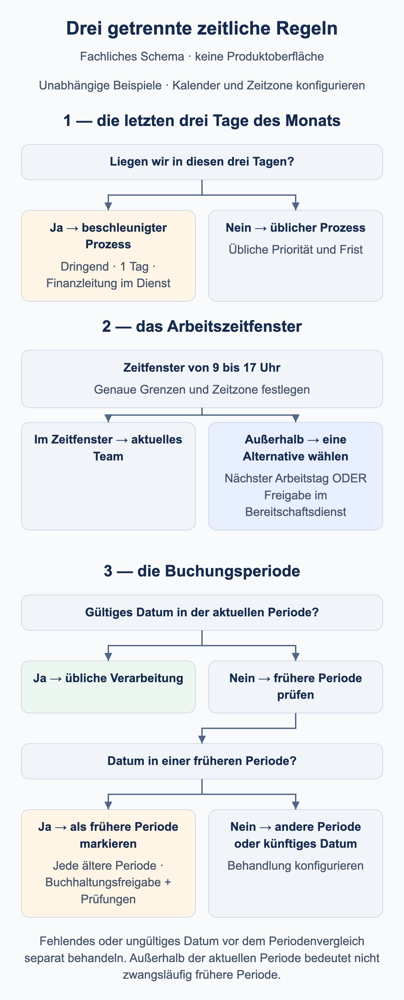<figcaption><p>Drei unabhängige Varianten: Monatsende, Arbeitszeitfenster und Buchungsperiode. Warteschlange und Bereitschaftsdienst sind zu wählende Alternativen. Ein Datum außerhalb der aktuellen Periode liegt nicht zwangsläufig davor; dieser Fall muss separat geprüft werden.</p></figcaption></figure>

Visuelle Erläuterung: [Zeitvarianten](#schema-zeitvarianten).

<details>
<summary>Drei unabhängige zeitliche Varianten</summary>

```
Verarbeitung zum Monatsende (letzte 3 Tage des Monats):
  IF Today in den letzten 3 Tagen des Monats:
    - Priorität: URGENT
    - Frist: 1 Tag
    - Freigabeinstanz: Finanzleitung im Dienst
    - Beschleunigter Prozess
  ELSE:
    - Übliche Priorität
    - Übliche Frist
    - Üblicher Prozess

Arbeitszeit und außerhalb der Arbeitszeit:
  IF Time zwischen 9 und 17 Uhr:
    - Dem aktuellen Team zuweisen
  ELSE:
    - Für den nächsten Arbeitstag einreihen
    - ODER an die Freigabeinstanz im Bereitschaftsdienst weiterleiten

Buchungsperiode (unabhängige Beispielregel):
  IF Document_Date fehlt oder ungültig ist:
    - Ungültiges oder unbekanntes Datum gemäß Konfiguration behandeln
  ELSE IF Document_Date in Current_Fiscal_Period:
    - Übliche Verarbeitung
  ELSE IF Document_Date in einer Fiscal_Period vor Current_Fiscal_Period:
    - Als "Prior Period" markieren
    - Freigabe der Buchhaltung verlangen
    - Zusätzliche Prüfungen
  ELSE:
    - Künftige oder andere Buchungsperiode: gemäß Konfiguration behandeln
```

</details>

***

### Pattern 4: Ausnahmebasiertes Routing

**Ausnahmen separat leiten:**

Der Schweregrad muss konfiguriert werden; eine Bestellabweichung ist nicht automatisch kritisch. Automatische Korrekturen sind nur für ausdrücklich erlaubte Fälle vorgesehen. Nach einer Prüfaufgabe erst nach der vorgesehenen Lösung fortfahren.

#### Schema: Schweregrade von Ausnahmen

<figure>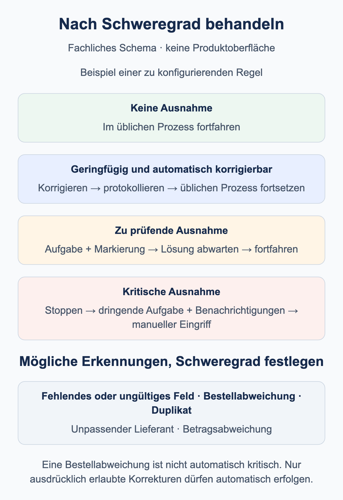<figcaption><p>Beispiel einer Schweregradregel: erst nach der vorgesehenen Korrektur oder erwarteten Lösung fortfahren. Eine kritische Ausnahme stoppt die Verarbeitung. Die Erkennungsbeispiele bestimmen ihren Schweregrad nicht von allein.</p></figcaption></figure>

Visuelle Erläuterung: [Schweregrade von Ausnahmen](#schema-schweregrade-von-ausnahmen).

<details>
<summary>Regel für den Schweregrad von Ausnahmen</summary>

```
Ausnahmeerkennung:

  Keine Ausnahme:
    → Üblicher Prozess

  Geringfügige Ausnahme (automatisch korrigierbar):
    → Automatisch korrigieren
    → Korrektur protokollieren
    → Üblichen Prozess fortsetzen

  Mittlere Ausnahme (Prüfung erforderlich):
    → Prüfaufgabe erstellen
    → Dokument markieren
    → Nach Korrektur: Prozess fortsetzen

  Schwere Ausnahme (Eskalation erforderlich):
    → Verarbeitung stoppen
    → Dringende Aufgabe erstellen
    → Mehrere Ebenen benachrichtigen
    → Manueller Eingriff erforderlich

Ausnahmetypen:
  - Fehlendes Pflichtfeld
  - Ungültiger Feldwert
  - Bestellabweichung
  - Doppelte Rechnung
  - Unpassender Lieferant
  - Betragsabweichung
```

</details>

***

## Vollständiges Entscheidungslogik-Diagramm

Die Grafiken zeigen die wesentlichen Schritte. Der folgende Textbaum enthält die technischen Einzelheiten des Beispiels; seine Ziele sind weiterhin zu konfigurieren.

Visuelle Erläuterung: [Gesamtprozess](#schema-gesamtprozess), [Betragsbereiche](#schema-betragsbereiche), [Lieferantenanalyse](#schema-lieferantenanalyse), [Freigaben in Folge](#schema-freigaben-in-folge), [Automatischer Pfad](#schema-automatischer-pfad), [Aufgabe der Abteilungsleitung](#schema-aufgabe-der-abteilungsleitung), [Freigaben der Leitung](#schema-freigaben-der-leitung).

<details>
<summary>Detaillierten Textbaum des vollständigen Beispiels anzeigen</summary>

```
RECHNUNG GEHT EIN
│
├─ EBENE 1: AUSNAHMEPRÜFUNG
│  │
│  ├─ Kritische Ausnahme oder Lieferant mit Status BLOCKED?
│  │  (Kritikalität konfigurieren; nicht jede Bestellabweichung ist kritisch.)
│  │  │
│  │  ├─ JA → Stoppen und eskalieren
│  │  │        Dringende Aufgabe erstellen
│  │  │        Administration benachrichtigen
│  │  │        → ENDE (Ausnahmebehandlung)
│  │  │
│  │  └─ NEIN → Mit Ebene 2 fortfahren
│
├─ EBENE 2: DOKUMENTTYP
│  │
│  ├─ Type = Invoice?
│  │  └─ JA → Mit Ebene 3 fortfahren
│  │
│  ├─ Type = Credit Note?
│  │  └─ JA → Zum Gutschriftenprozess verzweigen
│  │           → ENDE (Gutschriftspfad)
│  │
│  └─ Anderer Typ?
│     └─ JA → Zum passenden Prozess verzweigen
│              → ENDE (Pfad für anderen Typ)
│
├─ EBENE 3: DRINGLICHKEITSPRÜFUNG (für Rechnungen)
│  │
│  ├─ Urgent Flag = TRUE?
│  │  │
│  │  ├─ JA → Beschleunigter Prozess
│  │  │        Priority: URGENT
│  │  │        Frist: 1 Tag
│  │  │        Zuweisen an: höchste Freigabeinstanz
│  │  │        → ENDE (beschleunigter Pfad)
│  │  │
│  │  └─ NEIN → Mit Ebene 4 fortfahren
│
├─ EBENE 4: BETRAGSGRENZEN
│  │
│  ├─ Amount fehlt oder ist ungültig?
│  │  ├─ JA → Manuelle Prüfung (ausdrückliche Beispielregel)
│  │  └─ NEIN → Mit den folgenden Betragsgrenzen fortfahren
│  │
│  ├─ Amount < €1,000?
│  │  │
│  │  ├─ JA → AUTOMATISCHER FREIGABEPFAD
│  │  │        Approval_Type = "AUTO" setzen
│  │  │        Sofort freigeben
│  │  │        Ins ERP exportieren
│  │  │        → ENDE (automatisch freigegeben)
│  │  │
│  │  └─ NEIN → Fortfahren
│  │
│  ├─ Amount < €10,000?
│  │  │
│  │  ├─ JA → FREIGABEPFAD DER ABTEILUNGSLEITUNG
│  │  │        Aufgabe für die Abteilungsleitung erstellen
│  │  │        Priorität: mittel
│  │  │        Frist: 3 Tage
│  │  │        → Auf Ergebnis WARTEN; bei ausstehendem Ergebnis nicht fortfahren
│  │  │           → Zugestimmt: konfigurierten Prozess fortsetzen
│  │  │           → Abgelehnt: Kette stoppen und gemäß Konfiguration behandeln
│  │  │
│  │  └─ NEIN → Fortfahren
│  │
│  ├─ Amount < €50,000?
│  │  │
│  │  ├─ JA → FREIGABEPFAD DER DIREKTION
│  │  │        Mit Ebene 5 (Lieferantenprüfung) fortfahren
│  │  │
│  │  └─ NEIN → Fortfahren
│  │
│  └─ Amount ≥ €50,000?
│     │
│     └─ JA → FREIGABEPFAD DER GESCHÄFTSLEITUNG
│              Aufgaben nacheinander erstellen:
│              - Finanzdirektion
│              - CFO
│              - CEO (bei > €100,000)
│              Priority: URGENT
│              Frist: jeweils 1 Tag
│              → Auf alle erforderlichen Ergebnisse WARTEN
│                 → Alle zugestimmt: konfigurierten Prozess fortsetzen
│                 → Ausstehend: nicht fortfahren
│                 → Jede Ablehnung: Kette stoppen und gemäß Konfiguration behandeln
│
├─ EBENE 5: LIEFERANTENANALYSE (€10,000 ≤ Amount < €50,000)
│  │
│  ├─ Supplier Status = "BLOCKED"?
│  │  │
│  │  ├─ JA → SPERREN UND ESKALIEREN
│  │  │        Verarbeitung stoppen
│  │  │        Dringende Aufgabe erstellen
│  │  │        Einkauf und Finanzen benachrichtigen
│  │  │        → ENDE (gesperrter Lieferant)
│  │  │
│  │  └─ NEIN → Fortfahren
│  │
│  ├─ Supplier Age < 180 Tage (neu)?
│  │  │
│  │  ├─ JA → ZWEI FREIGABEN ERFORDERLICH
│  │  │        Aufgabe 1: Direktion (2 Tage)
│  │  │        → Auf Aufgabe 1 WARTEN
│  │  │           IF Aufgabe 1 zugestimmt:
│  │  │             Aufgabe 2: CFO (2 Tage)
│  │  │             → Auf Aufgabe 2 WARTEN
│  │  │                → Ausstehend: nicht fortfahren
│  │  │                → Zugestimmt: erst nach beiden Zustimmungen fortfahren
│  │  │                → Abgelehnt: Kette stoppen und gemäß Konfiguration behandeln
│  │  │           IF Aufgabe 1 abgelehnt:
│  │  │             → Kette stoppen und gemäß Konfiguration behandeln
│  │  │           IF Aufgabe 1 ausstehend:
│  │  │             → Aufgabe 2 nicht erstellen und nicht fortfahren
│  │  │
│  │  └─ NEIN → Fortfahren
│  │
│  ├─ Supplier Risk Rating = "HIGH"?
│  │  │
│  │  ├─ JA → VERSTÄRKTE FREIGABE
│  │  │        Zusätzliche Betrugsprüfungen
│  │  │        Vorfreigabe der Abteilungsleitung, danach Direktorfreigabe
│  │  │        Jede Zustimmung abwarten; ausstehend oder abgelehnt: nicht fortfahren
│  │  │        Fristen für Risikoprüfungen konfigurieren; Freigabeaufgaben in Pfad C nennen 2 Tage
│  │  │        → ENDE (verstärkter Pfad)
│  │  │
│  │  └─ NEIN → ÜBLICHE DIREKTORFREIGABE
│  │           Aufgabe für die Direktion erstellen
│  │           Priorität: hoch
│  │           Frist: 2 Tage
│  │           → Auf Ergebnis WARTEN; bei ausstehendem Ergebnis nicht fortfahren
│  │              → Zugestimmt: konfigurierten Prozess fortsetzen
│  │              → Abgelehnt: Kette stoppen und gemäß Konfiguration behandeln
│  │
│  └─ [Lieferantenanalyse abgeschlossen]
│
└─ [Alle Entscheidungsebenen bearbeitet]
```

</details>

***

## Bewährte Vorgehensweisen für die Konfiguration

### 1. Logik klar und wartbar halten

Der Vergleich zeigt eine einfache Bedingung, eine dichte Bedingung und eine eigene Regel mit mehreren Schritten. Die Schemata erläutern verschiedene Ansätze und behaupten keine logische Gleichwertigkeit.

#### Schema: Nachvollziehbare Entscheidungen

<figure>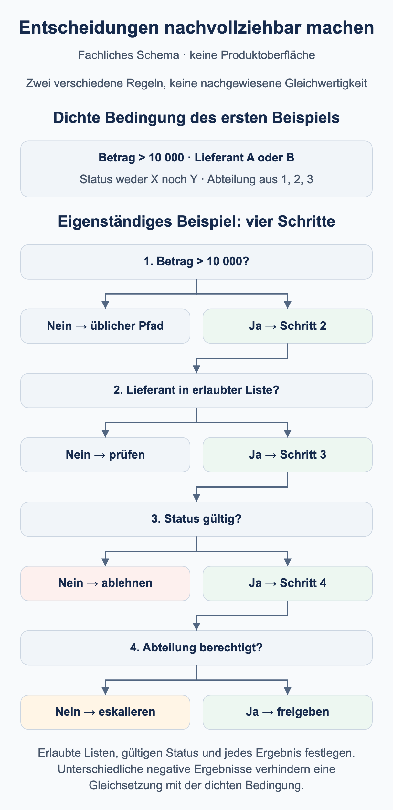<figcaption><p>Das Beispiel mit vier Schritten zeigt eine andere Regel als die dichte Bedingung. Es macht jedes negative Ergebnis sichtbar und ist keine nachgewiesen logisch gleichwertige Umformung. Erlaubte Listen und Behandlungen der Ausgänge müssen festgelegt werden.</p></figcaption></figure>

✅ **Gut:**

Visuelle Erläuterung: [Einfache Bedingung](#schema-einfache-bedingung).

<details>
<summary>Einfaches Beispiel: Pfad für hohe Beträge</summary>

```
IF Amount > 10000:
  → Pfad für hohe Beträge
ELSE:
  → Üblicher Pfad
```

</details>

❌ **Schlecht (zu komplex):**

Visuelle Erläuterung: [Nachvollziehbare Entscheidungen](#schema-nachvollziehbare-entscheidungen).

<details>
<summary>Beispiel einer dichten Bedingung</summary>

```
IF (Amount > 10000 AND (Supplier = "A" OR Supplier = "B") AND NOT (Status = "X" OR Status = "Y") AND Department IN [1,2,3]):
  → Komplexer Pfad
```

</details>

**Anderes Beispiel: eine eigene Regel mit vier Schritten:**

Dieses Beispiel macht die Ergebnisse jeder Stufe sichtbar. Es ist keine nachgewiesen logisch gleichwertige Umformung der dichten Bedingung: Lieferantenlisten, gültige Statuswerte, berechtigte Abteilungen und die Behandlung negativer Ergebnisse müssen für dieses zweite Beispiel festgelegt werden.

Visuelle Erläuterung: [Nachvollziehbare Entscheidungen](#schema-nachvollziehbare-entscheidungen).

<details>
<summary>Anderes Beispiel: Regel mit vier Schritten</summary>

```
Schritt 1: IF Amount > 10000: fortfahren, ELSE: üblicher Pfad
Schritt 2: IF Supplier in erlaubter Liste: fortfahren, ELSE: prüfen
Schritt 3: IF Status gültig: fortfahren, ELSE: ablehnen
Schritt 4: IF Department berechtigt: freigeben, ELSE: eskalieren
```

</details>

***

### 2. Entscheidungslogik dokumentieren

**Immer aufnehmen:**

* Zweck jedes Entscheidungspunkts
* Umgesetzte Geschäftsregel
* Erwartete Ergebnisse
* Ausnahmebehandlung

**Beispiel-Dokumentation:**

#### Schema: Regelsteckbrief

<figure>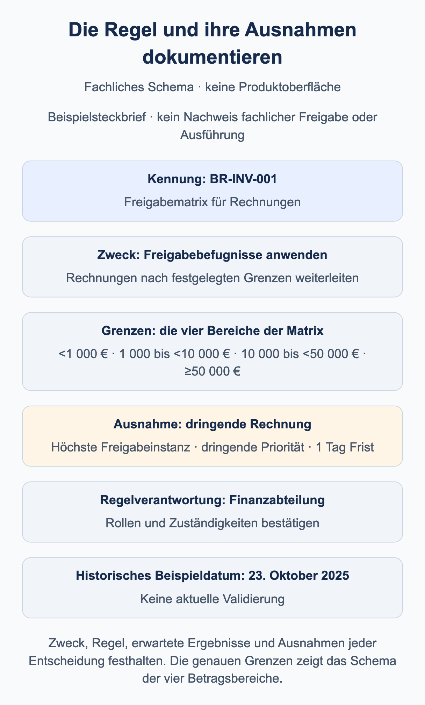<figcaption><p>Beispielsteckbrief für BR-INV-001: Zweck, Grenzen, Ausnahme, Zuständigkeit und Referenzdatum. Der Verweis auf die vier Bereiche vermeidet eine doppelte Regelbeschreibung; dieser Steckbrief belegt weder die Freigabe noch die Ausführung.</p></figcaption></figure>

Visuelle Erläuterung: [Regelsteckbrief](#schema-regelsteckbrief).

<details>
<summary>Beispielsteckbrief der Regel BR-INV-001</summary>

```
Entscheidungspunkt: Betragsgrenze prüfen
Geschäftsregel: BR-INV-001 (Freigabematrix für Rechnungen)
Zweck: Rechnungen gemäß Unternehmensrichtlinie nach Betragsgrenzen weiterleiten
Grenzen:
  < €1,000: automatisch freigeben (vom CFO genehmigte Grenze)
  €1,000 ≤ Amount < €10,000: Freigabe der Abteilungsleitung (Befugnismatrix)
  €10,000 ≤ Amount < €50,000: Direktorfreigabe mit Lieferantenprüfungen
  Amount ≥ €50,000: Freigabe der Geschäftsleitung
Ausnahmen: dringende Rechnungen direkt zur höchsten Freigabeinstanz
Aktualisiert: 2025-10-23
Verantwortlich: Finanzabteilung
```

</details>

***

### 3. Alle Pfade testen

**Vorgeschlagene Testmatrix – erwartete Ergebnisse, keine ausgeführten Tests:**

Prüfen Sie diese Erwartungen in Ihrer Konfiguration und tragen Sie danach die beobachteten Ergebnisse ein.

| Testfall | Betrag | Typ | Lieferant | Erwarteter Pfad | Prüfung |
| --- | --- | --- | --- | --- | --- |
| TC1 | 500 € | Rechnung | Bestehend | Automatische Freigabe | Zu testen |
| TC2 | 5.000 € | Rechnung | Bestehend | Verantwortliche Person | Zu testen |
| TC3 | 15.000 € | Rechnung | Neu | Direktor, danach Finanzleitung | Zu testen |
| TC4 | 60.000 € | Rechnung | Bestehend | Geschäftsführung | Zu testen |
| TC5 | 2.000 € | Gutschrift | Bestehend | Gutschriftenprozess | Zu testen |
| TC6 | 100.000 € | Rechnung | Gesperrt | Anhalten und eskalieren | Zu testen |
| TC7 | 999,99 € | Rechnung | Bestehend | Automatische Freigabe | Zu testen |
| TC8 | 1.000 € | Rechnung | Bestehend | Verantwortliche Person | Zu testen |
| TC9 | 9.999,99 € | Rechnung | Bestehend | Verantwortliche Person | Zu testen |
| TC10 | 10.000 € | Rechnung | Bestehend | Direktor + Lieferantenprüfung | Zu testen |
| TC11 | 49.999,99 € | Rechnung | Bestehend | Direktor + Lieferantenprüfung | Zu testen |
| TC12 | 50.000 € | Rechnung | Bestehend | Geschäftsführung | Zu testen |
| TC13 | Fehlend oder ungültig | Rechnung | Bestehend | Für dieses Beispiel konfigurierte manuelle Prüfung | Zu testen |
| TC14 | 15.000 € | Rechnung | Neu | Direktorfreigabe ausstehend: keine nächste Aufgabe erstellen | Zu testen |
| TC15 | 15.000 € | Rechnung | Neu | Ablehnung durch Direktor oder Finanzleitung: Kette anhalten und Ablehnung behandeln | Zu testen |
| TC16 | 15.000 € | Rechnung | Neu | Nach beiden positiven Freigaben vorgesehenen Prozess fortsetzen | Zu testen |

***

### 4. Entscheidungskennzahlen überwachen

**Verfolgen:**

* Verteilung auf die Entscheidungspfade
* Automatische Freigabequote
* Manuelle Prüfquote
* Durchschnittliche Verarbeitungszeit pro Pfad
* Ausnahmequoten
* Pfad-Auslastung

**Fiktive Beispiel-Kennzahlen:** Die folgenden Werte erläutern einen Bericht. Sie belegen weder aktuelle Leistungswerte noch die Ausführung dieses Workflows. Die vier Pfade umfassen insgesamt 1.250 Rechnungen; ihre Prozentwerte sind gerundet. Die 15 Ausnahmen (1,2 %) können dieselben Rechnungen betreffen und bilden keinen fünften Pfad.

#### Schema: Fiktive Kennzahlen

<figure>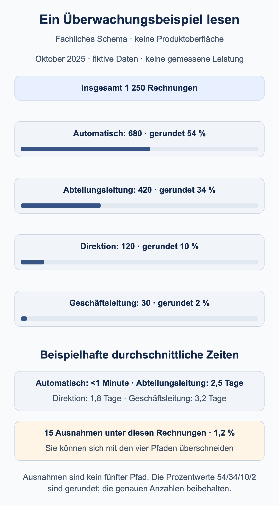<figcaption><p>Fiktives Beispiel: Die vier Pfade umfassen insgesamt 1 250 Rechnungen. Ihre Prozentwerte sind gerundet. Die 15 Ausnahmen, also 1,2 %, können dieselben Rechnungen betreffen und bilden keinen fünften Pfad. Die Zeiten sind keine gemessenen Leistungswerte von DocBits.</p></figcaption></figure>

Visuelle Erläuterung: [Fiktive Kennzahlen](#schema-fiktive-kennzahlen).

<details>
<summary>Fiktives Beispiel für Verteilung und Zeiten</summary>

```
Monat: Oktober 2025
Rechnungen insgesamt: 1.250

Verteilung auf Entscheidungspfade:
- Automatisch freigegeben (< €1k): 680 (54%)
- Abteilungsleitung (€1k ≤ Amount < €10k): 420 (34%)
- Direktion (€10k ≤ Amount < €50k): 120 (10%)
- Geschäftsleitung (Amount ≥ €50k): 30 (2%)

Verarbeitungszeit:
- Automatische Freigabe: < 1 Minute
- Abteilungsleitung: durchschnittlich 2,5 Tage
- Direktion: durchschnittlich 1,8 Tage
- Geschäftsleitung: durchschnittlich 3,2 Tage

Ausnahmen: 15 (1,2%)
```

</details>

***

## Verwandte Patterns

### Patterns, die gut zusammenpassen:

* [**Aufgabenverwaltungs-Pattern**](task-management-pattern.md) – Aufgaben anhand von Entscheidungen erstellen
* [**API-Integrations-Pattern**](api-integration-pattern.md) – Daten für die Entscheidungsfindung abrufen
* [**PO-Matching-Muster**](po-matching-pattern.md) – PO-Ergebnisse in Entscheidungen verwenden
* [**Datentransformations-Pattern**](data-transformation-pattern.md) – Daten vor Entscheidungen transformieren

***

## Verwandte Leitfäden

### Voraussetzungen

* [Leitfaden Bedingungskarten (komplett)](../and/condition-cards-complete-guide.md) – Alle Bedingungskarten
* [Leitfaden Feldmanipulation](../then/document-field/field-manipulation-guide.md) – Feldoperationen
* [Zuweisungs-Leitfaden](../then/assignee/assignment-user-guide.md) – Routing-Logik

### Verwandte Karten

* **CONDITION\_DOC\_FIELD\_AMOUNT** – [Leitfaden Bedingungskarten](../and/condition-cards-complete-guide.md)
* **CONDITION\_DOC\_TYPE\_IS\_ISNOT** – [Leitfaden Bedingungskarten](../and/condition-cards-complete-guide.md)
* **CONDITION\_SUPPLIER\_STATUS\_IS\_ISNOT** – [Leitfaden Bedingungskarten](../and/condition-cards-complete-guide.md)
* **ACTION\_ASSIGN\_TO\_USER** – [Zuweisungs-Leitfaden](../then/assignee/assignment-user-guide.md)
* **tasks\_create** – [Leitfaden Aufgabenzuweisung](../then/task/task-assignment-guide.md)

### Nächste Schritte

* Aufgaben erstellen: [Aufgabenverwaltungs-Pattern](task-management-pattern.md)
* Komplexen Abgleich hinzufügen: [PO-Matching-Pattern](po-matching-pattern.md)
* APIs integrieren: [API-Integrations-Pattern](api-integration-pattern.md)

***

**Historische Metadaten des Beispiels:**

**Pattern-Version:** 1.0 **Zuletzt aktualisiert:** 23. Oktober 2025 **Schwierigkeit:** Mittel **Geschätzte Zeit:** 30–45 Minuten
