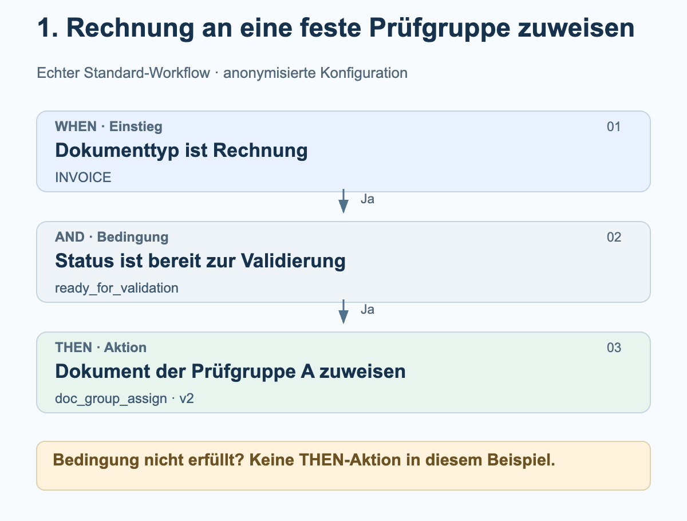
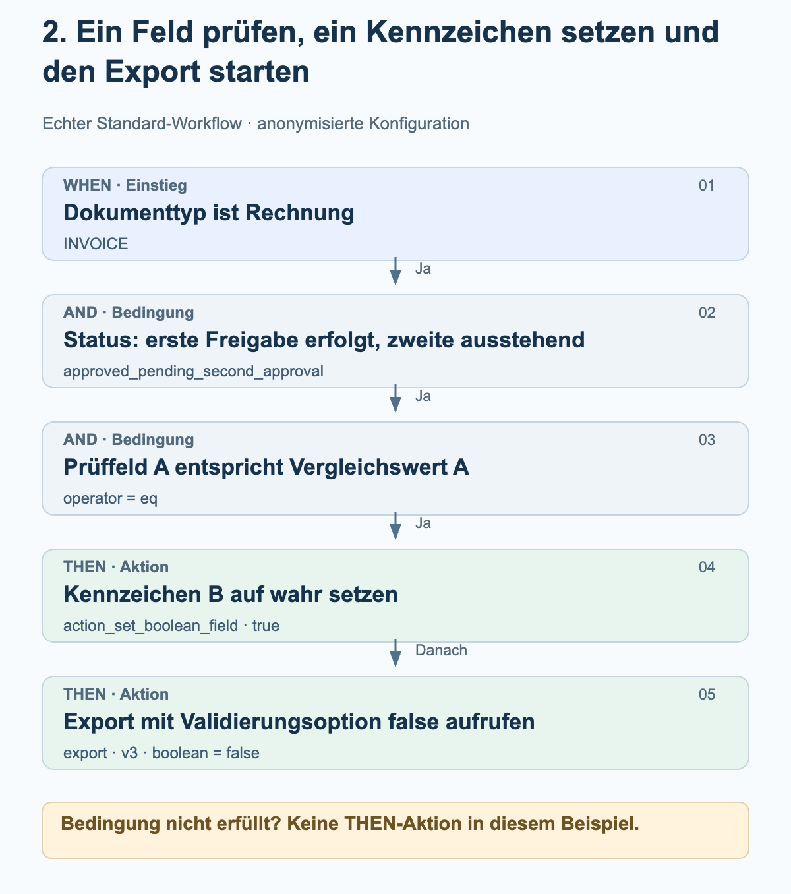
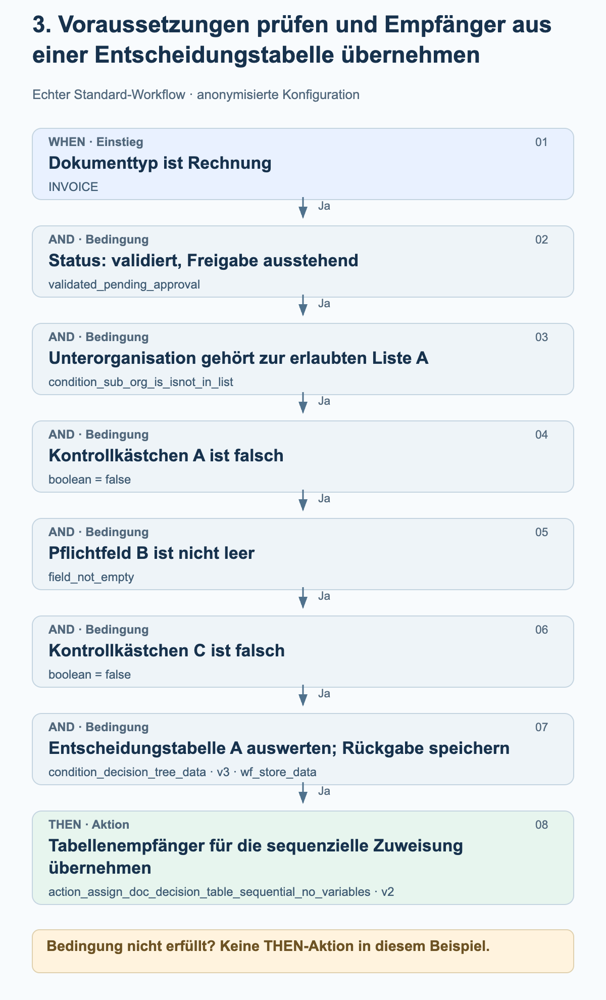

# Echte Workflow-Beispiele aus der Praxis

Diese drei Beispiele stammen aus aktivierten Standard-Workflows der Produktionsumgebung. Sie zeigen die tatsächlich konfigurierte Reihenfolge von WHEN, AND und THEN. Gruppen, Organisationen, Feldnamen, Vergleichswerte und Entscheidungstabellen sind durch neutrale Bezeichnungen ersetzt. Die Grafiken erklären die Konfiguration; sie sind keine Bildschirmaufnahmen.

Stand: 27. Oktober 2026. Die verwendeten Karten, Versionen, Parameter und ihre Reihenfolge wurden mit den gespeicherten Konfigurationen erfolgreicher Produktionsläufe abgeglichen. Ein Workflow-Protokoll mit dem Ergebnis success bestätigt weder eine menschliche Freigabe noch den Eingang im ERP. Es wurden keine Workflows verändert oder zu Testzwecken ausgeführt.

## So liest du die Grafiken

Die Beispiele verwenden den Standard-Modus. WHEN grenzt den Dokumenttyp ein; alle AND-Bedingungen müssen erfüllt sein, bevor die THEN-Aktionen folgen. Eine nicht erfüllte Bedingung führt in diesen Beispielen zu keiner THEN-Aktion. Die Pfeile zwischen Aktionen zeigen deren konfigurierte Reihenfolge. Sie sind kein zusätzlicher Erfolgs- oder Freigabeschritt. Ein Lauf kann auch mit einem Fehler enden.

## 1. Rechnung an eine feste Prüfgruppe zuweisen

Eine Rechnung soll zur Prüfung an eine fest konfigurierte Gruppe gehen, sobald sie den Status „bereit zur Validierung“ erreicht. Dieses Beispiel benötigt keine Entscheidungstabelle.

<figure><figcaption>Rechnung und passender Status: Das Dokument wird der fest konfigurierten Prüfgruppe A zugewiesen. Die Zuweisung ist noch keine Freigabe.</figcaption></figure>

Karten und Einstellungen

| Phase / Karte | Einstellung im Beispiel | Bedeutung |
| --- | --- | --- |
| WHEN · condition_doc_type_is_isnot_list · v2 | operator = is; doc_type = INVOICE | Nur Rechnungen erfüllen diese Bedingung. |
| AND · condition_doc_status_is_isnot · v2 | operator = is; status = ready_for_validation | Das Dokument ist bereit zur Validierung. |
| THEN · doc_group_assign · v2 | groups = Prüfgruppe A | Version 2 verwendet die konfigurierte Gruppe. Die Entscheidungstabellen-Option ist in dieser Kartenversion nicht maßgeblich. |

### Beim Nachbauen prüfen

- Prüfgruppe A ist eine anonymisierte Bezeichnung. Wähle eine Gruppe deiner Organisation und prüfe deren Zuständigkeit.
- Prüfe Dokumenttyp und Status getrennt: Eine Rechnung in einem anderen Status erfüllt dieses Beispiel nicht.
- Dokumentzuweisung, Aufgabe und Freigabe sind unterschiedliche Vorgänge. Diese Konfiguration enthält nur die Zuweisung.

## 2. Ein Feld prüfen, ein Kennzeichen setzen und den Export starten

Eine Rechnung in einem bestimmten Freigabestatus wird nur weiterverarbeitet, wenn ihr Prüffeld A genau dem Vergleichswert A entspricht. Danach versucht der Workflow, das Kennzeichen B auf wahr zu setzen, und ruft anschließend den Export auf. Die ursprünglichen Feldnamen und der Vergleichswert sind anonymisiert.

<figure><figcaption>Die Feldprüfung schaltet die beiden Aktionen frei. Zuerst wird das Setzen des Kennzeichens aufgerufen; danach folgt der Exportaufruf. Der Status und die deaktivierten Validierungsprüfungen sind Teil dieser konkreten Konfiguration.</figcaption></figure>

Karten und Einstellungen

| Phase / Karte | Einstellung im Beispiel | Bedeutung |
| --- | --- | --- |
| WHEN · condition_doc_type_is_isnot_list · v2 | operator = is; doc_type = INVOICE | Nur Rechnungen erfüllen diese Bedingung. |
| AND · condition_doc_status_is_isnot · v2 | operator = is; status = approved_pending_second_approval | Der konfigurierte Status bedeutet „erste Freigabe erfolgt, zweite Freigabe ausstehend“. Er wird hier nicht durch einen allgemeineren Freigabestatus ersetzt. |
| AND · condition_docfield_operator_value · v2 | field_name = Prüffeld A; operator = eq; field_value = Vergleichswert A | Der Feldinhalt muss dem konfigurierten Wert entsprechen; die Bedingung ist keine Prüfung auf lediglich ein gefülltes Feld. |
| THEN 1 · action_set_boolean_field · v2 | field_name = Kennzeichen B; boolean = true | Versucht, das konfigurierte boolesche Feld auf wahr zu setzen. |
| THEN 2 · export · v3 | boolean = false | Startet den Export mit ignore_field_validation_errors = true und validate_po_match = false. false schaltet hier Validierungsprüfungen ab, nicht den Export. |

### Beim Nachbauen prüfen

- Die Exportoption false ist eine kundenspezifische Einstellung und keine allgemeine Empfehlung. Prüfe vor dem Nachbauen insbesondere Feldvalidierung, PO-Abgleich und Freigabevorgaben.
- Zwischen Kennzeichensetzen und Export ist keine weitere Bedingung konfiguriert. Die Reihenfolge allein garantiert nicht, dass die erste Aktion erfolgreich war; Ausnahmen und Aktionsfehler sind gesondert zu prüfen.
- Der Workflow enthält keinen Warte-Schritt für eine zweite menschliche Freigabe. Ein erfolgreicher Workflow-Lauf ersetzt keinen Nachweis des ERP-Eingangs.

## 3. Voraussetzungen prüfen und Empfänger aus einer Entscheidungstabelle übernehmen

Eine Rechnung soll erst dann über eine Entscheidungstabelle zugewiesen werden, wenn Organisation, Status, zwei Kontrollkästchen und ein Pflichtfeld passen. Der Workflow speichert die Rückgabedaten der Entscheidungstabelle, damit die anschließende sequenzielle Zuweisung sie verwenden kann.

<figure><figcaption>Alle sechs AND-Bedingungen müssen erfüllt sein. Die Rückgabe der Entscheidungstabelle wird gespeichert und anschließend für die sequenzielle Dokumentzuweisung verwendet. Die Grafik erfindet keine Empfänger oder Freigabestufen.</figcaption></figure>

Karten und Einstellungen

| Phase / Karte | Einstellung im Beispiel | Bedeutung |
| --- | --- | --- |
| WHEN · condition_doc_type_is_isnot_list · v2 | operator = is; doc_type = INVOICE | Begrenzt das Beispiel auf Rechnungen. |
| AND 1 · condition_doc_status_is_isnot · v2 | operator = is; status = validated_pending_approval | Das Dokument ist validiert, eine Freigabe steht aus. |
| AND 2 · condition_sub_org_is_isnot_in_list · v2 | operator = is; sub_org_id = erlaubte Liste A | Nur die konfigurierten Unterorganisationen gehören zum Geltungsbereich. |
| AND 3 · condition_checkbox_is · v2 | field_name = Kontrollkästchen A; boolean = false | Das erste konfigurierte Kontrollkästchen muss falsch sein. |
| AND 4 · condition_docfield_status · v2 | field_name = Pflichtfeld B; field_status = field_not_empty | Das konfigurierte Feld muss gefüllt sein. |
| AND 5 · condition_checkbox_is · v2 | field_name = Kontrollkästchen C; boolean = false | Auch das zweite Kontrollkästchen muss falsch sein. |
| AND 6 · condition_decision_tree_data · v3 | decision_table = Entscheidungstabelle A; store_data = wf_store_data | Die Tabelle wird für das Dokument ausgewertet. Die Rückgabe wird für nachfolgende Karten gespeichert. Das zusätzliche ältere boolean-Feld ist leer und steuert diese Version nicht. |
| THEN · action_assign_doc_decision_table_sequential_no_variables · v2 | keine eigenen Kartenvariablen | Übernimmt Empfänger aus der gespeicherten Tabellenrückgabe für die sequenzielle Zuweisung. Empfänger und Prioritäten hängen von der Tabelle ab. |

### Beim Nachbauen prüfen

- Kontrollkästchen A, Pflichtfeld B und Kontrollkästchen C bezeichnen drei verschiedene konfigurierte Felder. Die neutralen Namen ersetzen die ursprünglichen Namen.
- Eine nicht leere Feldprüfung bestätigt noch keine fachliche Richtigkeit des Feldinhalts.
- Prüfe die tatsächliche Entscheidungstabelle einschließlich Empfängern und Prioritäten. Ihre Regeln sind hier nicht veröffentlicht; es werden keine Betragsgrenzen oder Rollen hinzuerfunden.
- Eine erfolgreiche Tabellenauswertung garantiert noch keine verwertbaren Empfänger. Die anschließende Zuweisung benötigt gültige Benutzer- oder Gruppenausgaben.
- Eine sequenzielle Zuweisung belegt keine abgeschlossene menschliche Freigabe. Dieser Workflow enthält keinen Exportaufruf.

## Vom Beispiel zur eigenen Konfiguration

Lege die passenden Felder, Gruppen und Entscheidungstabellen in deiner eigenen Organisation fest. Übernimm die neutralen Bezeichnungen nicht als vorhandene Produktfelder. Prüfe jeden positiven und negativen Bedingungsfall sowie Aktionsfehler in einer geeigneten Testumgebung. Prüfe Freigaben und Exporte anhand ihrer tatsächlichen Ergebnisse; aktiviere einen Workflow erst nach fachlicher Abnahme.
