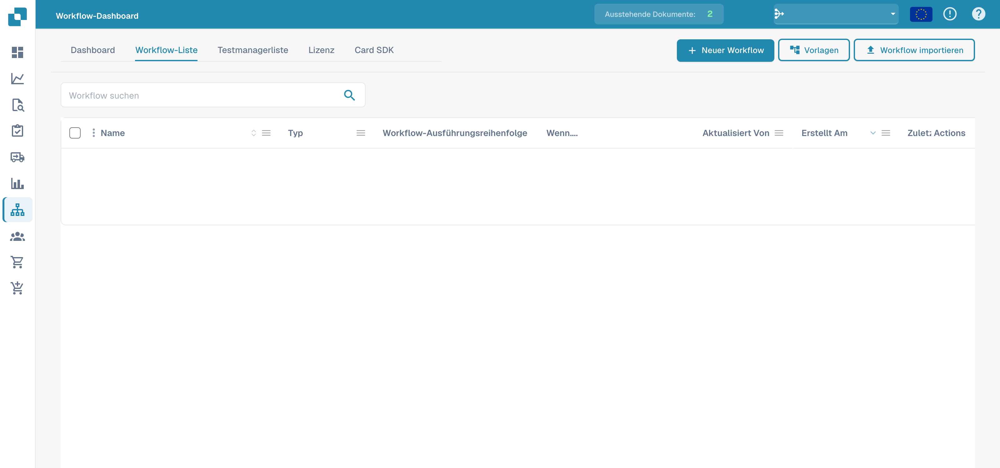

# Standard-Workflow

Der **Standard-Workflow**-Builder ist der lineare, kartenbasierte Editor zur Automatisierung der Dokumentenverarbeitung. Ein Workflow besteht aus drei Kartengruppen — **Wenn** (der Auslöser), **And** (zusätzliche Bedingungen) und **Dann** (die auszuführenden Aktionen). Wenn ein Dokument die When-/And-Bedingungen erfüllt, laufen die Then-Aktionen automatisch.

## Einen Standard Workflow erstellen und testen 

Erstellen Sie einen vollständigen Standard Workflow in der echten DocBits-Oberfläche: Rechnung auswählen, Rechnungsnummer und Betrag über 1000 prüfen, einen Prüfer zuweisen und den Status ändern. Speichern Sie die Regel, führen Sie drei Testszenarien aus und prüfen Sie das tatsächliche Ergebnis am Dokument.



[Mit Untertiteln ansehen](https://docbits-videos.fra1.cdn.digitaloceanspaces.com/settings-assistant/standard-workflow-admin/v2/de.html) · [Video öffnen](https://docbits-videos.fra1.cdn.digitaloceanspaces.com/settings-assistant/standard-workflow-admin/v2/de.mp4) · [Untertitel (WebVTT)](https://docbits-videos.fra1.cdn.digitaloceanspaces.com/settings-assistant/standard-workflow-admin/v2/de.vtt) · [Transkript](https://docbits-videos.fra1.cdn.digitaloceanspaces.com/settings-assistant/standard-workflow-admin/v2/de.txt) · 4:00

Kapitel und Transkript

| Kapitel | Start |
| --- | --- |
| Was dieser Workflow macht | [0:00](https://docbits-videos.fra1.cdn.digitaloceanspaces.com/settings-assistant/standard-workflow-admin/v2/de.mp4#t=0.000) |
| Workflow benennen | [0:14](https://docbits-videos.fra1.cdn.digitaloceanspaces.com/settings-assistant/standard-workflow-admin/v2/de.mp4#t=14.583) |
| Wenn: Dokumenttyp | [0:25](https://docbits-videos.fra1.cdn.digitaloceanspaces.com/settings-assistant/standard-workflow-admin/v2/de.mp4#t=25.583) |
| Und: Rechnungsnummer | [0:38](https://docbits-videos.fra1.cdn.digitaloceanspaces.com/settings-assistant/standard-workflow-admin/v2/de.mp4#t=38.125) |
| Und: Betrag über 1000 | [0:51](https://docbits-videos.fra1.cdn.digitaloceanspaces.com/settings-assistant/standard-workflow-admin/v2/de.mp4#t=51.708) |
| Dann: Prüfer zuweisen | [1:04](https://docbits-videos.fra1.cdn.digitaloceanspaces.com/settings-assistant/standard-workflow-admin/v2/de.mp4#t=64.708) |
| Dann: Status ändern | [1:19](https://docbits-videos.fra1.cdn.digitaloceanspaces.com/settings-assistant/standard-workflow-admin/v2/de.mp4#t=79.917) |
| Prüfen und speichern | [1:34](https://docbits-videos.fra1.cdn.digitaloceanspaces.com/settings-assistant/standard-workflow-admin/v2/de.mp4#t=94.417) |
| Gespeicherte Regel prüfen | [1:50](https://docbits-videos.fra1.cdn.digitaloceanspaces.com/settings-assistant/standard-workflow-admin/v2/de.mp4#t=111.000) |
| Testszenario vorbereiten | [2:03](https://docbits-videos.fra1.cdn.digitaloceanspaces.com/settings-assistant/standard-workflow-admin/v2/de.mp4#t=123.917) |
| Positivfall ausführen | [2:27](https://docbits-videos.fra1.cdn.digitaloceanspaces.com/settings-assistant/standard-workflow-admin/v2/de.mp4#t=147.375) |
| Grenzwert testen | [2:48](https://docbits-videos.fra1.cdn.digitaloceanspaces.com/settings-assistant/standard-workflow-admin/v2/de.mp4#t=168.833) |
| Andere Rechnungsnummer testen | [3:08](https://docbits-videos.fra1.cdn.digitaloceanspaces.com/settings-assistant/standard-workflow-admin/v2/de.mp4#t=188.292) |
| Ergebnis am Dokument prüfen | [3:26](https://docbits-videos.fra1.cdn.digitaloceanspaces.com/settings-assistant/standard-workflow-admin/v2/de.mp4#t=206.292) |
| Getestete Regel aktivieren | [3:45](https://docbits-videos.fra1.cdn.digitaloceanspaces.com/settings-assistant/standard-workflow-admin/v2/de.mp4#t=225.583) |

**Was dieser Workflow macht**

Gut, ich erstelle einen vollständigen Standard Workflow für eine Trainingsrechnung. Über tausend soll sie einem Prüfer zugewiesen werden und auf Genehmigung warten. Eine eigene Rechnungsnummer begrenzt das Beispiel auf dieses Dokument.

**Workflow benennen**

In der Workflow-Liste klicke ich auf Neuer Workflow. Ich vergebe einen verständlichen Namen, bevor ich Karten ergänze. Diese Organisation öffnet direkt den Standard Builder.

**Wenn: Dokumenttyp**

Unter Wenn öffne ich die Kartenbibliothek und wähle die Karte für den Dokumenttyp. Als Operator stelle ich Ist ein und wähle Rechnung. Damit lege ich den Dokumenttyp fest, den die Regel prüft.

**Und: Rechnungsnummer**

Unter Und ergänze ich eine Dokumentfeld-Bedingung. Ich wähle invoice_id, stelle Gleich ein und trage unsere Trainings-Rechnungsnummer ein. Diese zusätzliche Bedingung beschränkt die Demonstration auf die vorgesehene Rechnung.

**Und: Betrag über 1000**

Eine weitere Und-Bedingung prüft total_amount. Ich wähle Größer als und trage tausend ein. Genau tausend erfüllt diese Bedingung nicht. Betrag und Währung müssen zum Trainingsdokument passen.

**Dann: Prüfer zuweisen**

Unter Dann wähle ich die Aktion zum Zuweisen des Dokuments an einen Benutzer. Ich nehme Docs User A2, unseren Testprüfer für die Dokumentation. Diese Aktion weist das Dokument zu, ohne eine E-Mail-Benachrichtigung anzulegen.

**Dann: Status ändern**

Als zweite Aktion ändere ich den Status für die ausstehende Genehmigung. Workflows auslösen stelle ich auf falsch. Dieses Beispiel benötigt keinen weiteren Workflow-Lauf, wenn die eigene Aktion den Status ändert.

**Prüfen und speichern**

Vor dem Speichern lese ich die gesamte Regel noch einmal. Rechnung, die genaue Trainingsnummer und ein Betrag über tausend müssen passen. Danach laufen die beiden Aktionen in der angezeigten Reihenfolge. Ich speichere den Workflow und prüfe die Bestätigung.

**Gespeicherte Regel prüfen**

Zurück in der Liste prüfe ich den gespeicherten Workflow und seinen Aktivierungsstatus. Das Speichern kann einen Workflow bereits aktivieren. Während ich die Tests vorbereite, deaktiviere ich diese Trainingsregel.

**Testszenario vorbereiten**

Im Test Manager lege ich ein Szenario an und wähle unseren gespeicherten Workflow. Ich vergebe einen eindeutigen Namen und lade die JSON-Dateien für Eingabe und erwartetes Ergebnis hoch. Die Eingabe enthält unsere Rechnungsnummer, den Betrag siebzehnhundertfünfundachtzig und den Ausgangsstatus Bereit zur Validierung. Erwartet wird die ausstehende Genehmigung.

**Positivfall ausführen**

Ich sende das Szenario und wähle im Menü Test ausführen. Danach öffne ich die Liste erneut, um das gespeicherte Ergebnis zu laden. Bestanden prüft den erwarteten Dokumentstatus. Die Kartendetails zeigen in diesem Sandbox-Konto die einzelnen Meldungen nicht zuverlässig an, deshalb prüfe ich zusätzlich das tatsächliche Dokument.

**Grenzwert testen**

Jetzt teste ich genau tausend. Rechnungsnummer und Dokumenttyp stimmen weiterhin, aber Größer als muss falsch ergeben. In dieser Testeingabe bleibt der erwartete Status Bereit zur Validierung. Ich speichere und starte dieses eigene Szenario und prüfe anschließend das Ergebnis.

**Andere Rechnungsnummer testen**

Ein weiteres Szenario verwendet eine andere Rechnungsnummer und einen Betrag über tausend. Der Betrag allein darf die Aktionen nicht auslösen. Ich speichere und starte das Szenario mit dem unveränderten Ausgangsstatus als Erwartung. Diese Negativfälle prüfen die Grenzen unserer Regel.

**Ergebnis am Dokument prüfen**

Im Dashboard suche ich unser Trainingsdokument. Der tatsächliche Status wartet auf Genehmigung, und das Dokument ist Docs User A2 zugewiesen. Damit ist das sichtbare Ergebnis beider Aktionen bestätigt. Diese Änderung stammt aus dem manuellen Test und belegt keine automatische Verarbeitung.

**Getestete Regel aktivieren**

Zurück in der Workflow-Liste aktiviere ich die getestete Regel und prüfe den eingeschalteten Schalter. Vor der Freigabe kontrolliere ich Bedingungen, Empfänger und Testergebnisse. Nach dieser Demonstration schalte ich die Trainingsregel wieder aus.

## Zugang

Öffnen Sie **Workflow-Dashboard → Workflow-Liste** und klicken Sie auf **Workflow hinzufügen**, um einen neuen Standard-Workflow zu erstellen, oder klicken Sie einen bestehenden Workflow zum Bearbeiten an.

<figure><figcaption>
Deutsche Workflow-Liste mit Suche, Typ und Workflow-Ausführungsreihenfolge. Konfigurierte Workflowdaten sind ausgeblendet.
</figcaption></figure>

## Das When- / And- / Then-Modell

<figure><figcaption>
Die Standard-Workflow-Canvas. Dieses Beispiel wird bei Rechnungen einer Unterorganisation ausgelöst und weist sie einem Benutzer zu.
</figcaption></figure>

- **Wenn** — der Auslöser, der den Workflow startet (z. B. *Document type is Invoice*).
- **And** — zusätzliche Bedingungen, die ebenfalls erfüllt sein müssen (z. B. *Document is part of sub-organization*). Leer lassen, um bei jedem Treffer der When-Karte zu laufen.
- **Dann** — die auszuführenden Aktionen (z. B. *Assign the document to the user*, eine Aufgabe erstellen, eine API aufrufen, eine E-Mail senden).

## Karten hinzufügen

Klicken Sie in einer beliebigen Gruppe auf **Karte hinzufügen**, um die Kartenbibliothek zu öffnen. Die Karten sind nach Kategorie geordnet, sodass Sie den benötigten Baustein finden:

<figure><figcaption>
Die <strong>Add Card</strong>-Bibliothek — Bedingungskarten, Vergleichskarten, Aktionskarten und mehr, nach Kategorie gruppiert.
</figcaption></figure>

Speichern Sie über **Workflow speichern** oder sichern Sie das Layout als wiederverwendbare Vorlage über **Vorlage speichern**.

## Nächste Schritte

- Was die einzelnen Karten tun, sehen Sie im Abschnitt **Karten**.
- Bewährte Karten-Kombinationen finden Sie in den **Workflow-Pattern-Leitfäden**.
- Für verzweigte Abläufe mit parallelen Pfaden (Wait ALL / Wait ANY / OR) verwenden Sie den **Erweiterter Workflow**-Builder.
