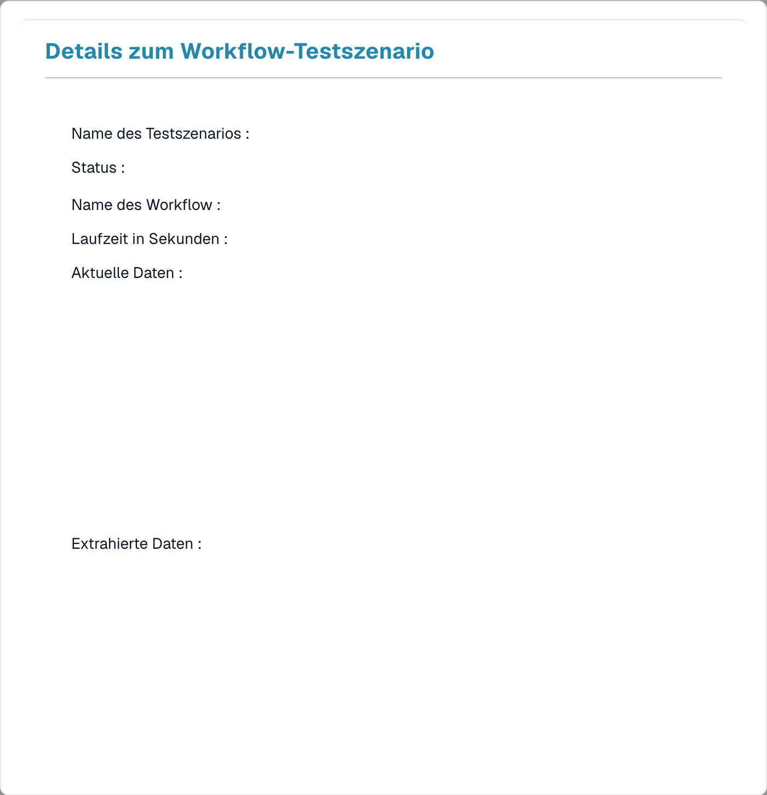

# Test Manager

Mit dem **Test Manager** können Sie wiederverwendbare **Testszenarien** für Ihre Workflows speichern und gemeinsam ausführen — so können Sie sicherstellen, dass sich ein Workflow auch nach einer Änderung noch korrekt verhält. Er funktioniert sowohl für Standard- als auch für Advanced-Workflows.

Öffnen Sie ihn über **Workflow-Dashboard → Testmanagerliste**.

<figure><figcaption>
Deutsche Testmanagerliste mit Alle Tests ausführen und Testszenario hinzufügen. Szenariodaten sind ausgeblendet; Actions bleibt ein Produktbegriff.
</figcaption></figure>

## Was ein Testszenario ist

Ein Testszenario erfasst einen Workflow, eine Beispieleingabe und das **erwartete Ergebnis**. Wenn Sie es ausführen, spielt der Test Manager den Workflow gegen diese Eingabe ab und vergleicht das Resultat mit Ihrer Erwartung — wodurch die Zeile **grün** (bestanden) oder **rot** (fehlgeschlagen) wird.

## Arbeiten mit Szenarien

- **Testszenario hinzufügen** — erstellen Sie ein neues Szenario aus einem Workflow und einem Beispieldokument.
- **Alle Tests ausführen** — führen Sie alle Szenarien auf einmal aus und sehen Sie auf einen Blick, welche Workflows noch bestehen.
- **Einzelheiten** — öffnen Sie ein Szenario, um sein Ergebnis zu prüfen.

<figure><figcaption>
Deutsche Details zum Workflow-Testszenario. Szenarioname, Workflow, Ergebniswerte und Dokumentdaten sind ausgeblendet.
</figcaption></figure>

Die Detailansicht zeigt den Szenarionamen und **Status**, den **Workflow-Namen**, die **Laufzeit** sowie die **tatsächlichen** und **extrahierten Daten**, die der Lauf erzeugt hat — so können Sie genau erkennen, warum ein Szenario bestanden oder fehlgeschlagen ist.

## Test Manager vs. Testen im Builder

Das sind zwei verschiedene Dinge:

- **Test Manager** (diese Seite) — *gespeicherte, wiederholbare* Szenarien mit erwarteten Ergebnissen, die gemeinsam mit **Alle Tests ausführen** ausgeführt werden. Verwenden Sie ihn für Regressionstests nach Änderungen.
- **Testen im Builder** — die direkten Steuerelemente **Validate** und **Test** innerhalb des Advanced Workflow-Builders, für schnelle Prüfungen während des Erstellens. Siehe [Validierung & Testen](advanced-workflow/validation-and-testing.md).
