# Dann

Eine **Then**-Karte teilt einem Workflow mit, was nach seinem **When**-Trigger und allen **And**-Bedingungen zu tun ist. Wählen Sie im **Workflow-Builder** unter **Then...** **Karte hinzufügen** aus. Wählen Sie links eine Kategorie oder geben Sie einen Namen in **Karte suchen** ein. Wählen Sie eine Kartenvorschau aus, um sie hinzuzufügen, füllen Sie die auf der Karte angezeigten Felder aus und speichern Sie den Workflow. Scrollen Sie in der Auswahl, um weitere Karten anzuzeigen. Wählen Sie **×**, um es zu schließen, ohne eine Karte hinzuzufügen. Die vollständige Sequenz finden Sie unter [Workflow](..)].

Die Vorschauen unten zeigen verfügbare Aktionen, nicht abgeschlossene Einstellungen. Wählen Sie die Aktion aus, die dem gewünschten Ergebnis entspricht.

## Dokumentfeld

Setzen oder invertieren Sie ein Kontrollkästchen, fügen Sie Text in ein Feld ein oder kopieren Sie ein Feld in ein anderes. Wählen Sie die von der Karte geforderten Feldnamen und Werte aus. Siehe [Dokumentfeld](document-field).

<figure>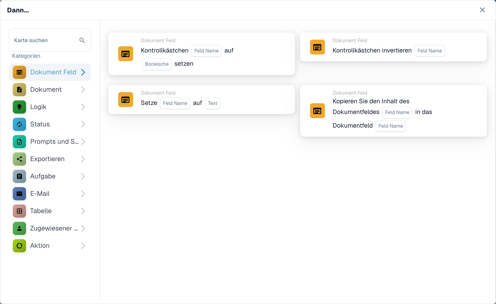<figcaption>Ein Feld ändern oder seinen Inhalt kopieren.</figcaption></figure>

## Dokument

Wählen Sie **Das Dokument genehmigen** oder **Das Dokument ablehnen**, wenn der Workflow diese Entscheidung treffen soll. Verwenden Sie zuerst eine **Und**-Bedingung, wenn die Genehmigung von einer Prüfung abhängig sein soll. Siehe [Dokument](document).

<figure>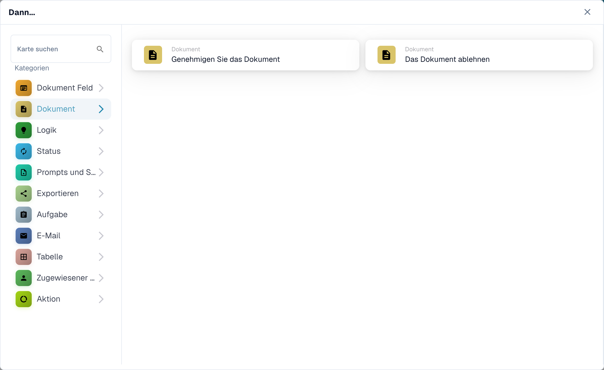<figcaption>Das aktuelle Dokument genehmigen oder ablehnen.</figcaption></figure>

## Logik

Verwenden Sie diese Karten, um Werte zwischen Zahlen-, Text- und booleschen Formaten zu konvertieren oder einen Wert aus JSON zu lesen. Wählen Sie die Ein- und Ausgabefelder auf der ausgewählten Karte aus.

<figure>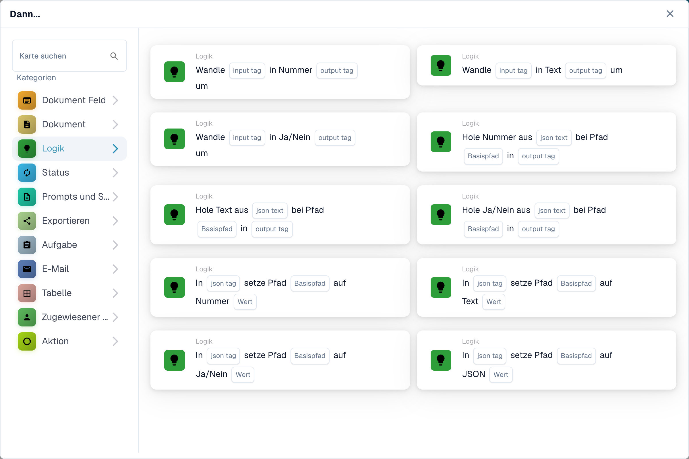<figcaption>Werte für einen späteren Workflow-Schritt umwandeln.</figcaption></figure>

## Status

Wählen Sie **Status ändern**, um das Dokument in einen ausgewählten Status zu verschieben. Die Karte kann auch einen anderen Workflow auslösen. Siehe [Status](status).

<figure>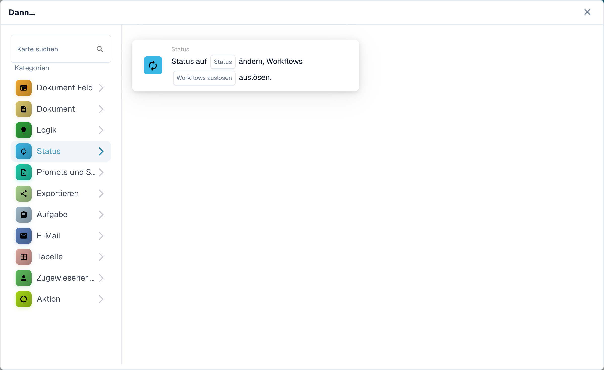<figcaption>Das Dokument in einen anderen Status verschieben.</figcaption></figure>

## Eingabeaufforderungen und Skripte

Wählen Sie diese Kategorie, um ein DocOperator-Eingabeaufforderungsskript auszuführen. Wählen Sie das Skript und die von der Karte angeforderten Variablen aus. Die Karte bietet auch Ausführungseinstellungen wie Wiederholungsversuche.

<figure>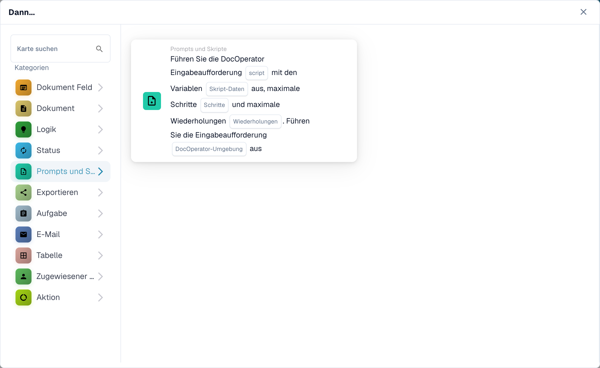<figcaption>Ein konfiguriertes DocOperator-Prompt-Skript ausführen.</figcaption></figure>

## Exportieren

Starten Sie einen Export, exportieren Sie mit einer ausgewählten Konfiguration oder stellen Sie einen endgültigen Export in die Warteschlange. Wählen Sie die auf Ihrer Karte angezeigte Exportkonfiguration und Option für ausstehende Aufgaben. Siehe [Export](export).

<figure>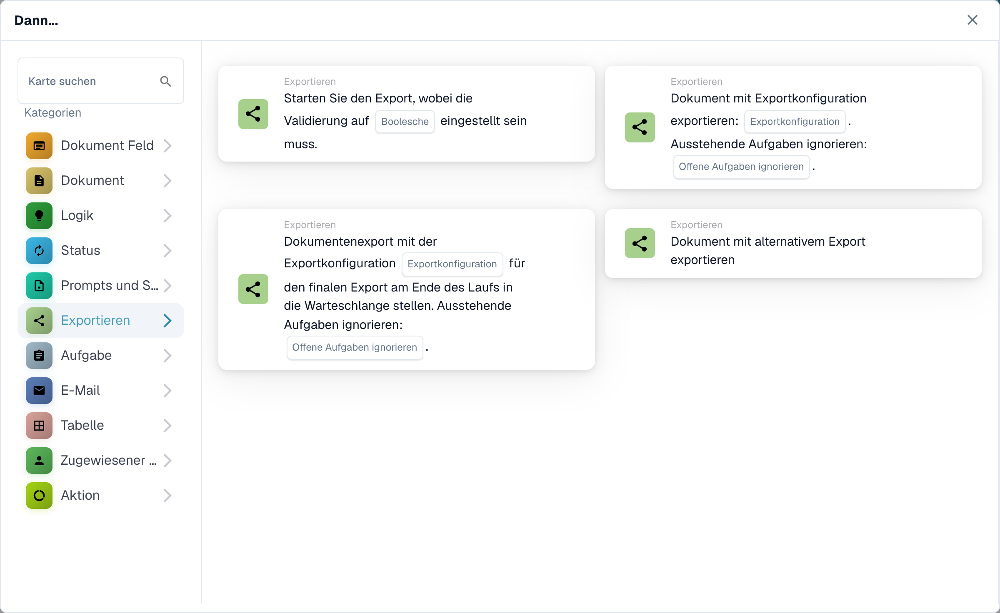<figcaption>Auswählen, wann und wie das Dokument exportiert wird.</figcaption></figure>

## Aufgabe

Erstellen Sie eine Aufgabe oder Benachrichtigung und weisen Sie sie einem Benutzer oder einer Gruppe zu. Geben Sie den von der Karte geforderten Titel, die Beschreibung, die Priorität und die Benachrichtigungseinstellungen ein. Einige Karten werden nacheinander zugewiesen. Siehe [Aufgabe](task).

<figure>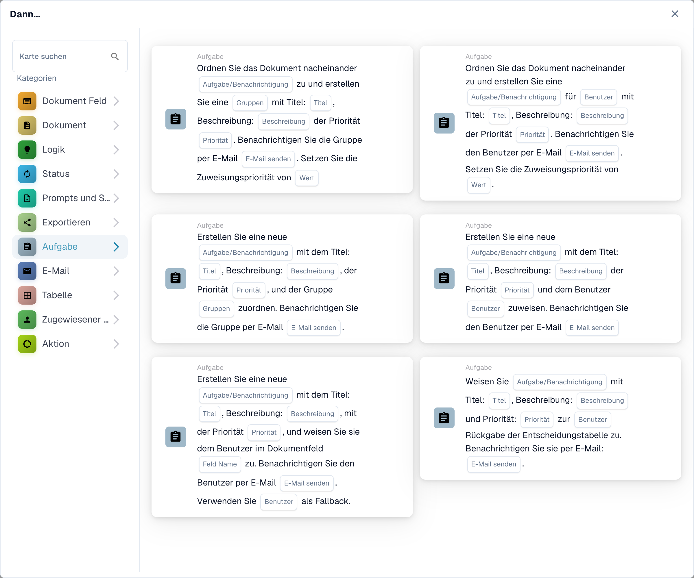<figcaption>Folgearbeit für eine Person oder Gruppe anlegen.</figcaption></figure>

## E-Mail

Senden Sie eine E-Mail mit einer ausgewählten Vorlage entweder an Empfänger oder an Gruppen. Wählen Sie die Vorlage und das Ziel auf der Karte aus.

<figure>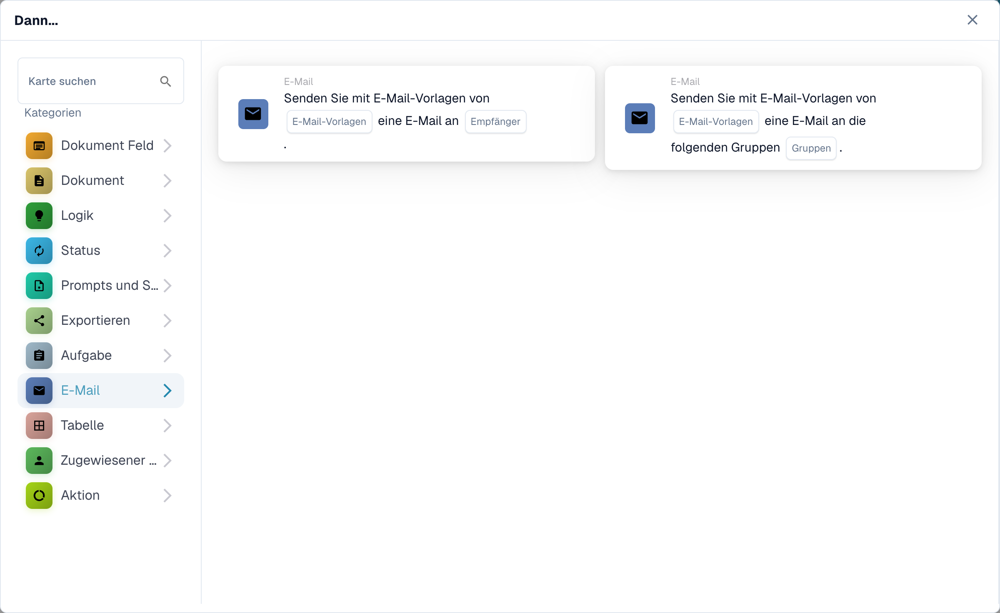<figcaption>Eine E-Mail mit Vorlage senden.</figcaption></figure>

## Tisch

Ändern Sie Einträge oder berechnen Sie Werte in einer Dokumententabelle. Wählen Sie die von der Karte angeforderte Tabelle, Spalten, den Operator und die Ergebnisspalte aus. Siehe [Tabelle](table).

<figure>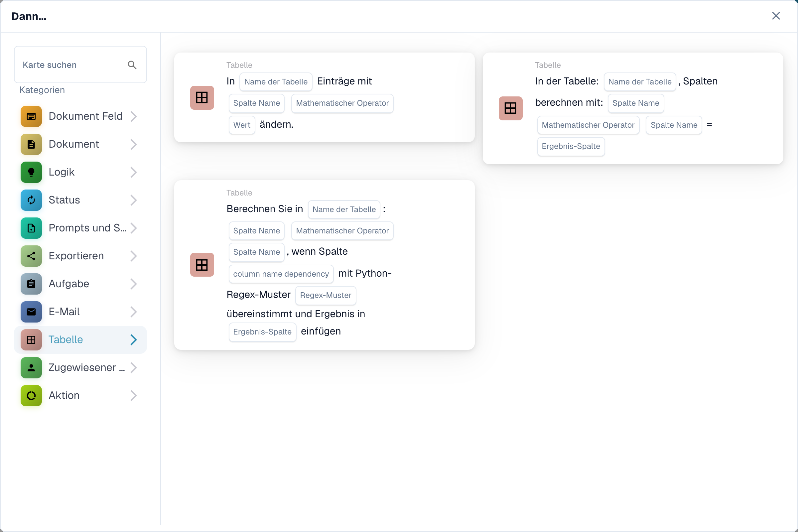<figcaption>Daten in Tabellen aktualisieren oder berechnen.</figcaption></figure>

## Bevollmächtigter

Weisen Sie das Dokument einem Benutzer, einer Gruppe, einem Empfänger oder einer Unterorganisation zu. Einige Karten verwenden ein Feld oder eine Entscheidungstabelle und bieten einen Fallback. Wählen Sie das richtige Ziel und den richtigen Fallback für die ausgewählte Karte. Siehe [Beauftragter](assignee).

<figure>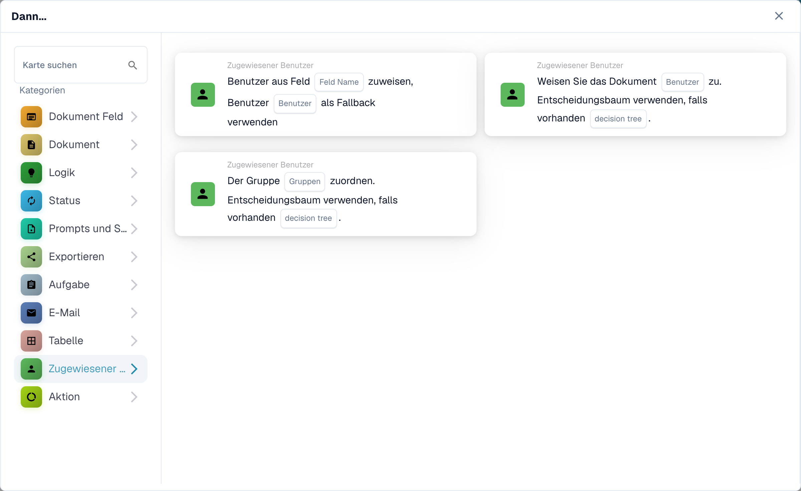<figcaption>Das Dokument der nächsten verantwortlichen Person oder Gruppe zuweisen.</figcaption></figure>

## Aktion

Führen Sie einen anderen Workflow aus, senden Sie eine HTTPS-Anfrage, rufen Sie eine API auf oder verwenden Sie die Kostensteigerungsberechnungskarte. Diese Aktionen können sich auf andere Systeme auswirken; Fragen Sie Ihren Administrator, welchen Endpunkt und welche Einstellungen Sie verwenden möchten. Siehe [Aktion](action).

<figure>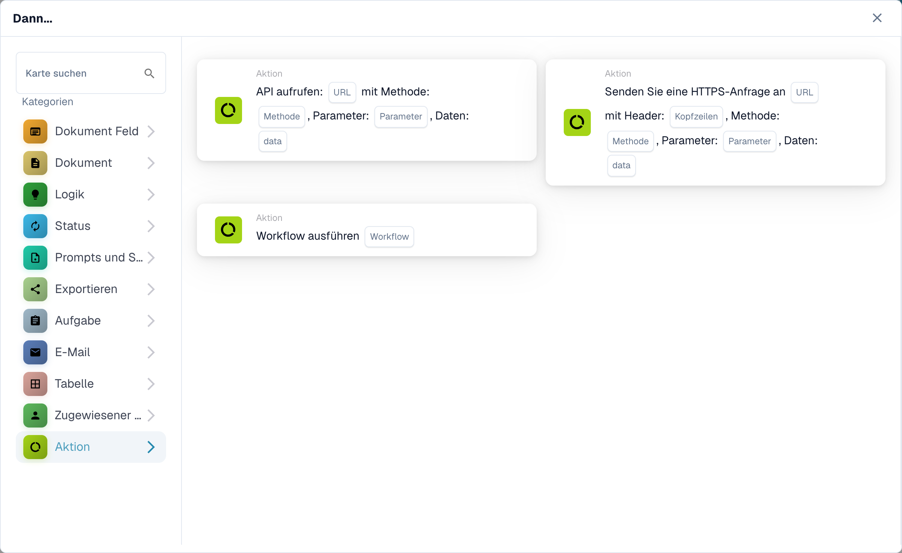<figcaption>Einen weiteren Workflow oder eine Integrationsaktion starten.</figcaption></figure>

[Detaillierte Logikkartenfelder, JSON-Pfade, Trigger und Tests](../cards-overview/logic-cards-guide.md).
