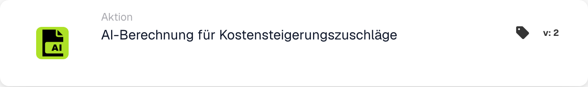

# KI-Berechnung für Kostensteigerungszuschläge

<figure><figcaption>
Kartenfelder in der angezeigten Version. Die Platzhalter sind noch nicht ausgefüllt.
</figcaption></figure>

## Wann sollte diese Karte verwendet werden?

Mit dieser Aktion fordern Sie die konfigurierte MTZ/ETZ-Material- und Energiezuschlagsberechnung für das aktuelle Dokument an. Bereiten Sie zunächst die für Ihre Organisation erforderlichen Dokumentdaten und Berechnungsdienstkonfigurationen vor.

## Tatsächliche Konfiguration

Die angezeigte Karte verfügt über keine Eingaben für Kostensteigerungsfaktor, Grundkostenfeld oder Zuschlagsfeld. Es delegiert die Berechnung an den konfigurierten Dienst. Suchen Sie nicht nach diesen nicht vorhandenen Kartenkontrollen und gehen Sie nicht von einer festen Prozentformel aus dem Kartennamen aus.

## Ergebnis und Überprüfung

Eine erfolgreiche Serviceantwort markiert die Karte als erfolgreich. Eine Zeitüberschreitung oder eine erfolglose Antwort führt zu einem Kartenfehler. Überprüfen Sie das Kartenprotokoll und die daraus resultierenden Zuschlagsdaten des Dokuments. Der Erfolg des Aufrufs allein dokumentiert noch keinen bestimmten Betrag.

Im Kartentestmodus wird der Aufruf übersprungen und ein Erfolg simuliert. Dies ist zum Testen der Workflow-Struktur nützlich, beweist aber nicht, dass der Dienst ausgeführt wurde oder ein Aufpreis berechnet wurde.

<!-- workflow-card-practical-example-20261021 -->

## Praxisbeispiel

**Verwendungszweck:** Fordern Sie die konfigurierte Material-/Energiezuschlagsberechnung für eine vorbereitete Rechnung an.

**Konfiguration:** Verwenden Sie die synthetische Rechnung `DEMO-001` mit den Daten, die für Ihren konfigurierten MTZ/ETZ-Dienst erforderlich sind. Fügen Sie diese Aktion nach den Dokumentvalidierungsbedingungen hinzu.

**Erwartetes Ergebnis und Gegenbeispiel:** Eine erfolgreiche Serviceantwort markiert die Karte als erfolgreich; Eine Zeitüberschreitung oder eine erfolglose Antwort führt zu einem Kartenfehler. Überprüfen Sie die Dokumentfelder und das Berechnungsergebnis separat. Der Kartentestmodus simuliert den Erfolg und ruft den Dienst nicht auf, sodass kein echtes Zuschlagsergebnis nachgewiesen werden kann.

Dies ist eine beispielhafte Konfiguration und ein erwartetes Ergebnis. Verwenden Sie in Ihrer Testorganisation konfigurierte Felder, Benutzer und Gruppen. Es wird nicht behauptet, dass dieses Beispiel ausgeführt wurde.
