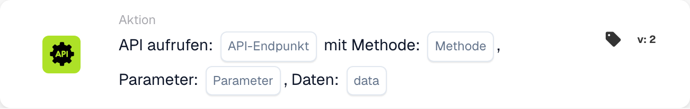

# DocBits-API aufrufen

<figure><figcaption>
Kartenfelder in der angezeigten Version. Die Platzhalter sind noch nicht ausgefüllt.
</figcaption></figure>

<!-- workflow-card-api-guide-contract-20261022 -->

Beobachtete Karte: `call_api`, Vorlage `6ca5e621-af72-4f55-aa2e-b3caa288722a`, Version `1`. Verwenden Sie die tatsächlich angebotene Version Ihrer Organisation.

## Zweck

Mit `call_api` rufe ich einen Endpunkt innerhalb der konfigurierten DocBits-API auf. Der Endpunkt ist ein relativer Pfad, der an die Basisadresse der DocBits-API angehängt wird. Eine beliebige externe URL richtet keine Integration zu einer fremden API ein.

## Konfiguration

Tragen Sie Endpunktpfad, HTTP-Methode, Abfrageparameter und die vom Endpunkt unterstützten Anfragedaten ein. Die Anfrage verwendet den aktuellen DocBits-Benutzerkontext. Fehlende Werte für `org_id` und `triggered_by_docflow` werden automatisch ergänzt. Parameter- und Datenobjekte beziehungsweise ihre unterstützte Textdarstellung müssen zum Format dieser Kartenversion passen. Die Version bietet keine allgemeine Zuordnung von JSON-Antwortfeldern.

## Ergebnis und Grenzen

Der Antworttext wird in einen Wahrheitswert umgewandelt: Reines `true`, `1`, `yes` oder `on` ergibt wahr; unbekannte Antworten einschließlich beliebiger JSON-Objekte ergeben standardmäßig falsch. Der HTTP-Status allein bestimmt diesen Wahrheitswert nicht. Zeitüberschreitungen oder Anfragefehler ergeben falsch. Im Kartentest wird der Aufruf nur simuliert und ohne Anfrage wahr zurückgegeben; das belegt weder Anmeldung noch Erreichbarkeit oder Endpunktverhalten.

## Praxisbeispiel

Wenn ich einen Wahrheitswert von einem konfigurierten DocBits-API-Endpunkt benötige, verwende ich diese Karte nach den erforderlichen Bedingungen. Wählen Sie für einen isolierten Test einen vorhandenen, dokumentierten, nur lesenden DocBits-Endpunkt mit passendem Wahrheitswert-Vertrag und die passende Methode, etwa `GET`. Verwenden Sie ausschließlich dessen unterstützte Demo-Parameter.

Erwartetes Ergebnis und Gegenbeispiel: Bei einer hypothetischen HTTP-Antwort `200` mit dem vollständigen Text `true` ist das Kartenergebnis wahr. Bei `false` ist es falsch. Ein Objekt wie `{"approved": true}` wird nicht automatisch zu wahr zugeordnet. Prüfen Sie die tatsächliche Antwort und die Protokolle getrennt. Dieses Beispiel wurde am Ausführungscode geprüft; es wurde keine Anfrage und kein Workflow ausgeführt.

## Fehlerbehebung

Die HTTPS-Anfragekarte verwendet eine konfigurierte HTTPS-URL und eigene Header. `call_api` verwendet einen relativen DocBits-API-Pfad und den aktuellen DocBits-Benutzerkontext; das Ergebnis wird aus dem Antworttext abgeleitet. Entscheidend sind Endpunkt und Antwortvertrag, nicht die Unterscheidung zwischen einfacher und komplexer API.

[Referenz](call-api.md)
