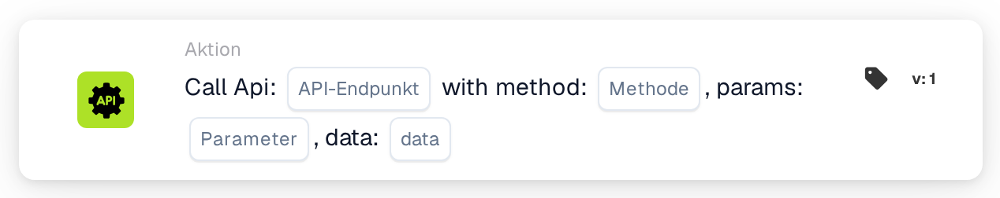
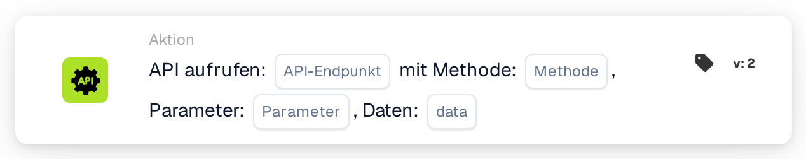

# API aufrufen

<figure><figcaption>
Version 1
</figcaption></figure>

<figure><figcaption>
Version 2
</figcaption></figure>

<!-- workflow-card-call-api-contract-20261022 -->

## Zweck

Mit `call_api` rufe ich einen Endpunkt innerhalb der konfigurierten DocBits-API auf. Der Endpunkt ist ein relativer Pfad, der an die Basisadresse der DocBits-API angehängt wird. Eine beliebige externe URL richtet keine Integration zu einer fremden API ein.

## Konfiguration

Tragen Sie Endpunktpfad, HTTP-Methode, Abfrageparameter und die vom Endpunkt unterstützten Anfragedaten ein. Die Anfrage verwendet den aktuellen DocBits-Benutzerkontext. Fehlende Werte für `org_id` und `triggered_by_docflow` werden automatisch ergänzt. Parameter- und Datenobjekte beziehungsweise ihre unterstützte Textdarstellung müssen zum Format dieser Kartenversion passen. Die Version bietet keine allgemeine Zuordnung von JSON-Antwortfeldern.

## Ergebnis und Grenzen

Der Antworttext wird in einen Wahrheitswert umgewandelt: Reines `true`, `1`, `yes` oder `on` ergibt wahr; unbekannte Antworten einschließlich beliebiger JSON-Objekte ergeben standardmäßig falsch. Der HTTP-Status allein bestimmt diesen Wahrheitswert nicht. Zeitüberschreitungen oder Anfragefehler ergeben falsch. Im Kartentest wird der Aufruf nur simuliert und ohne Anfrage wahr zurückgegeben; das belegt weder Anmeldung noch Erreichbarkeit oder Endpunktverhalten.

<!-- workflow-card-practical-example-20261021 -->

## Praxisbeispiel

Wenn ich einen Wahrheitswert von einem konfigurierten DocBits-API-Endpunkt benötige, verwende ich diese Karte nach den erforderlichen Bedingungen. Wählen Sie für einen isolierten Test einen vorhandenen, dokumentierten, nur lesenden DocBits-Endpunkt mit passendem Wahrheitswert-Vertrag und die passende Methode, etwa `GET`. Verwenden Sie ausschließlich dessen unterstützte Demo-Parameter.

Erwartetes Ergebnis und Gegenbeispiel: Bei einer hypothetischen HTTP-Antwort `200` mit dem vollständigen Text `true` ist das Kartenergebnis wahr. Bei `false` ist es falsch. Ein Objekt wie `{"approved": true}` wird nicht automatisch zu wahr zugeordnet. Prüfen Sie die tatsächliche Antwort und die Protokolle getrennt. Dieses Beispiel wurde am Ausführungscode geprüft; es wurde keine Anfrage und kein Workflow ausgeführt.

## Lernweg und Rückschreibvertrag

[P1: API-Aufruf und Weiterverwendung der Antwort prüfen](../../masterclass/api-response-contract.md) erklärt Simulation, Antwortauswertung und den ausdrücklich zu vereinbarenden Rückschreibweg. Eine erfolgreiche Anfrage stellt nicht automatisch ein Feld wie `api.response.cost_center` bereit.
