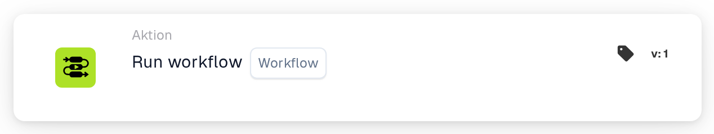
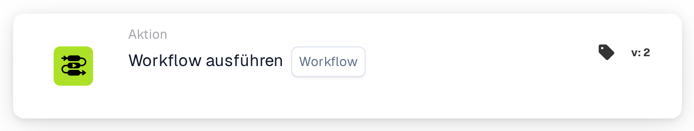

# Workflow ausführen

<figure><figcaption>
Version 1
</figcaption></figure>

<figure><figcaption>
Version 2
</figcaption></figure>

## Zweck:

Die Karte **„Workflow ausführen“** ermöglicht es Benutzern, dynamisch einen ausgewählten Workflow aus einer Liste verfügbarer Workflows auszuführen. Diese Karte ist nützlich, um Prozesse zu automatisieren, bei denen mehrere Workflows miteinander verbunden sind, und ermöglicht so optimierte Abläufe.

## Bestandteile der Karte:

1. **Arbeitsablauf**
   * **Beschreibung:** Gibt den Workflow an, der ausgeführt wird, wenn die Bedingungen als erfüllt ausgewertet werden.
   * **Detail:** Zur Auswahl wird eine Dropdown-Liste aller verfügbaren Workflows bereitgestellt.

## Funktionalität:

* **Bedingungsauswertung:** Die Karte führt den ausgewählten Workflow nur aus, wenn sowohl der **„Wenn“**- als auch der **„Und“**-Abschnitt als erfüllt ausgewertet werden.
  * Ist eine der Bedingungen nicht erfüllt, wird keine Aktion ausgeführt, und der Workflow bleibt nicht ausgelöst.
* **Workflow-Ausführung:**
  * Sind die Bedingungen erfüllt, wird der angegebene Workflow automatisch ausgelöst.
  * Sind die Bedingungen nicht erfüllt, wird kein Workflow ausgeführt.

## Einrichtung und Konfiguration:

1. **Workflow auswählen:** Wählen Sie den auszulösenden Workflow aus der **Dropdown-Liste** der verfügbaren Workflows.
2. **Bedingungen definieren:** Konfigurieren Sie die Abschnitte **„Wenn“** und **„Und“**, um die Kriterien festzulegen, die erfüllt sein müssen, damit der Workflow ausgeführt wird.

## Fazit:

Die Karte **„Workflow ausführen“** bietet eine komfortable und effiziente Möglichkeit, Workflows zu verknüpfen und mehrstufige Prozesse mühelos zu automatisieren. Indem sichergestellt wird, dass die Bedingungen in den Abschnitten **„Wenn“** und **„Und“** erfüllt sind, können Benutzer Workflows dynamisch ausführen und manuelle Eingriffe reduzieren.

<!-- workflow-card-practical-example-20261021 -->

## Praxisbeispiel

**Wann zu verwenden ist:** Wiederverwendung eines vorhandenen Validierungsworkflows.

**Konfiguration:** Wählen Sie einen konfigurierten untergeordneten Demo-Workflow aus, der `routing_result` auf `checked` setzt.

**Erwartetes Ergebnis und Gegenbeispiel:** Der ausgewählte Workflow wird in seinem unterstützten Ausführungskontext aufgerufen. Überprüfen Sie das eigene Protokoll und das Feldergebnis. Verknüpfen Sie es nicht in einer Schleife mit dem übergeordneten Element.

Dies ist eine beispielhafte Konfiguration und ein erwartetes Ergebnis. Verwenden Sie in Ihrer Testorganisation konfigurierte Felder, Benutzer und Gruppen. Es wird nicht behauptet, dass dieses Beispiel ausgeführt wurde.
