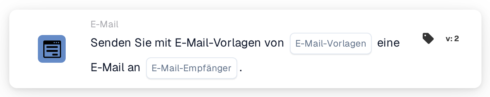

# E-Mail senden

<figure><figcaption>
Version 2
</figcaption></figure>

## Zweck:

Diese Workflow-Karte sendet eine E-Mail auf Basis einer oder mehrerer E-Mail-Vorlagen. Die Empfänger werden nicht als feste Adressen eingegeben: Sie werden über ihre Rolle im Workflow bestimmt, zum Beispiel der Benutzer oder die Gruppe, dem bzw. der das Dokument zugewiesen ist, oder die von einer Entscheidungstabelle zurückgegebenen Benutzer und Gruppen. So bleibt der Workflow gültig, wenn sich die Personen hinter diesen Rollen ändern.

Um stattdessen eine E-Mail an ausgewählte Benutzergruppen zu senden, kann die Karte **Send Email to Groups** verwendet werden, siehe [Send Email to Groups](send-email-groups-guide.md).

## Bestandteile der Karte:

1. **E-Mail-Vorlagen**
   * **Beschreibung:** Die für die E-Mail verwendeten E-Mail-Vorlagen.
   * **Detail:** Es können eine oder mehrere E-Mail-Vorlagen der Organisation ausgewählt werden. Jede ausgewählte Vorlage wird an jeden Empfänger gesendet. Läuft der Workflow für ein Dokument, wird eine Vorlage, die für einen bestimmten Dokumenttyp eingerichtet ist, nur gesendet, wenn das Dokument diesen Dokumenttyp hat.
2. **E-Mail-Empfänger**
   * **Beschreibung:** Wer die E-Mail erhält.
   * **Optionen:** Eine oder mehrere der folgenden Optionen können ausgewählt werden:
     * **Zugewiesener Benutzer/Gruppe des Dokuments:** Der Benutzer oder die Gruppe, dem bzw. der das Dokument aktuell zugewiesen ist.
     * **Zurückgegebener Benutzer/Gruppe der Entscheidungstabelle:** Die Benutzer und Gruppen, die von einer zuvor im selben Workflow ausgewerteten Entscheidungstabelle zurückgegeben wurden, zum Beispiel mit der Karte **Decision Table has Returns**.
     * **Dem Lieferanten zugewiesener Benutzer:** Der zugewiesene Benutzer des Lieferanten, in Workflows, die durch eine Statusänderung eines Lieferanten gestartet werden.
     * **Empfehlung des Lieferanten:** Die Person, die den Lieferanten empfohlen hat, in Workflows, die durch eine Statusänderung eines Lieferanten gestartet werden.

## Funktionalität:

* **Sammeln der Empfänger:** Die Karte sammelt die Empfänger aller ausgewählten Optionen. Ein Empfänger, der sich aus mehr als einer Option ergibt, erhält die E-Mail nur einmal.
* **Ausführung der Aktion:** Die E-Mail wird mit den ausgewählten Vorlagen gesendet. Läuft der Workflow für ein Dokument, können die Vorlagen die Feldwerte des Dokuments verwenden. Das Ergebnis wird zusammen mit den Namen der Empfänger im Workflow-Protokoll festgehalten.
* **Ohne Dokument:** Die Karte kann auch in Workflows laufen, die nicht für ein Dokument gestartet werden, zum Beispiel in Workflows, die durch eine Statusänderung eines Lieferanten gestartet werden. In einem solchen Workflow fügt die Option **Zugewiesener Benutzer/Gruppe des Dokuments** keinen Empfänger hinzu.
* **Fehlende Daten:**
  * Ist auf der Karte keine E-Mail-Vorlage oder keine Empfängeroption ausgewählt, wird die Karte nicht ausgeführt und meldet die fehlenden Daten im Workflow-Protokoll.
  * Führt eine ausgewählte Option zu niemandem, zum Beispiel weil das Dokument keinen zugewiesenen Benutzer hat oder die Entscheidungstabelle niemanden zurückgegeben hat, fügt diese Option keinen Empfänger hinzu.
* **Fehler:** Lehnt der E-Mail-Dienst die Anfrage ab oder antwortet er nicht rechtzeitig, endet die Karte mit einem Fehler.

## Einrichtung und Konfiguration:

* Die E-Mail-Vorlagen sollten in der Organisation eingerichtet sein, bevor sie auf der Karte ausgewählt werden können.
* Die Karte kann aus der Kategorie **E-Mail** hinzugefügt werden. Danach werden eine oder mehrere Vorlagen unter **E-Mail-Vorlagen** und eine oder mehrere Optionen unter **E-Mail-Empfänger** ausgewählt.
* Für die Option **Zurückgegebener Benutzer/Gruppe der Entscheidungstabelle** sollte zuvor im selben Workflow eine Entscheidungstabelle ausgewertet werden.

## Fazit:

Die Workflow-Karte „Send Email“ informiert die an einem Dokument- oder Lieferantenprozess beteiligten Personen automatisch mit vorbereiteten Vorlagen. Da die Empfänger über ihre Rolle bestimmt werden, erreicht derselbe Workflow auch dann die richtigen Personen, wenn sich Zuweisungen ändern.
