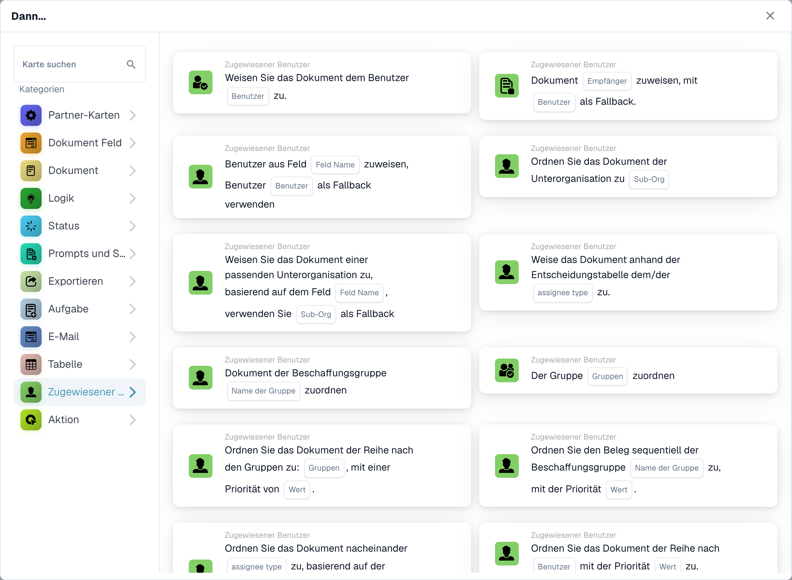

# Bevollmächtigter

Die Karten dieser Kategorie im **Karte hinzufügen**-Picker des Workflow-Builders:

<figure><figcaption>
Verfügbare Karten der ausgewählten Kategorie. Füllen Sie die Platzhalter vor der Verwendung aus. Einzelne Feldbeschriftungen dieser Kartenversion sind in der Oberfläche derzeit noch englisch. Die Erläuterungen auf dieser Seite sind übersetzt.
</figcaption></figure>
