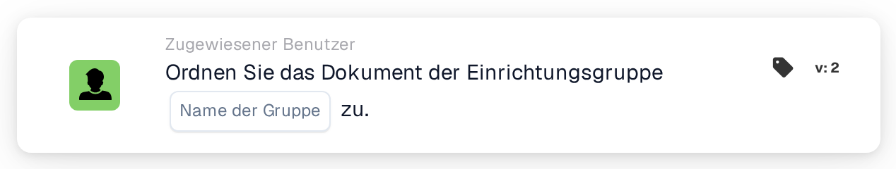

# Dokument der Einrichtungsgruppe zuweisen

<figure><figcaption>
Version 2
</figcaption></figure>

## Zweck:

Diese Workflow-Karte weist ein Dokument der Gruppe zu, die für die Einrichtung seiner Bestellung zuständig ist. Die Einrichtung wird nicht auf der Karte ausgewählt: Sie wird aus den Bestellungen übernommen, denen das Dokument zugeordnet ist. Die Karte sucht dann nach einer Benutzergruppe, deren Name sowohl den auf der Karte eingegebenen Gruppennamen als auch den Einrichtungscode enthält, und weist das Dokument dieser Gruppe zu.

Das ist nützlich, wenn es dieselbe Art von Team einmal pro Einrichtung gibt, zum Beispiel eine Genehmigungsgruppe pro Werk oder Lager, und jedes Dokument an das Team der Einrichtung gehen soll, für die bestellt wurde.

Für eine Zuweisung, die einer Reihenfolge von Genehmigern hinzugefügt statt direkt vorgenommen wird, kann die Karte **Assign Sequentially to Facility Group** verwendet werden.

## Bestandteile der Karte:

1. **Name der Gruppe**
   * **Beschreibung:** Der Namensteil, den die Einrichtungsgruppen gemeinsam haben.
   * **Detail:** Ein Text, der mit den Namen der Benutzergruppen der Organisation verglichen wird. Eine Gruppe passt, wenn ihr Name diesen Text und den Einrichtungscode der Bestellung enthält. Beim Vergleich wird Groß- und Kleinschreibung nicht beachtet. Mit dem Gruppennamen **Approver** und einer Bestellung für die Einrichtung **1000** würde zum Beispiel eine Gruppe namens **Approver 1000** passen.

## Funktionalität:

* **Ermitteln der Einrichtung:** Die Karte liest die Bestellungen, denen das Dokument zugeordnet ist, und sammelt den Einrichtungscode (den Standort der Bestellung) jeder dieser Bestellungen.
* **Ermitteln der Gruppe:** Für jeden Einrichtungscode sucht die Karte nach Benutzergruppen, deren Name sowohl den **Name der Gruppe** von der Karte als auch den Einrichtungscode enthält. Einrichtungscodes, für die keine Gruppe gefunden wird, werden im Workflow-Protokoll aufgeführt.
* **Ausführung der Aktion:** Das Dokument wird der passenden Gruppe zugewiesen. Passen mehrere Gruppen, zum Beispiel weil das Dokument Bestellungen verschiedener Einrichtungen zugeordnet ist, wird das Dokument nur einer von ihnen zugewiesen; welcher, wird nicht durch die Karte festgelegt.
* **Fehlende Daten:**
  * Ist auf der Karte kein Gruppenname eingegeben, wird die Karte nicht ausgeführt und meldet die fehlenden Daten im Workflow-Protokoll.
  * Ist das Dokument keiner Bestellung zugeordnet, meldet die Karte die fehlenden Daten, statt das Dokument zuzuweisen.
  * Passt keine Gruppe zu einem der Einrichtungscodes, wird das Dokument nicht zugewiesen und das Workflow-Protokoll vermerkt, dass keine passende Gruppe gefunden wurde.

## Einrichtung und Konfiguration:

* Die Benutzergruppen sollten so benannt sein, dass jeder Name den gemeinsamen Namensteil und den Einrichtungscode enthält, zum Beispiel **Approver 1000**, **Approver 2000**.
* Die Karte kann aus der Kategorie **Zugewiesener Benutzer** hinzugefügt werden. Danach wird der gemeinsame Namensteil der Gruppen in das Feld **Name der Gruppe** eingegeben.
* Da die Einrichtung aus den zugeordneten Bestellungen stammt, eignet sich die Karte am besten für Workflows mit Dokumenten, die bereits einer Bestellung zugeordnet wurden.

## Fazit:

Die Workflow-Karte „Assign Document to Facility Group“ leitet Dokumente an das Team der Einrichtung weiter, für die sie bestellt wurden. Eine Karte deckt alle Einrichtungen ab, sofern die Benutzergruppen einem einheitlichen Namensschema mit dem Einrichtungscode im Namen folgen.
