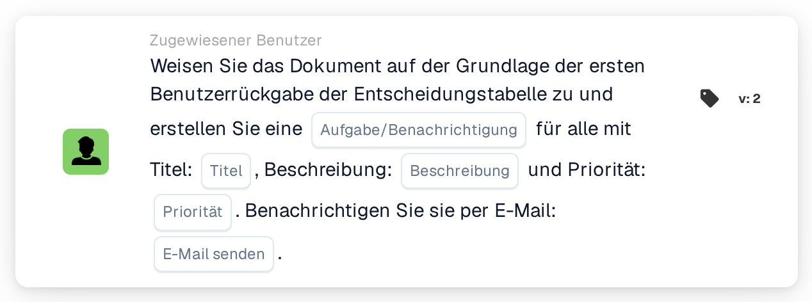

# Dokument dem ersten Benutzer der Entscheidungstabelle zuweisen und Aufgaben erstellen

<figure><figcaption>
Version 2
</figcaption></figure>

## Zweck:

Diese Workflow-Karte nutzt die von einer Entscheidungstabelle zurückgegebenen Benutzer auf zwei Arten: Das Dokument wird dem ersten zurückgegebenen Benutzer zugewiesen, und jeder zurückgegebene Benutzer, einschließlich des ersten, erhält eine Aufgabe oder Benachrichtigung zu dem Dokument. So wird eine Person für das Dokument verantwortlich, während die anderen ebenfalls informiert oder zum Handeln aufgefordert werden.

Die Benutzer stammen aus einer Entscheidungstabelle, die zuvor im selben Workflow ausgewertet wird, zum Beispiel mit der Karte **Decision Table has Returns**, die so eingestellt ist, dass die zurückgegebenen Daten in nachfolgenden Karten verwendet werden.

## Bestandteile der Karte:

1. **Aufgabe/Benachrichtigung**
   * **Beschreibung:** Legt fest, ob für die zurückgegebenen Benutzer eine Aufgabe oder eine Benachrichtigung erstellt wird.
   * **Optionen:**
     * **Aufgabe:** Für jeden Benutzer wird eine Aufgabe erstellt.
     * **Benachrichtigung:** Für jeden Benutzer wird eine Benachrichtigung erstellt.
2. **Titel**
   * **Beschreibung:** Der Titel der Aufgabe oder Benachrichtigung.
   * **Detail:** Ein kurzer Text, der die Aufgabe oder Benachrichtigung kennzeichnet.
3. **Beschreibung**
   * **Beschreibung:** Weitere Details zur Aufgabe oder Benachrichtigung.
   * **Detail:** Ein Text, der beschreibt, was getan werden soll oder warum die Benutzer informiert werden.
4. **Priorität**
   * **Beschreibung:** Die Dringlichkeit der Aufgabe oder Benachrichtigung.
   * **Optionen:**
     * **hohes Gewicht:** Die Aufgabe oder Benachrichtigung wird mit hoher Priorität erstellt.
     * **mittleres Gewicht:** Die Aufgabe oder Benachrichtigung wird mit mittlerer Priorität erstellt.
     * **niedriges Gewicht:** Die Aufgabe oder Benachrichtigung wird mit niedriger Priorität erstellt.
5. **E-Mail senden**
   * **Beschreibung:** Legt fest, ob die Benutzer zusätzlich per E-Mail über die Aufgabe oder Benachrichtigung informiert werden.
   * **Optionen:**
     * **True:** Eine E-Mail-Benachrichtigung wird gesendet.
     * **False:** Es wird keine E-Mail-Benachrichtigung gesendet.

## Funktionalität:

* **Lesen der Entscheidungstabelle:** Die Karte liest die Benutzer, die die Entscheidungstabelle zuvor im Workflow zurückgegeben hat. Berücksichtigt werden nur zurückgegebene Benutzer, keine Gruppen.
* **Dokumentzuweisung:** Das Dokument wird dem ersten zurückgegebenen Benutzer zugewiesen.
* **Erstellen der Aufgaben:** Für jeden zurückgegebenen Benutzer wird eine Aufgabe oder Benachrichtigung mit Titel, Beschreibung und Priorität von der Karte erstellt. Jeder Benutzer erhält eine eigene Aufgabe. Die Aufgaben werden auch dann erstellt, wenn die Zuweisung des Dokuments nicht erfolgreich war; das Workflow-Protokoll zeigt das Ergebnis der Zuweisung und jeder Aufgabe.
* **Standardwerte:** Ist keine Priorität festgelegt, wird **mittleres Gewicht** verwendet. Ist **E-Mail senden** nicht festgelegt, wird keine E-Mail gesendet. Ist **Aufgabe/Benachrichtigung** nicht festgelegt, wird eine Aufgabe erstellt und das Workflow-Protokoll vermerkt die fehlende Einstellung.
* **Fehlende Daten:**
  * Hat die Entscheidungstabelle keinen Benutzer zurückgegeben, wird nichts zugewiesen und die Karte meldet die fehlenden Daten im Workflow-Protokoll.
  * Ist der Titel oder die Beschreibung leer, wird das Dokument nicht zugewiesen, keine Aufgabe erstellt und die Karte meldet die fehlenden Daten.

## Einrichtung und Konfiguration:

* Eine Entscheidungstabelle, die Benutzer zurückgibt, sollte zuvor im Workflow ausgewertet werden, zum Beispiel mit der Karte **Decision Table has Returns**. Die Reihenfolge der zurückgegebenen Benutzer ist wichtig, da der erste das Dokument erhält.
* Die Karte kann aus der Kategorie **Zugewiesener Benutzer** hinzugefügt werden. Danach können die Art (**Aufgabe** oder **Benachrichtigung**), der Titel, die Beschreibung, die Priorität und die E-Mail-Einstellung konfiguriert werden.

## Fazit:

Die Workflow-Karte „Assign Document to First Decision Table User and Create Tasks“ verbindet eine klare Verantwortung für das Dokument mit Informationen für alle, die die Entscheidungstabelle nennt. Sie ist nützlich, wenn eine Person für das Dokument zuständig sein soll, während andere einbezogen oder auf dem Laufenden gehalten werden sollen.
