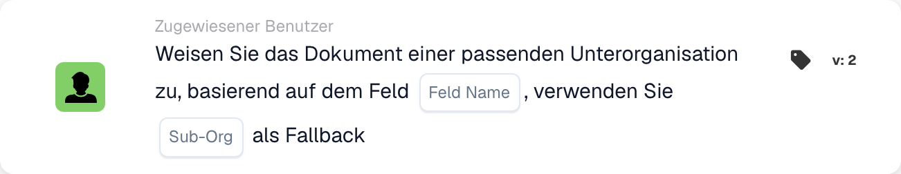

# Ordnen Sie das Dokument der passenden Unterorganisation zu

<figure><figcaption>
Kartenfelder in der angezeigten Version. Die Platzhalter sind noch nicht ausgefüllt.
</figcaption></figure>

## **Zweck:**

Die Workflow-Karte **„Dokument basierend auf Feld einer passenden Unterorganisation zuordnen“** weist ein Dokument dynamisch einer Unterorganisation zu, basierend auf einem angegebenen Feld im Dokument. Wird keine passende Unterorganisation gefunden, verwendet die Karte eine vordefinierte Ersatz-Unterorganisation.

## **Bestandteile der Karte:**

1. **Feldname**
   * **Beschreibung:** Gibt das Dokumentfeld an, das zur Bestimmung der passenden Unterorganisation verwendet wird.
   * **Detail:** Die Karte sucht nach einem Wert im angegebenen Feld, um ihn mit einer verfügbaren Unterorganisation abzugleichen.
2. **Unterorganisation (Ersatz)**
   * **Beschreibung:** Legt die Ersatz-Unterorganisation fest, die verwendet wird, wenn im angegebenen Feld keine Übereinstimmung gefunden wird.
   * **Detail:** Stimmt der Feldwert mit keiner Unterorganisation überein, wird das Dokument der ausgewählten Ersatz-Unterorganisation zugewiesen.

## **Funktionalität:**

* **Bedingungsauswertung:**\
  Die Karte führt ihre Aktion nur aus, wenn sowohl der **„Wenn“**- als auch der **„Und“**-Abschnitt als erfüllt ausgewertet werden.
* **Dynamische Zuweisung:**\
  Die Karte prüft den Wert des angegebenen Feldes und weist das Dokument der Unterorganisation zu, die diesem Wert entspricht.
* **Ersatzmechanismus:**\
  Wird keine passende Unterorganisation gefunden, wird das Dokument der Ersatz-Unterorganisation zugewiesen.

## **Einrichtung und Konfiguration:**

* **Feldnamen auswählen:**\
  Wählen Sie das Feld aus dem Dokument, das den Wert enthält, der mit einer Unterorganisation abgeglichen werden soll.
* **Ersatz-Unterorganisation auswählen:**\
  Wählen Sie die Unterorganisation, die verwendet wird, wenn im Dokumentfeld keine Übereinstimmung gefunden wird.

## **Fazit:**

Die Workflow-Karte **„Dokument basierend auf Feld einer passenden Unterorganisation zuordnen“** bietet Flexibilität, indem sie Dokumente dynamisch an die passende Unterorganisation weiterleitet, mit einer zusätzlichen Ersatzoption, um sicherzustellen, dass kein Dokument unzugewiesen bleibt.

<!-- workflow-card-practical-example-20261021 -->

## Praxisbeispiel

**Verwendungszweck:** Wählen Sie eine Geschäftseinheit aus einem extrahierten Routing-Feld aus.

**Konfiguration:** Setzen Sie das Routing-Feld `business_unit` auf den konfigurierten Unterorganisationsnamen `Demo North` und wählen Sie `Demo Default` als Fallback.

**Erwartetes Ergebnis und Gegenbeispiel:** Ein passender Feldwert wählt `Demo North` aus. Ein unbekannter Name verwendet `Demo Default`; Testen Sie den Fallback, bevor Sie den Workflow aktivieren.

Dies ist eine beispielhafte Konfiguration und ein erwartetes Ergebnis. Verwenden Sie in Ihrer Testorganisation konfigurierte Felder, Benutzer und Gruppen. Es wird nicht behauptet, dass dieses Beispiel ausgeführt wurde.
