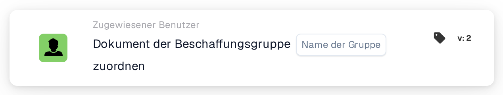

# Dokument der Beschaffungsgruppe zuordnen

<figure><figcaption>
Version 2
</figcaption></figure>

## **Zweck:**

Die Workflow-Karte **"Assign to Procurement Group"** wird verwendet, um ein Dokument einer angegebenen Beschaffungsgruppe innerhalb des Systems zuzuweisen. Dies hilft, das Dokumentenmanagement zu optimieren, indem sichergestellt wird, dass das passende Team das Dokument auf Basis seiner zugewiesenen Beschaffungsgruppe bearbeitet.

## **Bestandteile der Karte:**

1. **Beschaffungsgruppe**
   * **Beschreibung:** Gibt die Beschaffungsgruppe an, der das Dokument zugewiesen wird.
   * **Detail:** Die ausgewählte Beschaffungsgruppe ist für die Verarbeitung und Verwaltung des Dokuments verantwortlich.

## **Funktionalität:**

* **Bedingungsauswertung:**\
  Die Karte führt ihre Aktion nur aus, wenn sowohl der **„Wenn“**- als auch der **„Und“**-Abschnitt als erfüllt ausgewertet werden.
* **Ausführung der Aktion:**\
  Sind beide Bedingungen erfüllt, wird das Dokument der angegebenen Beschaffungsgruppe zugewiesen. Ist eine der Bedingungen nicht erfüllt, wird keine Aktion ausgeführt, und das Dokument bleibt unzugewiesen.

## **Einrichtung und Konfiguration:**

* **Beschaffungsgruppe auswählen:** Wählen Sie die Beschaffungsgruppe, der das Dokument zugewiesen werden soll, aus der Dropdown-Liste.

## **Fazit:**

Die Workflow-Karte **"Assign to Procurement Group"** bietet eine einfache, aber effektive Möglichkeit, sicherzustellen, dass Dokumente automatisch dem richtigen Beschaffungsteam zur weiteren Verarbeitung zugewiesen werden.

<!-- workflow-card-practical-example-20261021 -->

## Praxisbeispiel

**Verwendungszweck:** Senden Sie eine Einkaufsausnahme an die Beschaffungsgruppe.

**Konfiguration:** Wählen Sie die konfigurierte Gruppe `Demo Procurement` aus.

**Erwartetes Ergebnis und Gegenbeispiel:** Das Dokument ist dieser Beschaffungsgruppe zugeordnet. Bei einer gewöhnlichen Gruppe mit ähnlichem Namen darf nicht davon ausgegangen werden, dass es sich um dasselbe konfigurierte Ziel handelt.

Dies ist eine beispielhafte Konfiguration und ein erwartetes Ergebnis. Verwenden Sie in Ihrer Testorganisation konfigurierte Felder, Benutzer und Gruppen. Es wird nicht behauptet, dass dieses Beispiel ausgeführt wurde.
