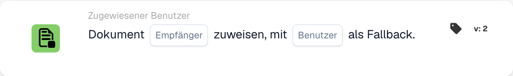

# Dokument dem Empfänger zuordnen

<figure><figcaption>
Kartenfelder in der angezeigten Version. Die Platzhalter sind noch nicht ausgefüllt.
</figcaption></figure>

## **Zweck:**

Die Workflow-Karte **„Dokument dem Disponenten/Käufer zuordnen“** weist ein Dokument entweder einem **Disponenten** oder einem **Einkäufer** zu. Wird kein gültiger Benutzer gefunden, wird ein Ersatzbenutzer ausgewählt, um sicherzustellen, dass das Dokument immer jemandem zugewiesen ist.

## **Bestandteile der Karte:**

1. **Disponent / Einkäufer**
   * **Beschreibung:** Gibt an, ob das Dokument einem Disponenten oder einem Einkäufer zugewiesen wird.
   * **Optionen:**
     * **Disponent:** Weist das Dokument dem Disponenten zu.
     * **Einkäufer:** Weist das Dokument dem Einkäufer zu.
2. **Ersatzbenutzer**
   * **Beschreibung:** Gibt einen Ersatzbenutzer für den Fall an, dass das Dokument dem ausgewählten Disponenten oder Einkäufer nicht zugewiesen werden kann.
   * **Detail:** Die Dropdown-Liste der verfügbaren Benutzer ermöglicht es Ihnen, einen Ersatzbenutzer auszuwählen, um sicherzustellen, dass das Dokument auch dann zugewiesen wird, wenn der primäre Benutzer nicht bestimmt werden kann.

## **Funktionalität:**

* **Bedingungsauswertung:**\
  Die Karte führt ihre Aktion nur aus, wenn sowohl der **„Wenn“**- als auch der **„Und“**-Abschnitt als erfüllt ausgewertet werden.
* **Dokumentzuweisung:**\
  Die Karte weist das Dokument je nach Auswahl entweder dem **Disponenten** oder dem **Einkäufer** zu. Ist die ausgewählte Person nicht verfügbar oder nicht gültig, wird das Dokument dem Ersatzbenutzer zugewiesen.

## **Einrichtung und Konfiguration:**

* **Disponent / Einkäufer auswählen:**\
  Wählen Sie, ob das Dokument dem **Disponenten** oder dem **Einkäufer** zugewiesen werden soll.
* **Ersatzbenutzer auswählen:**\
  Wählen Sie aus der Dropdown-Liste einen Ersatzbenutzer, der das Dokument erhält, wenn die primäre Zuweisung nicht möglich ist.

## **Fazit:**

Die Workflow-Karte **„Dokument dem Disponenten/Käufer zuordnen“** stellt sicher, dass das Dokument immer zugewiesen wird – entweder dem ausgewählten Disponenten/Einkäufer oder bei Bedarf dem Ersatzbenutzer. Dies minimiert Workflow-Unterbrechungen und stellt sicher, dass die Dokumentverarbeitung reibungslos fortgesetzt wird.

<!-- workflow-card-practical-example-20261021 -->

## Praxisbeispiel

**Verwendungszweck:** Weisen Sie ein Dokument seinem aufgelösten Empfänger zu, mit einem sicheren Fallback.

**Konfiguration:** Wählen Sie die Empfängerquelle und den Fallback-Benutzer `Demo Reviewer A`.

**Erwartetes Ergebnis und Gegenbeispiel:** Ein auflösbarer Empfänger erhält den Auftrag. Wenn der Empfänger nicht aufgelöst werden kann, wird der konfigurierte Fallback verwendet. Überprüfen Sie beide Pfade.

Dies ist eine beispielhafte Konfiguration und ein erwartetes Ergebnis. Verwenden Sie in Ihrer Testorganisation konfigurierte Felder, Benutzer und Gruppen. Es wird nicht behauptet, dass dieses Beispiel ausgeführt wurde.
