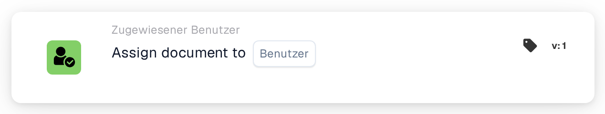
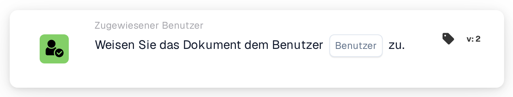
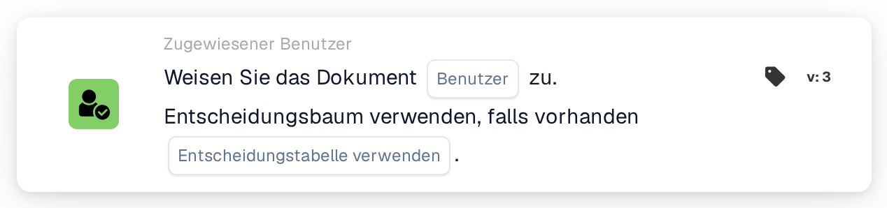

# Dokument dem Benutzer zuweisen

<figure><figcaption>
Version 1
</figcaption></figure>

<figure><figcaption>
Version 2
</figcaption></figure>

<figure><figcaption>
Version 3
</figcaption></figure>

## **Zweck:**

Die Workflow-Karte **"Assign Document to User"** ermöglicht es Benutzern, ein Dokument einem bestimmten Benutzer zuzuweisen, und sorgt so für ein reibungsloses Workflow-Management, indem Dokumente an die passende Person weitergeleitet werden. Version 3 fügt die Möglichkeit hinzu, einen Entscheidungsbaum zu verwenden, um die Benutzerzuweisung dynamisch auf Basis verfügbarer Bedingungen zu bestimmen.

## **Bestandteile der Karte:**

1. **Benutzer**
   * **Beschreibung:** Gibt den Benutzer an, dem das Dokument zugewiesen wird.
   * **Detail:** Zur Auswahl wird eine Dropdown-Liste aller verfügbaren Benutzer bereitgestellt. Dem ausgewählten Benutzer wird das Dokument zur weiteren Bearbeitung zugewiesen.

## **Zusätzliche Komponenten in Version 3:**

1. **Entscheidungsbaum verwenden**
   * **Beschreibung:** Ist diese Option aktiviert, verwendet die Karte einen Entscheidungsbaum, um die Benutzerzuweisung dynamisch zu bestimmen.
   * **Optionen:**
     * **True:** Verwendet den Entscheidungsbaum für die dynamische Benutzerzuweisung.
     * **False:** Weist das Dokument dem ausgewählten Benutzer ohne Verwendung des Entscheidungsbaums zu.

## **Funktionalität:**

* **Bedingungsauswertung:**\
  Die Karte führt ihre Aktion nur aus, wenn sowohl der **„Wenn“**- als auch der **„Und“**-Abschnitt als erfüllt ausgewertet werden.
* **Dokumentzuweisung:**\
  Die Karte weist das Dokument dem ausgewählten Benutzer zu und stellt so sicher, dass die Aufgabe an die passende Person zur Bearbeitung weitergeleitet wird. Dies unterstützt die Nachvollziehbarkeit und ein effektives Dokumentenmanagement.
* **Entscheidungsbaum (Version 3):**\
  Ist der Entscheidungsbaum aktiviert, wertet die Karte die innerhalb des Baums definierten Bedingungen aus, um den Benutzer für die Dokumentzuweisung dynamisch auszuwählen.

## **Einrichtung und Konfiguration:**

* **Benutzer auswählen:**\
  Wählen Sie aus der Dropdown-Liste den **Benutzer**, dem das Dokument zugewiesen wird.
* **Entscheidungsbaum verwenden (Version 3):**\
  Aktivieren oder deaktivieren Sie die Verwendung des Entscheidungsbaums zur dynamischen Auswahl des Benutzers.

## **Fazit:**

Die Workflow-Karte **"Assign Document to User"** ermöglicht eine effiziente Weiterleitung von Dokumenten, indem sie sie dem ausgewählten Benutzer zuweist, mit der zusätzlichen Flexibilität in Version 3, den Benutzer mithilfe eines Entscheidungsbaums dynamisch zu bestimmen. Dies sorgt für einen anpassungsfähigeren und effizienteren Workflow-Prozess.

<!-- workflow-card-practical-example-20261021 -->

## Praxisbeispiel

**Verwendungszweck:** Senden Sie Rechnungen, die eine manuelle Prüfung erfordern, an eine verantwortliche Person.

**Konfiguration:** Wählen Sie den konfigurierten Benutzer `Demo Reviewer A`.

**Erwartetes Ergebnis und Gegenbeispiel:** Das Dokument ist diesem Benutzer zugewiesen. Bestätigen Sie die resultierende Dokumentenzuordnung; Diese Karte allein erstellt keine separate Überprüfungsaufgabe.

Dies ist eine beispielhafte Konfiguration und ein erwartetes Ergebnis. Verwenden Sie in Ihrer Testorganisation konfigurierte Felder, Benutzer und Gruppen. Es wird nicht behauptet, dass dieses Beispiel ausgeführt wurde.
