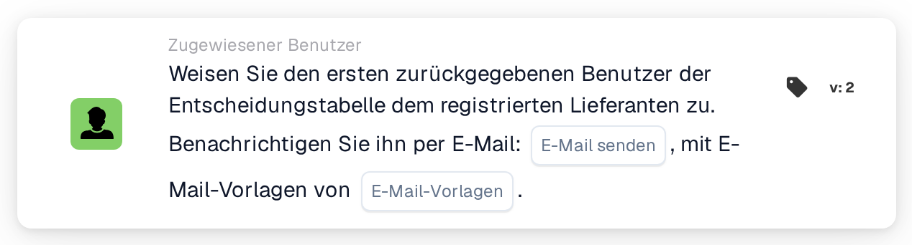

# Ersten Benutzer der Entscheidungstabelle dem Lieferanten zuweisen

<figure><figcaption>
Version 2
</figcaption></figure>

## Zweck:

Diese Workflow-Karte legt den zugewiesenen Benutzer eines registrierten Lieferanten auf Basis einer Entscheidungstabelle fest. Der erste von der Entscheidungstabelle zurückgegebene Benutzer wird zum zugewiesenen Benutzer des Lieferanten, also zum internen Ansprechpartner, der für den Lieferanten zuständig ist. Die zurückgegebenen Benutzer können außerdem per E-Mail informiert werden.

Wie **Assign User to Supplier** arbeitet die Karte nicht mit einem Dokument: Sie ist für Workflows gedacht, die durch eine Statusänderung eines Lieferanten gestartet werden, zum Beispiel mit der When-Karte **Supplier status changed**. Der Benutzer wird nicht auf der Karte ausgewählt, sondern durch eine Entscheidungstabelle bestimmt, die zuvor im selben Workflow ausgewertet wird, zum Beispiel mit der Karte **Decision Table has Returns**.

## Bestandteile der Karte:

1. **E-Mail senden**
   * **Beschreibung:** Die E-Mail-Einstellung der Karte.
   * **Optionen:** **True** oder **False**.
   * **Detail:** Mit **True** werden die E-Mails mit den ausgewählten E-Mail-Vorlagen gesendet. Mit **False** wird keine E-Mail gesendet. Ist **E-Mail senden** nicht festgelegt, wird ebenfalls keine E-Mail gesendet.
2. **E-Mail-Vorlagen**
   * **Beschreibung:** Die für die E-Mail verwendeten E-Mail-Vorlagen.
   * **Detail:** Es können eine oder mehrere E-Mail-Vorlagen der Organisation ausgewählt werden. Die Vorlagen werden verwendet, wenn **E-Mail senden** auf **True** steht.

## Funktionalität:

* **Lesen der Entscheidungstabelle:** Die Karte liest die Benutzer, die die Entscheidungstabelle zuvor im Workflow zurückgegeben hat. Berücksichtigt werden nur zurückgegebene Benutzer, keine Gruppen.
* **E-Mail-Benachrichtigung:** Werden E-Mails gesendet, gehen sie an alle von der Entscheidungstabelle zurückgegebenen Benutzer, nicht nur an den ersten. Die E-Mails werden gesendet, bevor der Benutzer dem Lieferanten zugewiesen wird.
* **Ausführung der Aktion:** Der erste zurückgegebene Benutzer wird als zugewiesener Benutzer des Lieferanten gespeichert, dessen Status sich geändert hat. Hat der Lieferant bereits einen zugewiesenen Benutzer, wird dieser ersetzt. Das Ergebnis wird im Workflow-Protokoll festgehalten.
* **Fehlende Daten:**
  * Hat die Entscheidungstabelle keinen Benutzer zurückgegeben, wird nichts zugewiesen und die Karte meldet die fehlenden Daten im Workflow-Protokoll.
  * Steht **E-Mail senden** auf **True**, ist aber keine E-Mail-Vorlage ausgewählt, stoppt die Karte, ohne den Benutzer zuzuweisen, und meldet die fehlenden Daten.
  * Ist **E-Mail senden** nicht festgelegt, vermerkt das Workflow-Protokoll die fehlende Einstellung und der Benutzer wird ohne E-Mail zugewiesen.
* **Fehler:** Lehnt der E-Mail- oder Lieferantendienst die Anfrage ab oder antwortet er nicht rechtzeitig, endet die Karte mit einem Fehler. Schlägt das Senden der E-Mails fehl, wird der Benutzer dem Lieferanten nicht zugewiesen.

## Einrichtung und Konfiguration:

* Die Karte kann in einem Workflow verwendet werden, der durch eine Statusänderung eines Lieferanten gestartet wird. Eine Entscheidungstabelle, die Benutzer zurückgibt, sollte zuvor im selben Workflow ausgewertet werden.
* Die Karte kann aus der Kategorie **Zugewiesener Benutzer** hinzugefügt werden. Danach kann **E-Mail senden** festgelegt und eine oder mehrere E-Mail-Vorlagen können ausgewählt werden.

## Fazit:

Die Workflow-Karte „Assign First Decision Table User to Supplier“ weist einem Lieferanten einen zuständigen Ansprechpartner nach Regeln zu, die in einer Entscheidungstabelle gepflegt werden. Die optionale E-Mail informiert die zurückgegebenen Benutzer sofort über den Lieferanten.
