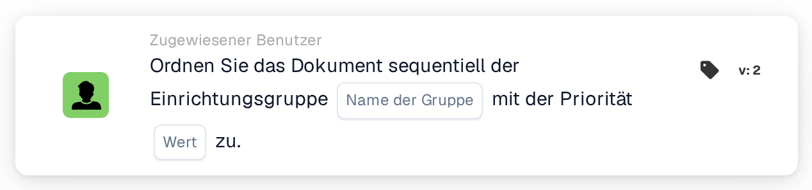

# Der Einrichtungsgruppe sequenziell zuweisen

<figure><figcaption>
Version 2
</figcaption></figure>

## Zweck:

Diese Workflow-Karte fügt die Gruppe, die für die Einrichtung der Bestellung des Dokuments zuständig ist, der sequenziellen Zuweisung des Dokuments hinzu. Wie **Assign Document to Facility Group** findet sie die Gruppe über den Einrichtungscode der zugeordneten Bestellungen. Statt das Dokument sofort zuzuweisen, fügt sie die Gruppe mit einer Priorität in die Reihenfolge der Genehmiger ein, sodass mehrere sequenzielle Karten in einem Workflow eine Kette von Zuweisungen bilden können.

## Bestandteile der Karte:

1. **Name der Gruppe**
   * **Beschreibung:** Der Namensteil, den die Einrichtungsgruppen gemeinsam haben.
   * **Detail:** Ein Text, der mit den Namen der Benutzergruppen der Organisation verglichen wird. Eine Gruppe passt, wenn ihr Name diesen Text und den Einrichtungscode der Bestellung enthält. Beim Vergleich wird Groß- und Kleinschreibung nicht beachtet. Mit dem Gruppennamen **Approver** und einer Bestellung für die Einrichtung **1000** würde zum Beispiel eine Gruppe namens **Approver 1000** passen.
2. **Wert**
   * **Beschreibung:** Die Priorität der Gruppe innerhalb der sequenziellen Zuweisung.
   * **Detail:** Eine ganze Zahl. Niedrigere Zahlen kommen zuerst, wobei 0 die höchste Priorität ist. Wird kein Wert oder ein negativer Wert eingegeben, wird die Priorität 1 verwendet.

## Funktionalität:

* **Ermitteln der Einrichtung:** Die Karte liest die Bestellungen, denen das Dokument zugeordnet ist, und sammelt den Einrichtungscode (den Standort der Bestellung) jeder dieser Bestellungen.
* **Ermitteln der Gruppe:** Für jeden Einrichtungscode sucht die Karte nach Benutzergruppen, deren Name sowohl den **Name der Gruppe** von der Karte als auch den Einrichtungscode enthält. Einrichtungscodes, für die keine Gruppe gefunden wird, werden im Workflow-Protokoll aufgeführt.
* **Ausführung der Aktion:** Jede passende Gruppe wird mit der Priorität aus dem Feld **Wert** der sequenziellen Zuweisung hinzugefügt. Die Zuweisung selbst erfolgt am Ende des Workflow-Laufs: Der Eintrag mit der niedrigsten Prioritätszahl wird zuerst zugewiesen, und alle Einträge, einschließlich des ersten, werden am Dokument als dessen Genehmigungsanfragen gespeichert. Die folgenden Schritte der Reihenfolge werden in aufsteigender Priorität daraus entnommen. Hat eine andere Karte das Dokument im selben Lauf bereits direkt zugewiesen, wird diese erste sequenzielle Zuweisung übersprungen.
* **Fehlende Daten:**
  * Ist auf der Karte kein Gruppenname eingegeben, wird die Karte nicht ausgeführt und meldet die fehlenden Daten im Workflow-Protokoll.
  * Ist das Dokument keiner Bestellung zugeordnet, meldet die Karte die fehlenden Daten, statt eine Gruppe hinzuzufügen.
  * Passt keine Gruppe zu einem der Einrichtungscodes, wird keine Gruppe hinzugefügt und das Workflow-Protokoll vermerkt, dass keine passende Gruppe gefunden wurde.

## Einrichtung und Konfiguration:

* Die Benutzergruppen sollten so benannt sein, dass jeder Name den gemeinsamen Namensteil und den Einrichtungscode enthält, zum Beispiel **Approver 1000**, **Approver 2000**.
* Die Karte kann aus der Kategorie **Zugewiesener Benutzer** hinzugefügt werden. Danach werden der gemeinsame Namensteil der Gruppen in das Feld **Name der Gruppe** und die Priorität in das Feld **Wert** eingegeben.
* Für eine Kette von Genehmigern können mehrere sequenzielle Karten im Workflow kombiniert werden, jede mit eigener Priorität, zum Beispiel die Einrichtungsgruppe mit Priorität 1 und eine zentrale Gruppe mit Priorität 2.

## Fazit:

Die Workflow-Karte „Assign Sequentially to Facility Group“ setzt das zuständige Einrichtungsteam an eine festgelegte Position in einer sequenziellen Genehmigung. Zusammen mit anderen sequenziellen Karten ermöglicht sie Genehmigungsketten, in denen das Einrichtungsteam einer von mehreren Schritten ist.
