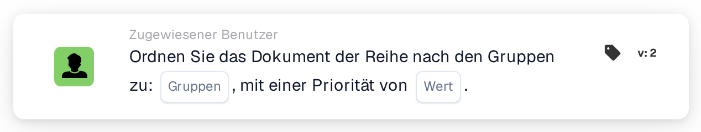

# Nacheinander Gruppen zuweisen

<figure><figcaption>
Version 2
</figcaption></figure>

## **Zweck**

Die Workflow-Karte "**Ordnen Sie das Dokument der Reihe nach den Gruppen zu**" ermöglicht die sequenzielle Zuweisung von Dokumenten an eine oder mehrere ausgewählte Gruppen. Der Prioritätswert bestimmt die Reihenfolge der Zuweisung, wobei niedrigere Zahlen eine höhere Priorität darstellen.

## **Bestandteile der Karte**

1. **Gruppe**
   * **Beschreibung**: Gibt die Gruppen an, die die Dokumentzuweisung erhalten.
   * **Detailliert**: Ein Dropdown-Menü, in dem eine oder mehrere Gruppen für die Dokumentzuweisung ausgewählt werden können.
2. **Priorität (Wert)**
   * **Beschreibung**: Ein numerisches Eingabefeld, in dem die Prioritätsstufe für die Gruppen festgelegt werden kann.
   * **Detailliert**: Niedrigere Zahlen bedeuten eine höhere Priorität und stellen sicher, dass Dokumente den Gruppen in aufsteigender Reihenfolge der Priorität zugewiesen werden.

## **Funktionalität**

* **Dokumentzuweisung**:\
  Die Karte weist Dokumente sequenziell den ausgewählten Gruppen auf Basis ihrer Prioritätswerte zu.\
  Teilen sich mehrere Gruppen dieselbe Priorität, werden die Dokumente in der Reihenfolge zugewiesen, in der die Gruppen ausgewählt wurden.

## **Einrichtung und Konfiguration**

1. Fügen Sie die Karte **Ordnen Sie das Dokument der Reihe nach zu** zu Ihrem Workflow hinzu.
2. Konfigurieren Sie das Feld **Gruppe**:
   * Wählen Sie eine oder mehrere Gruppen aus dem Dropdown-Menü.
3. Konfigurieren Sie das Feld **Priorität (Wert)**:
   * Geben Sie einen numerischen Wert ein, um die Zuweisungspriorität festzulegen.
4. Speichern und aktivieren Sie den Workflow, um die Konfiguration anzuwenden.

## **Fazit**

Die Workflow-Karte "Assign the Document Sequentially to Groups" sorgt für eine effiziente Dokumentzuweisung an eine oder mehrere Gruppen auf Basis der Priorität. Diese Funktion unterstützt eine flexible und organisierte Dokumentverarbeitung über mehrere Teams oder Abteilungen hinweg.

<!-- workflow-card-practical-example-20261021 -->

## Praxisbeispiel

**Verwendungszweck:** Priorisieren Sie die Dokumentzuweisung an Prüfteams.

**Konfiguration:** Wählen Sie die konfigurierten Demogruppen aus und stellen Sie die gewünschte Priorität ein, zum Beispiel `10`.

**Erwartetes Ergebnis und Gegenbeispiel:** Das Dokument erhält die ausgewählten Gruppenzuweisungen mit dieser Priorität. Testen Sie eine zweite Priorität separat, wenn die Gruppen unterschiedliche Stufen belegen müssen.

Dies ist eine beispielhafte Konfiguration und ein erwartetes Ergebnis. Verwenden Sie in Ihrer Testorganisation konfigurierte Felder, Benutzer und Gruppen. Es wird nicht behauptet, dass dieses Beispiel ausgeführt wurde.
