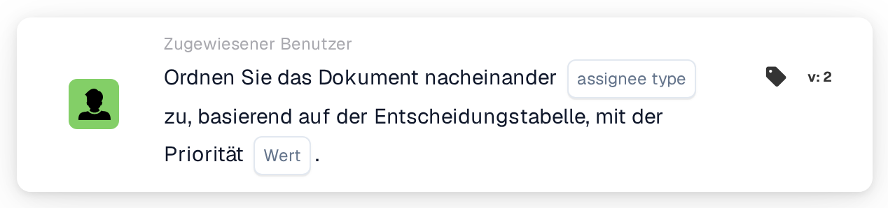
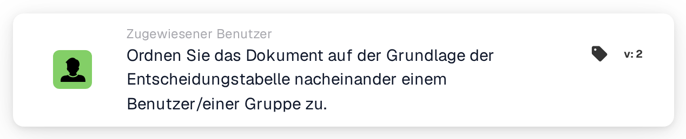

# Nacheinander Benutzer/Gruppe zuweisen

<figure><figcaption>
Version 2
</figcaption></figure>

<figure><figcaption>
Ordnen Sie das Dokument auf der Grundlage der Entscheidungstabelle nacheinander einem Benutzer/einer Gruppe zu. — Version 2
</figcaption></figure>

## **Zweck**

Die Workflow-Karte "**Ordnen Sie das Dokument basierend auf der Entscheidungstabelle der Reihe nach einem Benutzer/einer Gruppe zu**" weist Dokumente dynamisch entweder einem Benutzer oder einer Gruppe zu, abhängig von der Auswertung der Entscheidungstabelle. Dadurch wird sichergestellt, dass Dokumente auf Basis vordefinierter Regeln angemessen weitergeleitet werden.

## **Bestandteile der Karte**

1. **Priorität (Wert)**
   * **Beschreibung**: Gibt die Prioritätsstufe für Zuweisungen an, wobei niedrigere Zahlen eine höhere Priorität darstellen.
   * **Detailliert**: Ein numerisches Eingabefeld, in dem der Prioritätswert festgelegt werden kann, um die Reihenfolge der Zuweisung zu steuern.

## **Funktionalität**

* **Auswertung der Entscheidungstabelle**:\
  Die Entscheidungstabelle wertet vordefinierte Bedingungen aus, um zu entscheiden, ob das Dokument einem Benutzer oder einer Gruppe zugewiesen wird.
* **Dokumentzuweisung**:
  * Gibt die Entscheidungstabelle einen Benutzer zurück, wird das Dokument direkt diesem Benutzer zugewiesen.
  * Gibt die Entscheidungstabelle eine Gruppe zurück, wird das Dokument der Gruppe sequenziell zugewiesen, wobei der angegebene Prioritätswert berücksichtigt wird.

## **Einrichtung und Konfiguration**

1. Fügen Sie die Karte **Ordnen Sie das Dokument der Reihe nach zu** zu Ihrem Workflow hinzu.
2. Konfigurieren Sie das Feld **Priorität (Wert)**:
   * Geben Sie einen numerischen Wert ein, um die Zuweisungspriorität festzulegen.
3. Speichern und aktivieren Sie den Workflow, um die Konfiguration anzuwenden.

## **Fazit**

Die Workflow-Karte "**Ordnen Sie das Dokument basierend auf der Entscheidungstabelle der Reihe nach einem Benutzer/einer Gruppe zu**" sorgt für eine effiziente und dynamische Weiterleitung von Dokumenten. Durch die Nutzung der Logik der Entscheidungstabelle und der Prioritätswerte ermöglicht die Karte eine präzise Zuweisung an entweder einen Benutzer oder eine Gruppe und optimiert so Dokument-Workflows.

<!-- workflow-card-practical-example-20261021 -->

## Praxisbeispiel

**Verwendungszweck:** Verwenden Sie eine Entscheidungstabelle, um einen priorisierten Dokumentzuständigen auszuwählen.

**Konfiguration:** Konfigurieren Sie eine passende Demo-Entscheidungstabellenregel, die den gewünschten Benutzer oder die gewünschte Gruppe zurückgibt, und wählen Sie dann diese Tabelle auf der Karte aus.

**Erwartetes Ergebnis und Gegenbeispiel:** Der zurückgegebene Beauftragte wird für die sequentielle Dokumentenzuweisung verwendet. Wenn keine passende Rückgabe vorliegt, gehen Sie nicht von einem Standardempfänger aus; Überprüfen Sie das Ergebnis und das konfigurierte Fallback-Verhalten dieser Version.

Dies ist eine beispielhafte Konfiguration und ein erwartetes Ergebnis. Verwenden Sie in Ihrer Testorganisation konfigurierte Felder, Benutzer und Gruppen. Es wird nicht behauptet, dass dieses Beispiel ausgeführt wurde.
