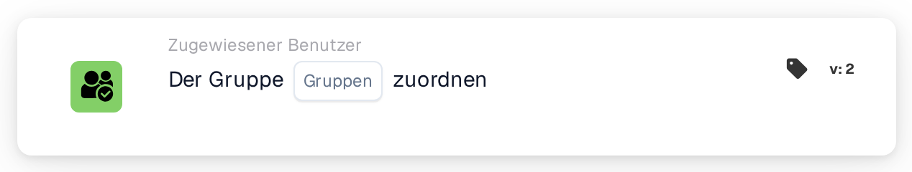
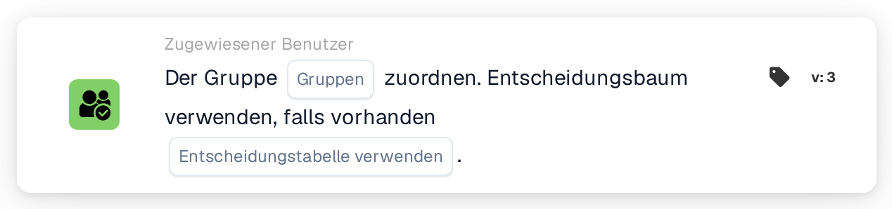

# Einer Gruppe zuweisen

<figure><figcaption>
Version 2
</figcaption></figure>

<figure><figcaption>
Version 3
</figcaption></figure>

## Zweck:

Die Workflow-Karte **"Assign to Group"** ermöglicht die Zuweisung von Dokumenten an eine bestimmte **Gruppe** innerhalb des Systems. Dadurch wird sichergestellt, dass das Dokument vom passenden Team verarbeitet wird, und der Workflow wird optimiert. In späteren Versionen erweitert, führt sie eine Entscheidungsbaum-Funktionalität für die dynamische Gruppenzuweisung ein.

## Bestandteile der Karte:

1. **Gruppen**
   * **Beschreibung:** Gibt die **Gruppe** an, der das Dokument zugewiesen wird.
   * **Detail:** Wird aus einer Dropdown-Liste der verfügbaren **Gruppen** ausgewählt.

## **Zusätzliche Komponenten in Version 3**

1. **Entscheidungsbaum (nur Version 3)**
   * **Beschreibung:** Ermöglicht die Verwendung eines Entscheidungsbaums, um die **Gruppe** dynamisch zu bestimmen, der das Dokument zugewiesen werden soll.
   * **Optionen:**
     * **True:** Aktiviert die Verarbeitung über den Entscheidungsbaum.
     * **False:** Deaktiviert die Verarbeitung über den Entscheidungsbaum.

## Funktionalität:

* **Bedingungsauswertung:** Die Karte führt ihre Aktion nur aus, wenn sowohl der **„Wenn“**- als auch der **„Und“**-Abschnitt als erfüllt ausgewertet werden.
* **Dokumentzuweisung:** Weist das Dokument der ausgewählten **Gruppe** zu. In **Version 3** bestimmt der **Entscheidungsbaum** die Zielgruppe dynamisch, sofern aktiviert.

## Einrichtung und Konfiguration:

* **Gruppe auswählen:** Wählen Sie die **Gruppe** aus der Dropdown-Liste, um das Dokument zuzuweisen.
* **Entscheidungsbaum verwenden (nur Version 3):** Aktivieren Sie diese Option, wenn der **Entscheidungsbaum** für die dynamische Zuweisung verwendet werden soll.

## Fazit:

Die Workflow-Karte **"Assign to Group"** automatisiert die Dokumentzuweisung an vordefinierte **Gruppen** und verbessert so die Teamkoordination. **Version 3** führt die Möglichkeit ein, Gruppen dynamisch auf Basis der Logik eines Entscheidungsbaums zuzuweisen.

<!-- workflow-card-practical-example-20261021 -->

## Praxisbeispiel

**Verwendungszweck:** Stellen Sie ein Dokument in eine gemeinsame Überprüfungswarteschlange.

**Konfiguration:** Wählen Sie die konfigurierte Gruppe `Demo Finance`.

**Erwartetes Ergebnis und Gegenbeispiel:** Das Dokument wird der ausgewählten Gruppe zugeordnet. Hierbei handelt es sich um eine Dokumentenzuweisung, nicht um ein Versprechen, dass eine zusätzliche Aufgabe oder E-Mail erstellt wird.

Dies ist eine beispielhafte Konfiguration und ein erwartetes Ergebnis. Verwenden Sie in Ihrer Testorganisation konfigurierte Felder, Benutzer und Gruppen. Es wird nicht behauptet, dass dieses Beispiel ausgeführt wurde.
