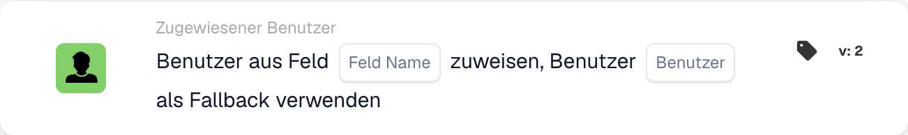

# Benutzer aus Feld zuweisen

<figure><figcaption>
Kartenfelder in der angezeigten Version. Die Platzhalter sind noch nicht ausgefüllt.
</figcaption></figure>

## **Zweck:**

Die Workflow-Karte **„Benutzer aus Feld mit Fallback zuweisen“** weist dynamisch einen Benutzer auf Basis des in einem angegebenen Dokumentfeld gefundenen Werts zu. Enthält das Feld keinen gültigen Benutzer, wird ein Ersatzbenutzer aus einer vordefinierten Liste verfügbarer Benutzer ausgewählt, um sicherzustellen, dass die Aufgabe oder Aktion ordnungsgemäß zugewiesen wird.

## **Bestandteile der Karte:**

1. **Feldname**
   * **Beschreibung:** Gibt das **Dokumentfeld** an, das die zuzuweisenden Benutzerinformationen enthält.
   * **Detail:** Dieses Feld wird ausgewertet, um zu bestimmen, welcher Benutzer zugewiesen werden soll. Enthält das Feld einen gültigen Benutzer, wird diesem Benutzer die Aufgabe zugewiesen. Ist das Feld leer oder ungültig, wird der Ersatzbenutzer zugewiesen.
2. **Benutzer (Ersatz)**
   * **Beschreibung:** Gibt den **Ersatzbenutzer** an, der zugewiesen wird, wenn das Dokumentfeld keinen gültigen Benutzer enthält.
   * **Detail:** Zur Auswahl wird eine Dropdown-Liste aller verfügbaren Benutzer bereitgestellt. Dieser Benutzer wird zugewiesen, wenn das Dokumentfeld leer ist oder keinen gültigen Benutzer enthält.

## **Funktionalität:**

* **Bedingungsauswertung:**\
  Die Karte führt ihre Aktion nur aus, wenn sowohl der **„Wenn“**- als auch der **„Und“**-Abschnitt als erfüllt ausgewertet werden.
* **Feldbasierte Benutzerzuweisung:**\
  Die Karte versucht zunächst, die Aufgabe oder Aktion dem im **Feldnamen** identifizierten Benutzer zuzuweisen.
* **Ersatzbenutzer-Zuweisung:**\
  Enthält das Feld keinen gültigen Benutzer (oder ist es leer), weist die Karte die Aufgabe dem aus der Dropdown-Liste **Benutzer (Ersatz)** ausgewählten Ersatzbenutzer zu.

## **Einrichtung und Konfiguration:**

* **Feldnamen auswählen:**\
  Wählen Sie das **Dokumentfeld**, das den Benutzer für die Zuweisung angibt.
* **Ersatzbenutzer auswählen:**\
  Wählen Sie den **Ersatzbenutzer** aus der Dropdown-Liste. Diesem Benutzer wird die Aufgabe zugewiesen, wenn das Dokumentfeld keinen gültigen Benutzer enthält.

## **Fazit:**

Die Workflow-Karte **„Benutzer aus Feld mit Fallback zuweisen“** stellt sicher, dass eine Aufgabe oder Aktion immer einem gültigen Benutzer zugewiesen wird. Ist der Benutzer im Dokumentfeld nicht verfügbar, wird automatisch der Ersatzbenutzer zugewiesen, was Flexibilität bietet und den Abschluss der Aufgabe gewährleistet.

<!-- workflow-card-practical-example-20261021 -->

## Praxisbeispiel

**Verwendungszweck:** Weisen Sie den Prüfer anhand der Dokumentdaten zu.

**Konfiguration:** Wählen Sie Feld `reviewer_name` und Fallback-Benutzer `Demo Reviewer A`. Geben Sie im ersten Test einen auflösbaren Demo-Benutzernamen an.

**Erwartetes Ergebnis und Gegenbeispiel:** Ein gültiger Feldwert wählt diesen Benutzer aus. Ein leerer oder nicht auflösbarer Wert verwendet den konfigurierten Fallback; Überprüfen Sie beide Fälle.

Dies ist eine beispielhafte Konfiguration und ein erwartetes Ergebnis. Verwenden Sie in Ihrer Testorganisation konfigurierte Felder, Benutzer und Gruppen. Es wird nicht behauptet, dass dieses Beispiel ausgeführt wurde.
