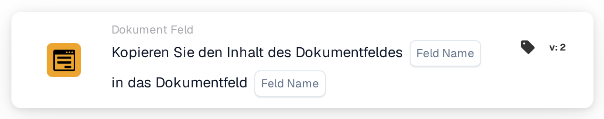

# Dokumentfeld in Dokumentfeld kopieren

<figure><figcaption>
Version 2
</figcaption></figure>

## Zweck:

Diese Workflow-Karte kopiert den Inhalt eines Dokumentfelds in ein anderes Dokumentfeld desselben Dokuments. Sie kann zum Beispiel verwendet werden, um ein Feld, das für einen Export oder eine spätere Karte benötigt wird, mit einem Wert zu füllen, der bereits in ein anderes Feld extrahiert wurde.

## Bestandteile der Karte:

1. **Feld Name** (erstes)
   * **Beschreibung:** Das Dokumentfeld, dessen Inhalt kopiert wird.
   * **Detail:** Der Name eines Dokumentfelds. Der Name wird exakt verglichen, einschließlich Groß- und Kleinschreibung. Das Feld selbst wird nicht verändert.
2. **Feld Name** (zweites)
   * **Beschreibung:** Das Dokumentfeld, in das der Inhalt kopiert wird.
   * **Detail:** Der Name eines Dokumentfelds. Sein aktueller Inhalt wird durch den kopierten Inhalt ersetzt.

## Funktionalität:

* **Lesen des Werts:** Die Karte sucht das erste Feld unter den Feldern des Dokuments und liest seinen Wert. Der gefundene Wert wird im Workflow-Protokoll vermerkt.
* **Ausführung der Aktion:** Der Wert wird in das zweite Feld geschrieben und das Dokument wird gespeichert. Der kopierte Wert wird unverändert übernommen, ohne Umwandlung. Existiert das zweite Feld noch nicht am Dokument, wird es hinzugefügt. Nach einem erfolgreichen Kopieren arbeiten spätere Karten im Workflow mit dem neuen Wert.
* **Fehlende Daten:**
  * Ist einer der beiden Feldnamen auf der Karte nicht festgelegt, wird die Karte nicht ausgeführt und meldet die fehlenden Daten im Workflow-Protokoll.
  * Hat das Dokument kein Feld mit dem ersten Namen, wird nichts kopiert und die Karte meldet, dass das Feld im Dokument nicht gefunden wurde.
* **Fehler:** Kann das Dokument nicht gespeichert werden, zum Beispiel weil sein aktueller Status keine Änderungen zulässt, endet die Karte mit einem Fehler und das zweite Feld behält seinen bisherigen Inhalt.

## Einrichtung und Konfiguration:

* Die Karte kann aus der Kategorie **Dokument Feld** hinzugefügt werden. Danach wird das Feld, aus dem kopiert wird, im ersten Platzhalter **Feld Name** festgelegt und das Feld, in das kopiert wird, im zweiten.
* Da der Wert ohne Umwandlung kopiert wird, sollten die beiden Felder dieselbe Art von Daten enthalten, zum Beispiel Text in Text oder ein Datum in ein Datum.

## Fazit:

Die Workflow-Karte „Copy Document Field into Document Field“ überträgt Werte zwischen Feldern ohne manuellen Aufwand. Sie hält zusammengehörige Felder konsistent und ermöglicht späteren Schritten eines Workflows, einen Wert unter dem Feldnamen zu verwenden, den sie erwarten.
