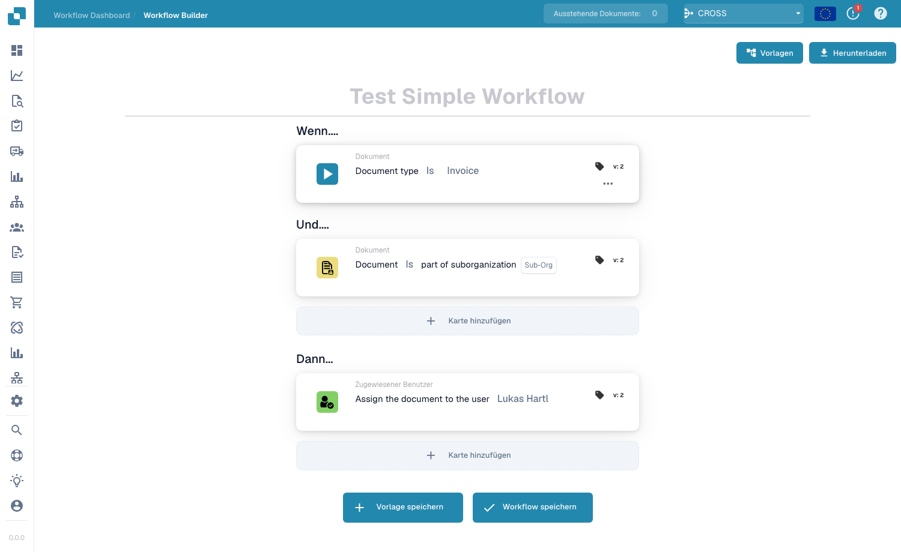

# Feld- und Tischmanipulationskarten

## Feld- und Tischmanipulationskarten – Vollständiger Leitfaden

**Umfasst:** 9 Karten zum Ändern von Dokumentfeldern und -tabellen

***

Die Feld- und Tabellenkarten auf dieser Seite gehören zur Gruppe **Then** des Workflow Builder – die Aktionen, die ausgeführt werden, sobald die Wenn/Und-Bedingungen übereinstimmen:

<figure><figcaption><p>Karten werden über <strong>Add Card</strong> zur <strong>Then</strong>-Gruppe hinzugefügt.</p></figcaption></figure>

***

### 📌 Versionsinformationen

**Mehrversionskarten:** CALC\_COLUMNS (v2), CALC\_COLUMNS\_REGEX (v2), EDIT\_COLUMN (v2), AI\_CALC\_MTZ\_ETZ (v2)

**Versionsmuster:** Alle Feldmanipulationskarten folgen dem Muster v1 → v2. **Schlüsseländerung:** v2 fügt Internationalisierungsunterstützung (i18n) mit Übersetzungsschlüsseln hinzu

📖 [Vollständiger Versionsverlauf](../../release.md) | [Kartenversionen und Verhalten](../../cards-overview/card-versions-guide.md)

***

## Manipulation von Dokumentfeldern

### Karte: ACTION\_SET\_FIELD\_TO\_TEXT / Feld auf Textwert setzen

#### Zweck

Füllt ein Dokumentfeld automatisch mit bestimmtem Text

#### Wann zu verwenden

* Feld aus Entscheidung füllen
* Legen Sie Standardwerte fest
* Geben Sie standardisierte Informationen ein
* Feld basierend auf Bedingungen aktualisieren

#### Wie es funktioniert

```
IF Condition is true
    THEN Set Field "Category" to Value "Premium"
```

#### Beispielszenarien

**Szenario 1: Genehmigungskategorie festlegen**

```
Condition: Invoice amount > €10,000
    ↓
Action: Set "Approval_Category" field to "High Value"
    ↓
Result: Document now shows "Approval_Category: High Value"
```

**Szenario 2: Lieferantenkategorie festlegen**

```
Condition: Supplier name contains "ABC"
    ↓
Action: Set "Supplier_Type" field to "Preferred Supplier"
    ↓
Result: Document marked as "Preferred Supplier"
```

**Szenario 3: Verarbeitungshinweise festlegen**

```
Condition: Document has been rejected
    ↓
Action: Set "Processing_Notes" to "Requires supplier revision"
    ↓
Result: Note appears for next processor
```

#### Parameter

**Feldname** Welches Feld aktualisiert werden soll

```
Examples: Category, Type, Status, Comment, Notes
```

**Textwert** Was in das Feld eingegeben werden soll

```
Examples: "Approved", "Pending Review", "High Priority"
```

#### Konfigurationsschritte

1. Wählen Sie das auszufüllende Feld aus
2. Geben Sie den Textwert ein
3. Bedingungen festlegen (wann auszufüllen)
4. Speichern

***

### Karte: ACTION\_SET\_BOOLEAN\_FIELD / Kontrollkästchenfeld festlegen

#### Zweck

Aktiviert oder deaktiviert automatisch ein Kontrollkästchenfeld

#### Wann zu verwenden

* Als bearbeitet markieren
* Genehmigungsflags setzen
* Optionen aktivieren/deaktivieren
* Für den Export markieren

#### Wie es funktioniert

```
IF Condition is true
    THEN Check/Uncheck the "Approved" box
```

#### True = Aktiviert, False = Deaktiviert

**Beispiele:**

**Beispiel 1: Als bestätigt markieren**

```
Condition: PO matches perfectly
    ↓
Action: Check "Verified" checkbox
    ↓
Result: ✅ Verified (checked)
```

**Beispiel 2: Flag für manuelle Überprüfung**

```
Condition: Price variance > 10%
    ↓
Action: Check "Requires_Manual_Review" checkbox
    ↓
Result: ✅ Requires_Manual_Review (marked)
```

**Beispiel 3: Vorab ausgefülltes Kästchen deaktivieren**

```
Condition: Supplier is blacklisted
    ↓
Action: Uncheck "Approved_for_Payment" checkbox
    ↓
Result: ☐ Approved_for_Payment (unchecked - blocked)
```

#### Parameter

```
Checkbox Field: [Choose field]
Set To: ☑ Checked (✅ True)
   or: ☐ Unchecked (❌ False)
```

***

### Karte: ACTION\_INVERT\_BOOLEAN\_FIELD / Kontrollkästchen umschalten

#### Zweck

Ändert den Status des Kontrollkästchens (aktiviert → deaktiviert, umgekehrt)

#### Wann zu verwenden

* Genehmigungsstatus umschalten
* Bearbeitungsmodus wechseln
* Vorherigen Zustand umkehren
* Boolesche Flags aktualisieren

#### Wie es funktioniert

```
Current state: ✅ (Checked)
    ↓
ACTION_INVERT: Toggle the box
    ↓
New state: ☐ (Unchecked)

OR

Current state: ☐ (Unchecked)
    ↓
ACTION_INVERT: Toggle the box
    ↓
New state: ✅ (Checked)
```

#### Beispiel

```
Invoice received with "Priority" checked
    ↓
After processing, invert "Priority" checkbox
    ↓
Checkbox now unchecked (no longer priority)
```

***

### Karte: ACTION\_COPY\_DOCFIELD\_TO\_DOCFIELD / Feldwert kopieren

#### Zweck

Kopiert den Wert von einem Feld in ein anderes Feld

#### Wann zu verwenden

* Lieferanteninformationen in Rechnungsinformationen kopieren
* Daten feldübergreifend duplizieren
* Datenformat standardisieren
* Wertsicherung erstellen

#### Wie es funktioniert

```
Source Field: "Invoice_Supplier"  Value: "ABC Corp"
    ↓
COPY TO
    ↓
Target Field: "Billing_Partner"  Value: "ABC Corp"

Both fields now have same value
```

#### Echte Beispiele

**Beispiel 1: Lieferadresse kopieren**

```
Source: "Delivery_Address" = "123 Main St, Berlin"
    ↓
Copy to: "Billing_Address"
    ↓
Result: Both fields show "123 Main St, Berlin"
```

**Beispiel 2: Lieferantencode kopieren**

```
Source: "Supplier_Code_External" = "SUPP-789"
    ↓
Copy to: "Supplier_Code_Internal"
    ↓
Result: Both codes match, system recognizes supplier
```

**Beispiel 3: Betrag zur Validierung kopieren**

```
Source: "Invoice_Total" = "€5000"
    ↓
Copy to: "Amount_to_Validate"
    ↓
Result: Validation field has correct amount
```

#### Parameter

```
Source Field: [Choose field to copy FROM]
Target Field: [Choose field to copy TO]
```

#### Notizen

* Originalfeld unverändert
* Zielfeld mit Quellwert überschrieben
* Gut zur Standardisierung von Daten

***

## Tabellenmanipulation

### Karte: EDIT\_COLUMN / Tabellenspalte bearbeiten

#### Zweck

Ändert Werte in einer Tabellenspalte basierend auf Bedingungen

#### Wann zu verwenden

* Beheben Sie Preisfehler in Werbebuchungen
* Mengen aktualisieren
* Korrekte Artikelbeschreibungen
* Werte standardisieren

#### Wie es funktioniert

```
Table Column: "Unit_Price"
Original Values: [100, 105, 103]
    ↓
FIND: Values matching condition
REPLACE: With new value
    ↓
Updated Column: [100, 110, 110] (example)
```

#### Beispiel: Festpreise

**Szenario: Preise in falscher Währung**

```
Table "Line_Items" with column "Price"

Current prices: [100, 100, 100] (in wrong currency)
    ↓
Condition: "If Price column equals 100"
    ↓
Action: Replace with 95 (corrected price)
    ↓
Result: [95, 95, 95] (prices corrected)
```

#### Parameter

```
Table: [Choose table]
Column: [Choose column to edit]
Find: [Value to find]
Replace with: [New value]
Condition: [When to apply]
```

#### Allgemeine Verwendungen

* Einheitspreise festlegen
* Beschreibungen standardisieren
* Richtige Mengen
* Aktualisieren Sie die Artikelnummern

***

### Karte: CALC\_COLUMNS / Spaltenwerte berechnen

#### Zweck

Führt eine Berechnung für Tabellenspalten durch und speichert das Ergebnis

#### Wann zu verwenden

* Zeilensummen berechnen (Menge × Stückpreis)
* Summenspalten
* Rabatte berechnen
* Berechnen Sie Prozentsätze

#### Wie es funktioniert

```
Column A (Quantity): 100
Column B (Unit Price): €50
    ↓
CALCULATE: A × B
    ↓
Column C (Line Total): €5000
```

#### Berechnungsarten

**Typ 1: Einfache Multiplikation**

```
Formula: Qty × Unit Price = Line Total

Example:
100 units × €50/unit = €5000

Config:
  Column 1: Quantity
  Operator: ×
  Column 2: Unit Price
  Result Column: Line Total
```

**Typ 2: Addition**

```
Formula: Base Price + Shipping + Tax = Total

Example:
€5000 + €100 + €950 = €6050

Config:
  Column 1: Base Price
  Operator: +
  Column 2: Shipping
  Operator: +
  Column 3: Tax
  Result Column: Total
```

**Typ 3: Prozentberechnung**

```
Formula: Amount × (1 + Tax%) = Total with Tax

Example:
€5000 × 1.19 = €5950

Config:
  Column: Amount
  Operator: × (1 + Tax%)
  Result Column: Amount_with_Tax
```

**Typ 4: Subtraktion**

```
Formula: Original Price - Discount = Final Price

Example:
€100 - €10 = €90

Config:
  Column 1: Original Price
  Operator: -
  Column 2: Discount
  Result Column: Final Price
```

#### Beispiel aus der Praxis

**Berechnung der Rechnungseinzelposten:**

```
Table: Invoice_Lines

Row 1:
  Quantity: 100
  Unit Price: €25.00
  Calculate: 100 × €25.00 = €2500.00 (Line Total)

Row 2:
  Quantity: 50
  Unit Price: €40.00
  Calculate: 50 × €40.00 = €2000.00 (Line Total)

Row 3:
  Quantity: 200
  Unit Price: €10.00
  Calculate: 200 × €10.00 = €2000.00 (Line Total)

Subtotal: €6500.00 (sum of line totals)
Tax (19%): €1235.00
Shipping: €100.00
TOTAL: €7835.00
```

#### Parameter

```
Table: [Select table]
Column 1: [First column]
Operator: [×, +, -, ÷, %]
Column 2: [Second column] (if needed)
Result Column: [Where to put answer]
```

***

### Karte: CALC\_COLUMNS\_REGEX / Berechnen mit Regex-Muster

#### Zweck

Berechnet Spaltenwerte basierend auf Mustervergleichen

#### Wann zu verwenden

* Extrahieren Sie mithilfe von Mustern Werte aus Text
* Formatieren Sie Daten basierend auf Regeln
* Konvertieren Sie Werte basierend auf Mustern
* Analysieren Sie strukturierten Text

#### Wie es funktioniert

**Regex-Mustervergleich:**

```
Original Value: "ABC-12345-XYZ"
Pattern: Extract numbers only
Calculation: Convert to "12345"
Result: "12345"
```

#### Beispiel: Lieferantencode extrahieren

**Szenario: Artikelnummern enthalten Lieferanteninformationen**

```
Table Column: "Article_Code"
Values: ["SUPP001-2025-A", "SUPP002-2025-B"]

Pattern: Extract supplier code (first 7 characters)
    ↓
Calculate: SUPP001, SUPP002
    ↓
Store in: "Supplier_Code" column

Result:
Article_Code: SUPP001-2025-A  →  Supplier_Code: SUPP001
Article_Code: SUPP002-2025-B  →  Supplier_Code: SUPP002
```

#### Beispiel: Telefonnummern formatieren

**Szenario: Unformatierte Telefonnummern**

```
Original: "491234567890"
Pattern: Format as: +49 123 4567 890
Result: "+49 123 4567 890"
```

#### Beispiel: Preise aus Text extrahieren

**Szenario: Preise im Textformat**

```
Original: "Price is 99.99 EUR"
Pattern: Extract number only
Result: "99.99"
```

#### Parameter

```
Table: [Select table]
Column: [Column to analyze]
Regex Pattern: [Pattern to find]
Replacement: [What to replace with]
Result Column: [Where to store result]
```

#### Gängige Regex-Muster

```
Numbers only: [0-9]+
Letters only: [a-zA-Z]+
First word: ^\w+
Extract €: €(\d+\.\d{2})
Date format: \d{4}-\d{2}-\d{2}
```

***

## Berechnungsbeispiele

### Beispiel 1: Rechnungsgesamtberechnung

```
Step 1: Calculate line totals
  Each row: Qty × Unit Price

Step 2: Sum all line totals
  Sum: €2500 + €2000 + €2000 = €6500

Step 3: Calculate tax
  Tax: €6500 × 0.19 = €1235

Step 4: Add shipping
  Final: €6500 + €1235 + €100 = €7835
```

### Beispiel 2: Varianzberechnung

```
PO Price: €100
Invoice Price: €103

Variance = |(Invoice - PO)| / PO × 100
Variance = |3| / 100 × 100 = 3%

Store in "Price_Variance%" column
```

### Beispiel 3: Rabattantrag

```
Original Price: €100
Discount %: 10%
Discount Amount: €100 × 0.10 = €10
Final Price: €100 - €10 = €90
```

***

## Beispiel für einen Feldmanipulations-Workflow

```
Document arrives
    ↓
Check condition: "Amount > €5000?"
    ↓
YES → Set field "Category" = "High Value"
    ↓
Check condition: "Supplier is preferred?"
    ↓
YES → Check "FastTrack" checkbox
    ↓
Copy "Delivery_Address" to "Invoice_Address"
    ↓
In table: Calculate line totals (Qty × Price)
    ↓
In table: Calculate total with tax
    ↓
Document now has all calculated and populated fields
```

***

## Best Practices

✅ **Do:**

* Halten Sie Formeln einfach
* Testrechnungen mit Beispieldaten
* Überprüfen Sie, ob die Ergebnisse sinnvoll sind
* Dokumentieren Sie, warum Sie Felder ändern
* Verwenden Sie das Kopierfeld, wenn die Daten identisch sind

❌ **Nicht:**

* Zirkelverweise erstellen (A=B, B=A)
* Überschreiben Sie wichtige Daten ohne Angabe von Gründen
* Erstellen Sie übermäßig komplexe Regex-Muster
* Vergessen Sie, die Berechnungsergebnisse zu überprüfen
* Berechnen Sie anhand falscher Tabellen/Spalten

***

## Fehlerbehebung

### „Feld wird nicht aktualisiert“

**Ursache:** Bedingung nicht erfüllt oder Karte nicht ausgelöst

**Lösung:**

* Überprüfen Sie, ob die Bedingung wahr ist
* Überprüfen Sie, ob sich die Karte im Workflow befindet
* Testen Sie mit Beispieldaten
* Überprüfen Sie den Feldnamen auf Tippfehler

### „Berechnungsergebnis falsch“

**Ursache:** Falsche Spalten ausgewählt oder Formel falsch

**Lösung:**

* Überprüfen Sie die Quellspalten
* Überprüfen Sie, ob die Formel korrekt ist
* Manuell testen
* Überprüfen Sie die Dezimalstellen/Rundungen

### „Tabelle zeigt Fehler“

**Ursache:** Die referenzierte Spalte existiert nicht

**Lösung:**

* Überprüfen Sie die Schreibweise des Spaltennamens
* Überprüfen Sie, ob die Spalte Daten enthält
* Stellen Sie sicher, dass der Datentyp der Spalte mit der Berechnung übereinstimmt
* Fügen Sie bei Bedarf fehlende Spalten hinzu

***

## Verwandte Karten

* **ACTION\_COPY\_DOCFIELD\_TO\_DOCFIELD** – Werte kopieren
* **EDIT\_COLUMN** – Tabellenwerte ändern
* **CALC\_COLUMNS** - Formeln berechnen
* **ACTION\_SET\_FIELD\_TO\_TEXT** – Textwerte festlegen
* **ACTION\_SET\_BOOLEAN\_FIELD** – Kontrollkästchen
