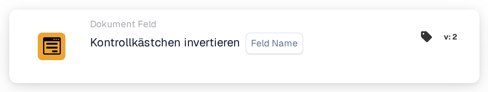

# Kontrollkästchen umkehren

<figure><figcaption>
Version 2
</figcaption></figure>

## **Zweck:**

Diese Workflow-Karte ist darauf ausgelegt, den aktuellen Zustand eines Kontrollkästchenfelds umzukehren. Ist das Kontrollkästchen aktiviert (true), wird es deaktiviert (false), und umgekehrt. Die Umkehrung erfolgt auf Basis der in den Abschnitten **„Wenn“** und **„Und“** festgelegten Bedingungen. Diese Karte hilft, Workflows zu automatisieren, bei denen eine Bedingung das Umschalten eines Kontrollkästchens auf Basis bestimmter Kriterien erfordert.

## **Bestandteile der Karte:**

1. **Feldname**
   * **Beschreibung**: Gibt das umzukehrende Kontrollkästchenfeld an.
   * **Detailliert**: Der Zustand des ausgewählten Kontrollkästchenfelds wird je nach aktuellem Zustand von true auf false oder von false auf true umgeschaltet.

## **Funktionalität:**

* **Bedingungsauswertung**: Das System wertet die in den Abschnitten **„Wenn“** und **„Und“** definierten Bedingungen aus:
  * Sind **beide Bedingungen erfüllt**, wird die Aktion im **"Then"-Abschnitt** ausgeführt, was in diesem Fall bedeutet, dass das Kontrollkästchenfeld umgeschaltet wird.
  * Ist **eine der beiden Bedingungen nicht erfüllt**, wird die Karte nicht ausgeführt, und es erfolgt keine Änderung am Kontrollkästchenfeld.
* **Ausführung der Aktion**: Werden die Bedingungen in den Abschnitten **„Wenn“** und **„Und“** als erfüllt ausgewertet, wird der Zustand des Kontrollkästchenfelds umgekehrt:
  * Ist das Kontrollkästchen aktiviert (true), wird es deaktiviert (false).
  * Ist das Kontrollkästchen deaktiviert (false), wird es aktiviert (true).

## **Einrichtung und Konfiguration:**

Um diese Karte zu konfigurieren, müssen Benutzer:

1. **Das umzukehrende Kontrollkästchenfeld auswählen** (Feldname). Die verfügbaren Kontrollkästchenfelder im Dokument werden zur Auswahl aufgelistet.
2. Das Kontrollkästchenfeld wird nur umgekehrt, wenn die Bedingungen in beiden Abschnitten **„Wenn“** und **„Und“** erfüllt sind.

## **Fazit:**

Die Workflow-Karte **"Invert checkbox \[Field Name]"** bietet ein einfaches, aber leistungsstarkes Automatisierungswerkzeug, um Kontrollkästchenwerte auf Basis bestimmter Bedingungen umzuschalten. Indem sie den Bedarf an manuellen Anpassungen von Kontrollkästchen reduziert, steigert diese Karte die Effizienz bei der Dokumentverarbeitung und sorgt für Konsistenz über Workflows hinweg.

<!-- workflow-card-practical-example-20261021 -->

## Praxisbeispiel

**Verwendungszweck:** Schalten Sie einen booleschen Wert um, wenn dies der beabsichtigte Geschäftsvorgang ist.

**Konfiguration:** Aktivieren Sie das Kontrollkästchen `demo_flag` mit dem Anfangswert `false`.

**Erwartetes Ergebnis und Gegenbeispiel:** Eine Ausführung ergibt `true`; eine zweite Ausführung macht es wieder `false`. Verwenden Sie stattdessen das Kontrollkästchen „Setzen“, wenn bei Wiederholungsversuchen immer derselbe Wert übrig bleiben muss.

Dies ist eine beispielhafte Konfiguration und ein erwartetes Ergebnis. Verwenden Sie in Ihrer Testorganisation konfigurierte Felder, Benutzer und Gruppen. Es wird nicht behauptet, dass dieses Beispiel ausgeführt wurde.
