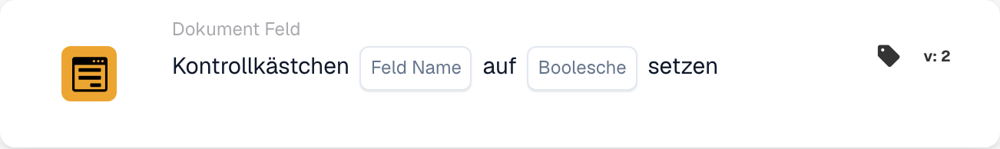

# Setzen Sie das Kontrollkästchen auf

<figure><figcaption>
Kartenfelder in der angezeigten Version. Die Platzhalter sind noch nicht ausgefüllt.
</figcaption></figure>

## **Zweck:**

Diese Workflow-Karte ist darauf ausgelegt, ein Kontrollkästchenfeld auf einen angegebenen Wert (true oder false) zu setzen, basierend auf den in den Abschnitten **„Wo“** und **„Und“** definierten Bedingungen. Sie bietet eine einfache, aber effektive Möglichkeit, Kontrollkästchenaktualisierungen zu automatisieren, wenn bestimmte Kriterien erfüllt sind, und sorgt so für eine optimierte Dokumentverarbeitung.

## **Bestandteile der Karte:**

1. **Feldname:**
   * **Beschreibung**: Gibt das Feld an, in dem das Kontrollkästchen gesetzt wird.
   * **Detailliert**: Das zu aktualisierende Kontrollkästchenfeld wird durch den Feldnamen identifiziert.
2. **Boolescher Wert**
   * **Beschreibung**: Legt den Wert fest, auf den das Kontrollkästchenfeld gesetzt wird, wenn die Bedingungen in den Abschnitten **Wo** und **Und** beide erfüllt sind.
   * **Optionen**:
     * **True**: Das Kontrollkästchen wird auf **true** gesetzt, wenn die Bedingungen erfüllt sind.
     * **False**: Das Kontrollkästchen wird auf **false** gesetzt, wenn die Bedingungen erfüllt sind.

## **Funktionalität:**

* **Bedingungsauswertung**: Das System wertet die Bedingungen sowohl im Abschnitt **„Wo“** als auch im Abschnitt **„Und“** aus.
* **Ausführung der Aktion**: Werden sowohl der **„Wo“**- als auch der **„Und“**-Abschnitt als erfüllt ausgewertet, wird das Kontrollkästchenfeld auf den angegebenen Wert (true oder false) aktualisiert. Ist eine der Bedingungen nicht erfüllt, wird keine Aktion ausgeführt, und das Kontrollkästchen bleibt unverändert.

## **Einrichtung und Konfiguration:**

Um diese Karte zu konfigurieren, müssen Benutzer:

1. **Das Ziel-Kontrollkästchenfeld angeben**, das bei Erfüllung der Bedingungen auf true oder false gesetzt wird.
2. **Den Wert (true oder false) auswählen**, auf den das Kontrollkästchen bei der Bedingungsauswertung gesetzt wird.
3. Die Karte führt ihre Aktion nur aus, wenn beide Bedingungen in den Abschnitten **„Wo“** und **„Und“** als erfüllt ausgewertet werden.

## **Fazit:**

Die Workflow-Karte **"Set Checkbox"** ist ein einfaches und effektives Automatisierungswerkzeug, um Kontrollkästchenfelder auf Basis bestimmter Bedingungen zu aktualisieren. Indem sie sicherstellt, dass sowohl der **„Wo“**- als auch der **„Und“**-Abschnitt erfüllt sind, ermöglicht sie es Benutzern, Prozesse zu automatisieren und manuelle Eingriffe zu reduzieren, und sorgt so für eine reibungslosere und effizientere Dokumentverarbeitung.
