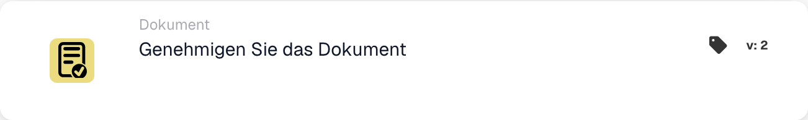

# Genehmigen Sie das Dokument

<figure><figcaption>
Kartenfelder in der angezeigten Version. Die Platzhalter sind noch nicht ausgefüllt.
</figcaption></figure>

## **Zweck:**

Die Workflow-Karte **„Dokument genehmigen“** wird verwendet, um ein Dokument als freigegeben zu markieren. Sie ermöglicht es dem Dokument, in die nächste Phase des Workflows überzugehen, und erlaubt die Ausführung automatisierter Verarbeitungs- oder Freigabe-Workflows. Diese Karte hilft, Dokumentenmanagementprozesse zu optimieren, und stellt sicher, dass nur freigegebene Dokumente für weitere Aktionen weitergeleitet werden.

## **Bestandteile der Karte:**

1. **Freigabestatus**
   * **Beschreibung**: Diese Komponente markiert das Dokument als freigegeben.
   * **Detailliert**: Wird diese Karte ausgelöst, wird der Freigabestatus des Dokuments aktualisiert, um die Freigabe anzuzeigen. Diese Aktion kann auf Basis der in den Abschnitten **„Wenn“** und **„Und“** definierten Bedingungen festgelegt werden.

## **Funktionalität:**

* **Bedingungsauswertung**: Das System wertet die in den Abschnitten **„Wenn“** und **„Und“** festgelegten Bedingungen aus.
  * Sind **beide Bedingungen erfüllt**, wird das Dokument als freigegeben markiert.
  * Ist **eine der Bedingungen nicht erfüllt**, wird die Karte nicht ausgeführt, und der Freigabestatus des Dokuments bleibt unverändert.
* **Ausführung der Aktion**: Sind die Bedingungen erfüllt, wird das Dokument freigegeben. Diese Änderung spiegelt sich im Dokumentstatus wider und ermöglicht es, im Workflow weiter fortzufahren.

## **Fazit:**

Die Workflow-Karte **„Dokument genehmigen“** ist eine zentrale Komponente für die Automatisierung der Dokumentfreigabe in Geschäftsworkflows. Indem sie sicherstellt, dass nur Dokumente freigegeben werden, die bestimmte Kriterien erfüllen, hilft sie, Konsistenz zu wahren, manuelle Kontrolle zu reduzieren und eine reibungslosere Dokumentverarbeitung zu ermöglichen.

<!-- workflow-card-practical-example-20261021 -->

## Praxisbeispiel

**Verwendungszweck:** Genehmigen Sie ein Dokument, nachdem alle erforderlichen Prüfbedingungen erfüllt sind.

**Konfiguration:** Platzieren Sie diese Aktion nach den Überprüfungsbedingungen im erfolgreichen Zweig. Verwenden Sie ein Demodokument, das auf die Genehmigung wartet.

**Erwartetes Ergebnis und Gegenbeispiel:** Die Aktion genehmigt dieses Dokument. Ein Dokument, das eine frühere Bedingung nicht erfüllt, erreicht diese Aktion nie; Die Genehmigung allein ist kein Beweis für einen abgeschlossenen ERP-Export.

Dies ist eine beispielhafte Konfiguration und ein erwartetes Ergebnis. Verwenden Sie in Ihrer Testorganisation konfigurierte Felder, Benutzer und Gruppen. Es wird nicht behauptet, dass dieses Beispiel ausgeführt wurde.
