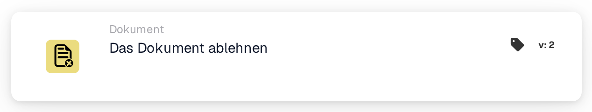

# Lehnen Sie das Dokument ab

<figure><figcaption>
Version 1
</figcaption></figure>

<figure><figcaption>
Version 2
</figcaption></figure>

## **Zweck:**

Die Workflow-Karte **„Das Dokument ablehnen“** wird verwendet, um ein Dokument innerhalb eines Workflows als abgelehnt zu markieren. Diese Aktion stoppt den Fortschritt des Dokuments und verhindert, dass es in die nächste Phase des Workflows übergeht. Sie stellt sicher, dass Dokumente, die die erforderlichen Bedingungen oder Kriterien nicht erfüllen, markiert und von der weiteren Verarbeitung ausgeschlossen werden.

## **Bestandteile der Karte:**

1. **Ablehnungsstatus**
   * **Beschreibung**: Diese Komponente markiert das Dokument als abgelehnt und signalisiert, dass es die für die Freigabe erforderlichen Bedingungen nicht erfüllt hat.
   * **Detailliert**: Wird diese Karte ausgelöst, aktualisiert sie den Status des Dokuments auf "abgelehnt". Diese Entscheidung wird auf Basis der in den Abschnitten **„Wenn“** und **„Und“** festgelegten Bedingungen getroffen.

## **Funktionalität:**

* **Bedingungsauswertung**: Das System wertet die in den Abschnitten **„Wenn“** und **„Und“** festgelegten Bedingungen aus.
  * Sind **beide Bedingungen erfüllt**, wird das Dokument abgelehnt.
  * Ist **eine der Bedingungen nicht erfüllt**, wird die Karte nicht ausgeführt, und der Status des Dokuments bleibt unverändert.
* **Ausführung der Aktion**: Sind die Bedingungen erfüllt, wird das Dokument als abgelehnt markiert. Diese Aktion stellt sicher, dass nur Dokumente, die bestimmte Kriterien erfüllen, weiter fortfahren, während andere markiert und zur Prüfung oder Korrektur angehalten werden.

## **Fazit:**

Die Workflow-Karte **„Das Dokument ablehnen“** ist ein unverzichtbares Werkzeug, um den Dokumentfluss in automatisierten Prozessen zu steuern. Indem sie die Ablehnung nicht konformer Dokumente ermöglicht, stellt sie sicher, dass nur gültige und korrekte Dokumente den Workflow durchlaufen, und verbessert so die Effizienz und Genauigkeit im Dokumentenmanagement.

<!-- workflow-card-practical-example-20261021 -->

## Praxisbeispiel

**Verwendungszweck:** Ein Dokument ablehnen, das einer definierten Ablehnungsregel entspricht.

**Konfiguration:** Leiten Sie ein absichtlich ungültiges Demodokument in diese Aktion weiter, beispielsweise nach einer expliziten Ablehnungsentscheidung.

**Erwartetes Ergebnis und Gegenbeispiel:** Das Dokument wird abgelehnt. Ein gültiges Dokument muss einem anderen Zweig folgen und darf diese Aktion nicht ausführen.

Dies ist eine beispielhafte Konfiguration und ein erwartetes Ergebnis. Verwenden Sie in Ihrer Testorganisation konfigurierte Felder, Benutzer und Gruppen. Es wird nicht behauptet, dass dieses Beispiel ausgeführt wurde.
