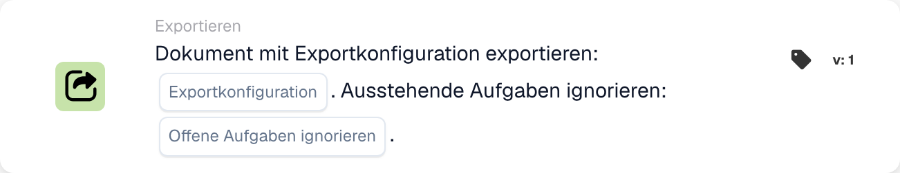

# Exportieren mit Exportkonfiguration

<figure><figcaption>
Kartenfelder in der angezeigten Version. Die Platzhalter sind noch nicht ausgefüllt.
</figcaption></figure>

## **Zweck:**

Die Workflowkarte **„Dokument mit Exportkonfiguration exportieren“** dient zum Exportieren eines Dokuments mithilfe einer angegebenen Exportkonfiguration. Es bietet die Flexibilität, alle mit dem Dokument verbundenen ausstehenden Aufgaben zu ignorieren und so einen reibungslosen Exportvorgang unabhängig vom aktuellen Status sicherzustellen.

## **Bestandteile der Karte:**

1. **Konfiguration exportieren**
   * **Beschreibung**: Gibt die Exportkonfiguration an, die für die Verarbeitung des Dokuments verwendet werden soll.
   * **Detailliert**: Diese Konfiguration bestimmt das Format, die Struktur und das Ziel des exportierten Dokuments.
2. **Ausstehende Aufgaben ignorieren**
   * **Beschreibung**: Legt fest, ob mit dem Dokument verknüpfte ausstehende Aufgaben während des Exportvorgangs ignoriert werden sollen.
   * **Optionen**:
     * **True**: Exportiert das Dokument unabhängig von ausstehenden Aufgaben.
     * **False**: Stellt sicher, dass ausstehende Aufgaben vor dem Export abgeschlossen werden.

## **Funktionalität:**

* **Bedingungsauswertung**: Das System wertet die in den **„Wenn“** und **„Und Abschnitte“** des Workflows festgelegten Bedingungen aus. Wenn beide Bedingungen erfüllt sind, wird der Exportvorgang eingeleitet.
* **Dokumentexport**: Mithilfe der angegebenen **Exportkonfiguration** wird das Dokument verarbeitet und im definierten Format und Ziel exportiert.
* **Bearbeitung ausstehender Aufgaben**: Wenn **Ausstehende Aufgaben ignorieren** auf **True** gesetzt ist, umgeht der Exportvorgang alle ausstehenden Aufgaben, die mit dem Dokument verknüpft sind. Wenn auf **False** gesetzt, können ausstehende Aufgaben den Export verhindern. Beheben Sie sie und veranlassen Sie den vorgesehenen Workflow-Auslöser oder versuchen Sie es erneut.

## **Einrichtung und Konfiguration:**

Um diese Karte zu konfigurieren, müssen Benutzer:

1. Wählen Sie die gewünschte **Exportkonfiguration** aus, um zu definieren, wie das Dokument exportiert wird.
2. Wählen Sie aus, ob **Ausstehende Aufgaben ignorieren** werden soll, indem Sie den Wert auf **True** oder **False** setzen.
3. Stellen Sie sicher, dass die Bedingungen in den Abschnitten **„Wenn“** und **„Und“** richtig eingestellt sind, da die Karte ihre Aktion nur ausführt, wenn diese Bedingungen erfüllt sind.

## **Fazit:**

Die Workflowkarte **„Dokument mit Exportkonfiguration exportieren“** sorgt dafür, dass Dokumente effizient und gemäß vordefinierter Konfigurationen exportiert werden. Durch die Möglichkeit, ausstehende Aufgaben zu ignorieren, bietet diese Karte Flexibilität bei der Dokumentenbearbeitung in verschiedenen Phasen, reduziert Verzögerungen und optimiert den Exportprozess.

## Aktuelle Versionen und ausstehende Aufgaben

Wählen Sie bei v3 auch **Status nach Export**: `finished` schließt das Dokument nach einem erfolgreichen Export; `exported` lässt es zur weiteren Bearbeitung offen. Frühere Versionen behalten `finished` bei. Eine fehlende Auswahl ist standardmäßig `finished`; eine ungültige Auswahl wird abgelehnt.

Wenn offene Aufgaben den Export verhindern, meldet die Karte die Ablehnung. Lösen Sie die Aufgaben und veranlassen Sie den beabsichtigten Auslöser oder versuchen Sie es erneut. Automatisches Warten und Wiederaufnehmen sind mit dieser Karte nicht gewährleistet. Die separate Warteschlangen-Exportkarte sammelt eine Konfiguration für den endgültigen Export am Ende des Laufs. Siehe [Karten und Ergebnisstatus exportieren](../../cards-overview/export-cards-guide.md).

<!-- workflow-card-practical-example-20261021 -->

## Praxisbeispiel

**Verwendungszweck:** Wählen Sie eine bestimmte Exportkonfiguration für ein validiertes Dokument.

**Konfiguration:** Wählen Sie den konfigurierten Demo-Exporter aus und setzen Sie „Ausstehende Aufgaben ignorieren“ auf `false`. Verwenden Sie ein Dokument mit einer offenen Aufgabe und anschließend einen separaten Test ohne offene Aufgaben.

**Erwartetes Ergebnis und Gegenbeispiel:** Es darf nicht davon ausgegangen werden, dass der Fall mit offener Aufgabe automatisch fortgesetzt wird. Nachdem Sie die Aufgabe gelöst haben, lösen Sie den beabsichtigten Export erneut aus und überprüfen Sie das Exporter-Ergebnis und den unterstützten Status.

Dies ist eine beispielhafte Konfiguration und ein erwartetes Ergebnis. Verwenden Sie in Ihrer Testorganisation konfigurierte Felder, Benutzer und Gruppen. Es wird nicht behauptet, dass dieses Beispiel ausgeführt wurde.

## Lernweg und Wirkungsnachweis

[P1: Exportvarianten, offene Aufgaben und Abschlussstatus](../../masterclass/export-lifecycle.md) trennt Konfigurationsauswahl, Vormerken, Exportanforderung, tatsächlichen Empfang und ERP-Verarbeitung. Eine grüne Simulation oder eine Statusänderung belegt den Empfang nicht.
