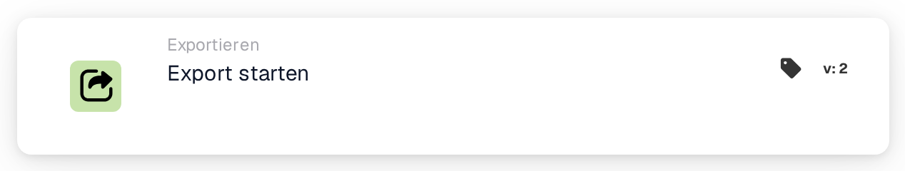
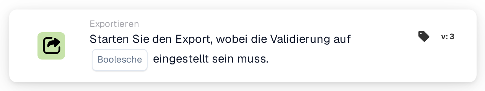
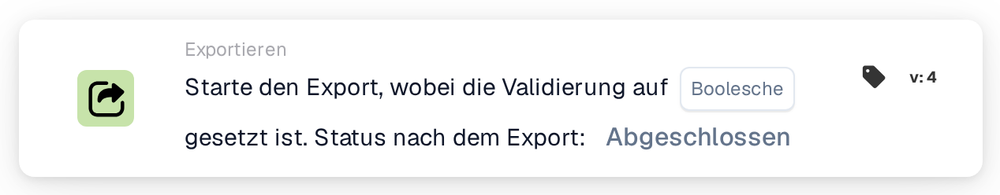

# Starten Sie den Export

<figure><figcaption>
Version 1
</figcaption></figure>

<figure><figcaption>
Version 2
</figcaption></figure>

<figure><figcaption>
Version 3
</figcaption></figure>

<figure><figcaption>
Version 4
</figcaption></figure>

## **Zweck:**

Die Workflowkarte **„Export starten“** dient dazu, den Exportvorgang für ein Dokument zu starten. Diese Karte fungiert als Auslöser innerhalb des Workflows, um den Exportvorgang nahtlos zu starten, sobald die Bedingungen in den vorherigen Abschnitten erfüllt sind.

## **Bestandteile der Karte:**

1. **Aktion**
   1. **Beschreibung**: Initiiert den Exportvorgang für das Dokument.
   2. **Detailliert**: Die Karte verwendet die konfigurierten Exporteinstellungen im System, um das Dokument zu verarbeiten und zu exportieren.

## **Funktionalität:**

* **Bedingungsauswertung**: Das System wertet die in den **„Wenn“** und **„Und Abschnitte“** des Workflows festgelegten Bedingungen aus. Wenn alle Bedingungen erfüllt sind, beginnt der Exportvorgang.
* **Dokumentexport**: Das Dokument wird mit der Standard- oder zuvor definierten Exportkonfiguration verarbeitet und exportiert.

## **Einrichtung und Konfiguration:**

Frühere Versionen verwenden die bereits im System definierten Exporteinstellungen. Konfigurieren Sie in Version 4 die Validierung und wählen Sie Status nach Export aus. Überprüfen Sie außerdem Folgendes:

1. Die Bedingungen **„Wenn“** und **„Und Abschnitte“** sind korrekt konfiguriert, da die Karte nur ausgeführt wird, wenn diese Bedingungen als wahr ausgewertet werden.
2. Dem Dokument im System ist eine gültige Exportkonfiguration zugeordnet.

## **Fazit:**

Die Workflowkarte **„Export starten“** bietet eine optimierte und automatisierte Möglichkeit, den Exportvorgang auszulösen. Durch den Rückgriff auf vorkonfigurierte Einstellungen und bedingte Auswertungen gewährleistet es eine effiziente und genaue Dokumentenverarbeitung.

## Kartenversionen und Ergebnisstatus

Die obige Aussage über keine kartenspezifische Konfiguration gilt für die frühere Karte „Start Export“. Export mit Validierung starten v4 beinhaltet Validierung und **Status nach dem Export**. Wählen Sie `finished`, um ein erfolgreich exportiertes Dokument zu schließen, oder `exported`, um es zur weiteren Verarbeitung geöffnet zu lassen. Frühere Versionen behalten `finished` bei. Siehe [Karten und Ergebnisstatus exportieren](../../cards-overview/export-cards-guide.md) für Standardeinstellungen, Fehler und Tests.

<!-- workflow-card-practical-example-20261021 -->

## Praxisbeispiel

**Verwendungszweck:** Exportieren Sie ein Dokument, nachdem die erforderlichen Prüfungen bestanden wurden.

**Konfiguration:** Wählen Sie den unterstützten Post-Export-Status aus, zum Beispiel `exported`, wenn das Dokument für die weitere Verarbeitung verfügbar bleiben muss. Stellen Sie sicher, dass der konfigurierte Exporter und die erforderlichen Daten bereit sind.

**Erwartetes Ergebnis und Gegenbeispiel:** Nach erfolgreichem Export wird der ausgewählte Ergebnisstatus übernommen. Bei einem Exportfehler handelt es sich nicht um einen abgeschlossenen Export. Überprüfen Sie das Protokoll und testen Sie den Fehlerzweig.

Dies ist eine beispielhafte Konfiguration und ein erwartetes Ergebnis. Verwenden Sie in Ihrer Testorganisation konfigurierte Felder, Benutzer und Gruppen. Es wird nicht behauptet, dass dieses Beispiel ausgeführt wurde.

## Lernweg und Wirkungsnachweis

[P1: Exportvarianten, offene Aufgaben und Abschlussstatus](../../masterclass/export-lifecycle.md) trennt Konfigurationsauswahl, Vormerken, Exportanforderung, tatsächlichen Empfang und ERP-Verarbeitung. Eine grüne Simulation oder eine Statusänderung belegt den Empfang nicht.
