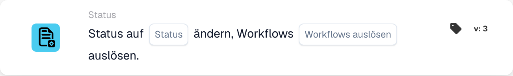

# Ändern Sie den Status in

<figure><figcaption>
Kartenfelder in der angezeigten Version. Die Platzhalter sind noch nicht ausgefüllt.
</figcaption></figure>

## **Zweck:**

Die Workflow-Karte **"Change Status"** wird verwendet, um den Status eines Dokuments in einen der vordefinierten Zustände zu ändern – **Fehler, Abgelehnt, Bereit zur Validierung, Genehmigung ausstehend, Zweite Genehmigung ausstehend** – und optional auf Basis der Statusänderung zugehörige Workflows auszulösen. Diese Karte automatisiert den Prozess von Statusaktualisierungen und Workflow-Auslösern und gewährleistet so ein effizientes Dokumentenmanagement und eine effiziente Fehlerbehandlung.

## **Bestandteile der Karte:**

1. **Status**
   * **Beschreibung**: Gibt den neuen Status an, der auf das Dokument angewendet wird.
   * **Optionen**:
     * **Fehler**: Markiert das Dokument als fehlerbehaftet.
     * **Abgelehnt**: Gibt an, dass das Dokument abgelehnt wurde und nicht weiter fortfährt.
     * **Bereit zur Validierung**: Setzt das Dokument so, dass es vom nächsten Benutzer oder Systemprozess geprüft und validiert wird.
     * **Genehmigung ausstehend**: Versetzt das Dokument in einen Wartezustand zur Freigabe.
     * **Zweite Genehmigung ausstehend**: Stellt das Dokument für eine zweite Freigabestufe zurück, sofern zutreffend.
2. **Workflows auslösen**
   * **Beschreibung**: Legt fest, ob nach der Statusänderung nachfolgende Workflows ausgelöst werden sollen.
   * **Optionen**:
     * **True**: Startet alle relevanten Workflows auf Basis der Statusänderung.
     * **False**: Verhindert die Ausführung von Workflows nach der Statusänderung.

## **Funktionalität:**

* **Bedingungsauswertung**: Das System wertet die in den Abschnitten **„Wenn“** und **„Und“** festgelegten Bedingungen aus. Sind diese Bedingungen erfüllt, fährt die Karte fort und ändert den Status des Dokuments in den ausgewählten Wert.
* **Statusaktualisierung**: Sind die Bedingungen erfüllt, wird der Status des Dokuments je nach Auswahl des Benutzers auf eine der vordefinierten Optionen aktualisiert (Fehler, Abgelehnt, Bereit zur Validierung, Genehmigung ausstehend, Zweite Genehmigung ausstehend).
* **Workflow-Auslöseaktion**: Ist **Workflows auslösen** auf **True** gesetzt, startet das System nach der Statusaktualisierung automatisch alle zugehörigen Workflows. Ist die Einstellung auf **False** gesetzt, werden keine zusätzlichen Workflows ausgelöst, und der Prozess endet mit der Statusänderung.

## **Einrichtung und Konfiguration:**

Um diese Karte zu konfigurieren, müssen Benutzer:

1. Den gewünschten **Status** angeben, auf den das Dokument bei der Bedingungsauswertung gesetzt wird (Fehler, Abgelehnt, Bereit zur Validierung, Genehmigung ausstehend oder Zweite Genehmigung ausstehend).
2. Wählen, ob nach der Statusänderung **Workflows ausgelöst** werden sollen, indem **True** oder **False** ausgewählt wird.
3. Die Karte führt ihre Aktion nur aus, wenn beide Bedingungen in den Abschnitten **„Wenn“** und **„Und“** als erfüllt ausgewertet werden.

## **Fazit:**

Die Workflow-Karte **"Change Status"** bietet einen optimierten Ansatz zur Verwaltung von Dokumentstatus und zum Auslösen zugehöriger Workflows. Sie stellt sicher, dass Dokumente automatisch in den korrekten Status überführt und die erforderlichen Aktionen je nach Statusänderung ausgeführt werden. Durch das Festlegen klarer Bedingungen für die Ausführung reduziert sie den manuellen Aufwand und steigert die Workflow-Effizienz.

<!-- workflow-card-practical-example-20261021 -->

## Praxisbeispiel

**Wann nutzen:** Einen geprüften Beleg zur Freigabe weitergeben.

**Wo:** Standard-Workflow-Designer → Dann → Status → Status auf … ändern.

**Konfiguration:** Wählen Sie Version 3 von `staus_change`, den Status Genehmigung ausstehend (`validated_pending_approval`) und setzen Sie das Auslösen weiterer Workflows auf `false` (`trigger_docflow=false`). Verwenden Sie eine isolierte synthetische Rechnung, deren vorhergehende Prüfungen erfüllt sind.

**Erwartetes Ergebnis und Gegenbeispiel:** Eine zulässige, erfolgreiche Änderung versetzt den Beleg in den gewählten Status. Ist eine vorhergehende Bedingung falsch, wird diese Aktion nicht erreicht und ändert keinen Status. Eine abgelehnte oder fehlgeschlagene API-Änderung zählt nicht als Erfolg: Prüfen Sie den tatsächlichen Status und die Protokolle. Die Karte führt selbst keinen Export aus.

### Kartenversionen

Der ausdrückliche Schalter zum Auslösen weiterer Workflows ist in v3 verfügbar. Version 1 und 2 bieten ihn nicht; ihr älterer Aktualisierungspfad verwendet das Standardverhalten zum Auslösen von Workflows. Übertragen Sie eine v3-Einstellung `false` nicht ungeprüft auf eine ältere Kartenversion.

Dies ist eine am Ausführungscode geprüfte Konfiguration mit erwartetem Ergebnis. Es wurde kein Workflow und keine Statusänderung ausgeführt.

## Admin-Beispielvideo

Wann ich einen geprüften Beleg auf eine Freigabestufe setze und wie ich in Version 3 das Auslösen weiterer Workflows steuere. Die Beispiele zeigen erwartete Ergebnisse.



[Video mit deutschen Untertiteln öffnen](https://docbits-videos.fra1.cdn.digitaloceanspaces.com/settings-assistant/workflow-card-change-status-admin/v1/de.html)

[Transkript lesen](https://docbits-videos.fra1.cdn.digitaloceanspaces.com/settings-assistant/workflow-card-change-status-admin/v1/de.txt)
