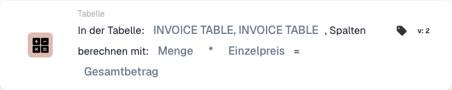
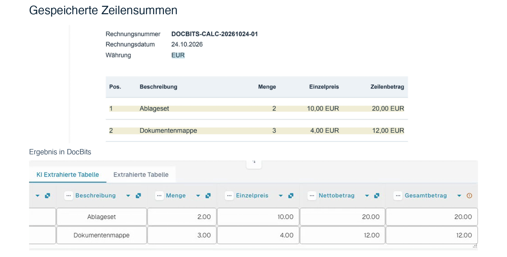

# Spalten berechnen

Die Karte wendet eine Rechenoperation auf zwei Spalten derselben Tabelle an und speichert das Ergebnis für jede Zeile in einer Ergebnisspalte.

## Wann und wo einsetzen

Nutzen Sie die Karte, wenn der nächste Workflowschritt berechnete Zeilenwerte benötigt, zum Beispiel **Menge × Einzelpreis**. Sie finden sie im Bereich **Dann**, Kategorie **Tabelle**. Prüfen Sie vorher, dass beide Eingabespalten Zahlen enthalten und die benötigten Werte vollständig sind.

<figure><figcaption>
Karte Version 2: INVOICE_TABLE, Menge × Einzelpreis → TOTAL_AMOUNT. Die Oberfläche zeigt den Tabellennamen doppelt an.
</figcaption></figure>

## Admin-Video

**34 Sekunden · Deutsch.** Thomas erklärt den Einsatz, wählt die Multiplikation und zeigt die gespeicherten Ergebnisse auf derselben Beispielrechnung.



[Video mit deutschen Untertiteln ansehen](https://docbits-videos.fra1.cdn.digitaloceanspaces.com/settings-assistant/workflow-card-calc-columns-admin/v2/de.html) · [Transkript lesen](https://docbits-videos.fra1.cdn.digitaloceanspaces.com/settings-assistant/workflow-card-calc-columns-admin/v2/de.txt)

## Karte konfigurieren

| Einstellung | Auswahl im Beispiel |
| --- | --- |
| Tabelle | `INVOICE_TABLE` |
| Erste Spalte | `QUANTITY` — Menge |
| Rechenoperation | `*` — Multiplikation |
| Zweite Spalte | `UNIT_PRICE` — Einzelpreis |
| Ergebnisspalte | `TOTAL_AMOUNT` — Gesamtbetrag |

Außerdem stehen `+` (Addition), `-` (Subtraktion) und `/` (Division) zur Verfügung. Bei Subtraktion und Division ist die Reihenfolge der beiden Spalten entscheidend. Wählen Sie die in Ihrer Organisation konfigurierten Tabellen- und Spaltenkennungen.

<!-- workflow-card-practical-example-20261021 -->

## Praxisbeispiel

Die Beispielrechnung enthält zwei Zeilen. Vor der Berechnung ist die Ergebnisspalte noch nicht vorhanden:

| Zeile | Menge | Einzelpreis | Gespeichertes Ergebnis in `TOTAL_AMOUNT` |
| --- | --- | --- | --- |
| 1 | 2 | 10 | 20 |
| 2 | 3 | 4 | 12 |

Im gezeigten Test legt die Karte die Ergebnisspalte an. Nach dem erneuten Öffnen der Rechnung sind **20,00** und **12,00** sichtbar. Die Eingabespalten und die ursprünglichen Werte in `NET_AMOUNT` bleiben in diesem Beispiel erhalten. Enthält die ausgewählte Ergebnisspalte bereits Werte, werden diese durch die Berechnung ersetzt.

<figure><picture><source srcset="../../../../.gitbook/assets/workflow-card-calc-columns-saved-result-de-dark-20261024.png" media="(prefers-color-scheme: dark)"></picture><figcaption>
Dieselbe Beispielrechnung und das nach erneutem Öffnen gespeicherte Ergebnis: Gesamtbetrag 20,00 und 12,00. Die ursprünglichen Nettobeträge bleiben erhalten.
</figcaption></figure>

## Prüfen und Gegenbeispiele

- Prüfen Sie beide Eingabespalten und kontrollieren Sie nach der Berechnung die gespeicherten Ergebniswerte.
- Ein fehlender Preis kann im dargestellten Beispielfall null ergeben. Null belegt daher keine vollständigen Eingaben: Prüfen Sie die Daten vor der Berechnung.
- Ein Text wie `ABC` anstelle einer Zahl führt zu einem Berechnungsfehler. Korrigieren Sie den Wert und prüfen Sie den Fall erneut.
- Die Grafik zeigt für den fehlenden Preis und den nicht numerischen Text erwartete Beispielfälle. Diese beiden Gegenbeispiele sind keine weiteren Ausführungen der gezeigten Rechnung.
