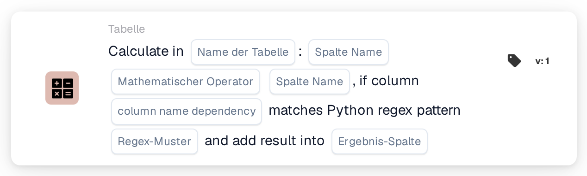
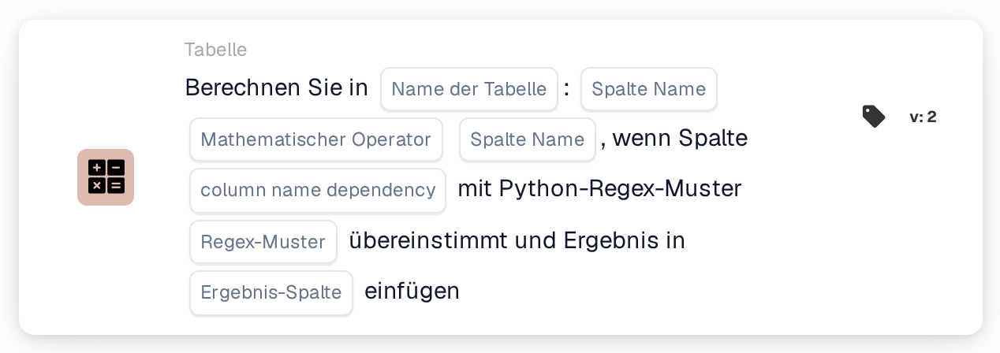

# Werte in einer Tabelle berechnen

<figure><figcaption>
Version 1
</figcaption></figure>

<figure><figcaption>
Version 2
</figcaption></figure>

## **Zweck:**

Die Workflow-Karte **„Berechnen mit Regex-Abhängigkeit“** ermöglicht es Benutzern, Berechnungen zwischen Spalten in einer ausgewählten Tabelle durchzuführen, mit einer zusätzlichen Bedingung, die auf einem regulären Ausdruck (Regex) basiert, der auf eine Abhängigkeitsspalte angewendet wird. Stimmt das Muster überein, wird die Berechnung durchgeführt und das Ergebnis in der angegebenen Ergebnisspalte gespeichert.

## **Bestandteile der Karte:**

1. **Tabellenname**
   * **Beschreibung:** Gibt die **Tabelle** an, in der die Spalten berechnet werden.
   * **Detail:** Zur Auswahl wird eine Dropdown-Liste aller verfügbaren **Tabellen** bereitgestellt.
2. **Spaltenname (1. Spalte)**
   * **Beschreibung:** Gibt die **erste Spalte** an, die an der Berechnung beteiligt ist.
   * **Detail:** Zur Auswahl wird eine Liste aller verfügbaren **Spalten** bereitgestellt.
3. **Betrieb**
   * **Beschreibung:** Legt die mathematische Operation fest, die zwischen den ausgewählten Spalten angewendet wird.
   * **Optionen:**
     * **Addieren (+):** Addiert den Wert der zweiten Spalte zum Wert der ersten Spalte.
     * **Subtrahieren (-):** Subtrahiert den Wert der zweiten Spalte von der ersten Spalte.
     * **Multiplizieren (\*):** Multipliziert den Wert der ersten Spalte mit dem Wert in der zweiten Spalte.
     * **Dividieren (/):** Dividiert den Wert der ersten Spalte durch die zweite Spalte.
4. **Spaltenname (2. Spalte)**
   * **Beschreibung:** Gibt die **zweite Spalte** an, die an der Berechnung beteiligt ist.
   * **Detail:** Zur Auswahl wird eine Liste aller verfügbaren **Spalten** bereitgestellt.
5. **Spaltenname (Abhängigkeit)**
   * **Beschreibung:** Gibt die **Abhängigkeitsspalte** an, auf die das Regex-Muster angewendet wird.
   * **Detail:** Für den Musterabgleich wird eine Liste aller verfügbaren **Spalten** bereitgestellt.
6. **Regex-Muster**
   * **Beschreibung:** Legt das **Regex-Muster** fest, das für den Abgleich mit der Abhängigkeitsspalte verwendet wird.
   * **Detail:** Stimmt der Wert in der Abhängigkeitsspalte mit dem Regex-Muster überein, wird die Berechnung durchgeführt.
7. **Ergebnisspalte**
   * **Beschreibung:** Gibt die **Ergebnisspalte** an, in der das Berechnungsergebnis gespeichert wird.
   * **Detail:** Dies kann eine neue oder vorhandene Spalte sein, in der der berechnete Wert gespeichert wird.

## **Funktionalität:**

* **Bedingungsauswertung:**
  * Die Karte führt ihre Aktion nur aus, wenn sowohl der **„Wenn“**- als auch der **„Und“**-Abschnitt als erfüllt ausgewertet werden.
  * Die Karte führt ihre Aktion nur aus, wenn der Wert in der Abhängigkeitsspalte mit dem angegebenen **Regex-Muster** übereinstimmt.
* **Spaltenberechnung:**\
  Stimmt das Regex-Muster überein, führt die Karte die ausgewählte mathematische Operation zwischen den beiden gewählten Spalten durch.
* **Ergebnisspeicherung:**\
  Das Ergebnis der Berechnung wird in der ausgewählten **Ergebnisspalte** gespeichert.

## **Einrichtung und Konfiguration:**

* **Tabelle auswählen:**\
  Wählen Sie die **Tabelle**, in der die Spalten berechnet werden.
* **Spalten wählen:**\
  Wählen Sie die **erste Spalte** und die **zweite Spalte**, die in der Berechnung verwendet werden.
* **Operation auswählen:**\
  Wählen Sie die mathematische Operation (**Addieren (+)**, **Subtrahieren (-)**, **Multiplizieren (\*)**, **Dividieren (/)**), die zwischen den Spalten angewendet wird.
* **Abhängigkeitsspalte auswählen:**\
  Wählen Sie die **Abhängigkeitsspalte**, auf die das Regex-Muster angewendet wird.
* **Regex-Muster definieren:**\
  Geben Sie das **Regex-Muster** ein, mit dem die Abhängigkeitsspalte übereinstimmen soll.
* **Ergebnisspalte auswählen:**\
  Wählen Sie die **Ergebnisspalte**, in der der berechnete Wert gespeichert wird.

## **Fazit:**

Die Workflow-Karte **„Berechnen mit Regex-Abhängigkeit“** bietet eine leistungsstarke Möglichkeit, Berechnungen mit bedingter Logik auf Basis eines Regex-Musters durchzuführen. Dadurch wird sichergestellt, dass nur Zeilen, in denen die Abhängigkeitsspalte mit dem angegebenen Muster übereinstimmt, der angegebenen Berechnung unterzogen werden und das Ergebnis in der gewählten Ergebnisspalte gespeichert wird.

<!-- workflow-card-practical-example-20261021 -->

## Praxisbeispiel

**Wann zu verwenden:** Berechnet nur ausgewählte Tabellenzeilen.

**Konfiguration:** Verwenden Sie die Demotabelle `lines` mit den numerischen Spalten `quantity` und `unit_price`. Wählen Sie passende Zeilen über die Abhängigkeitsspalte und den regulären Ausdruck aus, multiplizieren Sie die numerischen Spalten und schreiben Sie in `line_total`.

**Erwartetes Ergebnis und Gegenbeispiel:** Eine ausgewählte Zeile mit `2` und `10` erhält `20`. Eine nicht übereinstimmende Zeile muss separat überprüft werden, um sicherzustellen, dass sie nicht für die Berechnung ausgewählt wurde.

Dies ist eine beispielhafte Konfiguration und ein erwartetes Ergebnis. Verwenden Sie in Ihrer Testorganisation konfigurierte Felder, Benutzer und Gruppen. Es wird nicht behauptet, dass dieses Beispiel ausgeführt wurde.
