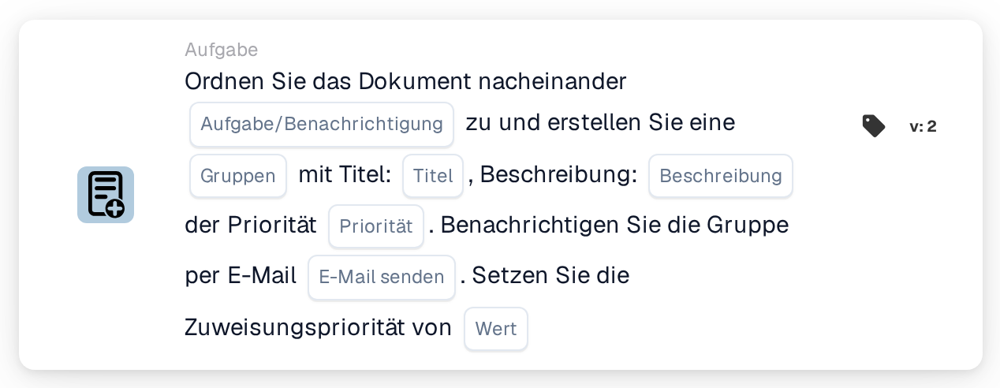

# Dokument zuweisen und Aufgabe/Benachrichtigung für Gruppe erstellen

<figure><figcaption>
Version 2
</figcaption></figure>

## **Zweck**

Die Workflow-Karte "**Dokument zuweisen und Aufgabe/Benachrichtigung für Gruppe erstellen**" weist ein Dokument einer angegebenen Gruppe zu, erstellt eine Aufgabe oder Benachrichtigung mit anpassbaren Details und sendet optional eine E-Mail-Benachrichtigung an die Gruppe. Diese Karte unterstützt außerdem die Zuweisung eines numerischen Prioritätswerts, um die Reihenfolge der Ausführung zu bestimmen.

## **Bestandteile der Karte**

1. **Gruppenname**
   * **Beschreibung:** Gibt die Gruppe an, die die Aufgabe oder Benachrichtigung erhält.
   * **Detail:** Ein Dropdown zur Auswahl des Namens der Gruppe, der das Dokument und die Aufgabe/Benachrichtigung zugewiesen werden.
2. **Aufgabe/Benachrichtigung**
   * **Beschreibung:** Gibt die Art der für die Gruppe zu erstellenden Aktion an.
   * **Detail:** Ein Dropdown zur Auswahl von entweder "Task" oder "Notification" je nach gewünschter Aktion.
3. **Titel**
   * **Beschreibung:** Gibt den Titel der Aufgabe oder Benachrichtigung an.
   * **Detail:** Ein Feld zum Hinzufügen eines prägnanten, beschreibenden Titels für die Aufgabe oder Benachrichtigung.
4. **Beschreibung**
   * **Beschreibung:** Beschreibt die Aufgabe oder Benachrichtigung näher.
   * **Detail:** Ein Feld, um zusätzliche Details zum Zweck der Aufgabe oder zum Inhalt der Benachrichtigung anzugeben.
5. **Priorität**
   * **Beschreibung:** Legt die Dringlichkeitsstufe der Aufgabe oder Benachrichtigung fest.
   * **Optionen:**
     * **Hoch:** Erfordert sofortige Aufmerksamkeit.
     * **Mittel:** Wichtig, aber nicht dringend.
     * **Niedrig:** Kann später bearbeitet werden.
6. **Mail senden**
   * **Beschreibung:** Konfiguriert, ob eine E-Mail-Benachrichtigung an die Gruppe gesendet wird.
   * **Optionen:**
     * **True:** Sendet eine E-Mail-Benachrichtigung.
     * **False:** Sendet keine E-Mail.
7. **Wert**
   * **Beschreibung:** Legt die numerische Priorität für die Dokumentzuweisung fest.
   * **Detail:** Ein Feld zur Eingabe eines numerischen Werts, wobei eine niedrigere Zahl eine höhere Priorität anzeigt.

## **Funktionalität**

* **Bedingungsauswertung:**\
  Die Karte führt ihre Aktionen nur aus, wenn die konfigurierten Workflow-Bedingungen erfüllt sind.
* **Dokumentzuweisung und Erstellung von Aufgabe/Benachrichtigung:**\
  Das Dokument wird der im Feld "Gruppenname" angegebenen Gruppe zugewiesen. Es wird eine Aufgabe oder Benachrichtigung mit dem konfigurierten Titel, der Beschreibung und der Prioritätsstufe erstellt.
* **E-Mail-Benachrichtigung:**\
  Ist "Mail senden" auf True gesetzt, wird eine E-Mail-Benachrichtigung an die Gruppe gesendet, um sie über die Aufgabe oder Benachrichtigung zu informieren.

## **Einrichtung und Konfiguration**

1. **Gruppennamen definieren:**
   * Geben Sie den Namen der Gruppe in das Feld Gruppenname ein.
2. **Task/Notification auswählen:**
   * Wählen Sie "Task" oder "Notification" aus dem Dropdown Task/Notification.
3. **Details der Aufgabe/Benachrichtigung festlegen:**
   * Geben Sie den Titel und die Beschreibung für die Aufgabe oder Benachrichtigung ein.
   * Wählen Sie die Priorität aus dem Dropdown (Hoch, Mittel oder Niedrig).
4. **E-Mail-Benachrichtigung aktivieren:**
   * Konfigurieren Sie die Option Mail senden auf True oder False, je nachdem, ob eine E-Mail-Benachrichtigung gesendet werden soll.
5. **Numerische Priorität zuweisen:**
   * Geben Sie im Feld Wert einen numerischen Wert ein, um die Priorität der Zuweisung zu bestimmen, wobei niedrigere Werte Vorrang haben.
6. Speichern Sie die Kartenkonfiguration und aktivieren Sie den Workflow.

## **Fazit**

Die Workflow-Karte "Assign Document and Create Task/Notification for Group" stellt sicher, dass Dokumente der passenden Gruppe zugewiesen werden, und erstellt gleichzeitig Aufgaben oder Benachrichtigungen mit anpassbaren Optionen für Priorität und E-Mail-Benachrichtigung. Dies optimiert das Dokumentenmanagement und steigert die Workflow-Effizienz.

<!-- workflow-card-practical-example-20261021 -->

## Praxisbeispiel

**Verwendungszweck:** Erstellen Sie eine Teamaufgabe neben der priorisierten Dokumentenzuweisung.

**Konfiguration:** Wählen Sie `Demo Finance`, den Titel `Review invoice` und die Aufgaben- und Zuweisungsprioritäten.

**Erwartetes Ergebnis und Gegenbeispiel:** Überprüfen Sie die Gruppendokumentzuordnung und die Aufgabe/Benachrichtigung separat. Eine Aufgabe allein ist kein Beweis für eine abgeschlossene Dokumentenfreigabe.

Dies ist eine beispielhafte Konfiguration und ein erwartetes Ergebnis. Verwenden Sie in Ihrer Testorganisation konfigurierte Felder, Benutzer und Gruppen. Es wird nicht behauptet, dass dieses Beispiel ausgeführt wurde.
