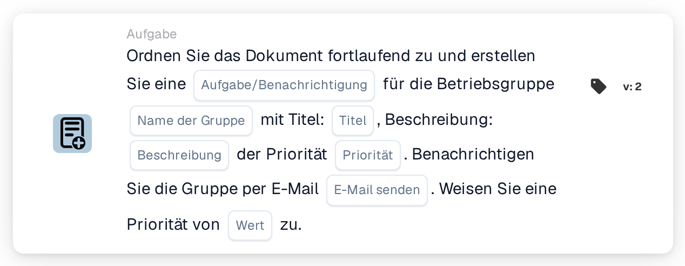

# Der Einrichtungsgruppe zuweisen und eine Aufgabe/Benachrichtigung erstellen

<figure><figcaption>
Version 2
</figcaption></figure>

## Zweck:

Diese Workflow-Karte fügt die Gruppe, die für die Einrichtung der Bestellung des Dokuments zuständig ist, der sequenziellen Zuweisung des Dokuments hinzu und verknüpft diesen Schritt mit einer Aufgabe oder Benachrichtigung. Die Einrichtung wird aus den Bestellungen übernommen, denen das Dokument zugeordnet ist, und die Gruppe wird über ihren Namen gefunden, der sowohl den auf der Karte eingegebenen Gruppennamen als auch den Einrichtungscode enthält. Die Aufgabe oder Benachrichtigung gehört zum Schritt der Gruppe in der Reihenfolge.

## Bestandteile der Karte:

1. **Aufgabe/Benachrichtigung**
   * **Beschreibung:** Legt fest, ob für die Gruppe eine Aufgabe oder eine Benachrichtigung erstellt wird.
   * **Optionen:**
     * **Aufgabe:** Es wird eine Aufgabe erstellt.
     * **Benachrichtigung:** Es wird eine Benachrichtigung erstellt.
2. **Name der Gruppe**
   * **Beschreibung:** Der Namensteil, den die Einrichtungsgruppen gemeinsam haben.
   * **Detail:** Ein Text, der mit den Namen der Benutzergruppen der Organisation verglichen wird. Eine Gruppe passt, wenn ihr Name diesen Text und den Einrichtungscode der Bestellung enthält. Beim Vergleich wird Groß- und Kleinschreibung nicht beachtet. Mit dem Gruppennamen **Approver** und einer Bestellung für die Einrichtung **1000** würde zum Beispiel eine Gruppe namens **Approver 1000** passen.
3. **Titel**
   * **Beschreibung:** Der Titel der Aufgabe oder Benachrichtigung.
   * **Detail:** Ein kurzer Text, der die Aufgabe oder Benachrichtigung kennzeichnet.
4. **Beschreibung**
   * **Beschreibung:** Weitere Details zur Aufgabe oder Benachrichtigung.
   * **Detail:** Ein Text, der beschreibt, was getan werden soll oder warum die Gruppe informiert wird.
5. **Priorität**
   * **Beschreibung:** Die Dringlichkeit der Aufgabe oder Benachrichtigung.
   * **Optionen:**
     * **hohes Gewicht:** Die Aufgabe oder Benachrichtigung wird mit hoher Priorität erstellt.
     * **mittleres Gewicht:** Die Aufgabe oder Benachrichtigung wird mit mittlerer Priorität erstellt.
     * **niedriges Gewicht:** Die Aufgabe oder Benachrichtigung wird mit niedriger Priorität erstellt.
6. **E-Mail senden**
   * **Beschreibung:** Legt fest, ob die Gruppe zusätzlich per E-Mail über die Aufgabe informiert wird.
   * **Optionen:**
     * **True:** Eine E-Mail-Benachrichtigung wird an die Gruppe gesendet.
     * **False:** Es wird keine E-Mail-Benachrichtigung gesendet.
7. **Wert**
   * **Beschreibung:** Die Priorität der Gruppe innerhalb der sequenziellen Zuweisung.
   * **Detail:** Eine ganze Zahl. Niedrigere Zahlen kommen zuerst, wobei 0 die höchste Priorität ist. Wird kein Wert oder ein negativer Wert eingegeben, wird die Priorität 1 verwendet.

## Funktionalität:

* **Ermitteln der Einrichtung:** Die Karte liest die Bestellungen, denen das Dokument zugeordnet ist, und sammelt den Einrichtungscode (den Standort der Bestellung) jeder dieser Bestellungen.
* **Ermitteln der Gruppe:** Für jeden Einrichtungscode sucht die Karte nach Benutzergruppen, deren Name sowohl den **Name der Gruppe** von der Karte als auch den Einrichtungscode enthält. Einrichtungscodes, für die keine Gruppe gefunden wird, werden im Workflow-Protokoll aufgeführt.
* **Ausführung der Aktion:** Jede passende Gruppe wird zusammen mit der Aufgabe oder Benachrichtigung mit der Priorität aus dem Feld **Wert** der sequenziellen Zuweisung hinzugefügt. Die Zuweisung selbst erfolgt am Ende des Workflow-Laufs: Der Eintrag mit der niedrigsten Prioritätszahl wird zuerst zugewiesen und seine Aufgabe oder Benachrichtigung wird erstellt. Alle Einträge, einschließlich des ersten, werden am Dokument als dessen Genehmigungsanfragen gespeichert, und die folgenden Schritte der Reihenfolge werden in aufsteigender Priorität daraus entnommen. Hat eine andere Karte das Dokument im selben Lauf bereits direkt zugewiesen, wird diese erste sequenzielle Zuweisung übersprungen, und ihre Aufgabe oder Benachrichtigung wird in diesem Lauf nicht erstellt.
* **Standardwerte:** Ist keine Aufgabenpriorität festgelegt, wird **mittleres Gewicht** verwendet. Ist **E-Mail senden** nicht festgelegt, wird keine E-Mail gesendet. Ist **Aufgabe/Benachrichtigung** nicht festgelegt, wird eine Aufgabe erstellt und das Workflow-Protokoll vermerkt die fehlende Einstellung.
* **Fehlende Daten:**
  * Ist der Gruppenname, der Titel oder die Beschreibung leer, wird die Karte nicht ausgeführt und meldet die fehlenden Daten im Workflow-Protokoll.
  * Ist das Dokument keiner Bestellung zugeordnet, meldet die Karte die fehlenden Daten, statt eine Gruppe hinzuzufügen.
  * Passt keine Gruppe zu einem der Einrichtungscodes, wird keine Gruppe hinzugefügt und das Workflow-Protokoll vermerkt, dass keine passende Gruppe gefunden wurde.

## Einrichtung und Konfiguration:

* Die Benutzergruppen sollten so benannt sein, dass jeder Name den gemeinsamen Namensteil und den Einrichtungscode enthält, zum Beispiel **Approver 1000**, **Approver 2000**.
* Die Karte kann aus der Kategorie **Aufgabe** hinzugefügt werden. Danach können die Art (**Aufgabe** oder **Benachrichtigung**), der gemeinsame Namensteil der Gruppen, der Titel, die Beschreibung, die Aufgabenpriorität, die E-Mail-Einstellung und die Position in der Reihenfolge (**Wert**) konfiguriert werden.
* Für eine Kette von Genehmigern können mehrere sequenzielle Karten im Workflow kombiniert werden, jede mit eigenem **Wert**.

## Fazit:

Die Workflow-Karte „Assign to Facility Group and Create a Task/Notification“ setzt das zuständige Einrichtungsteam an eine festgelegte Position in einer sequenziellen Genehmigung und gibt ihm eine klare Aufgabe für seinen Schritt. Eine Karte deckt alle Einrichtungen ab, sofern die Benutzergruppen einem einheitlichen Namensschema mit dem Einrichtungscode im Namen folgen.
