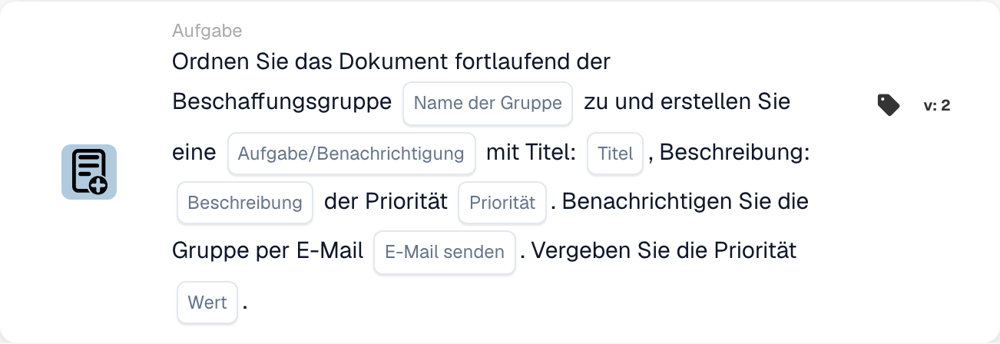

# Der Beschaffungsgruppe zuweisen und eine Aufgabe/Benachrichtigung erstellen

<figure><figcaption>
Kartenfelder in der angezeigten Version. Die Platzhalter sind noch nicht ausgefüllt.
</figcaption></figure>

## **Zweck**

Die Workflow-Karte "**Ordnen Sie das Dokument der Beschaffungsgruppe zu und erstellen Sie eine Aufgabe/Benachrichtigung**" weist ein Dokument einer angegebenen Beschaffungsgruppe zu, erstellt eine Aufgabe oder Benachrichtigung mit definierten Details und benachrichtigt die Gruppe optional per E-Mail. Sie priorisiert die Ausführung der Aufgabe auf Basis eines konfigurierbaren numerischen Prioritätswerts.

## **Bestandteile der Karte**

1. **Gruppenname**
   * **Beschreibung:** Gibt die Beschaffungsgruppe an, die für die Bearbeitung des Dokuments verantwortlich ist.
   * **Detail:** Ein Feld, in dem der Benutzer den Namen der Beschaffungsgruppe manuell eingeben kann.
2. **Aufgabe/Benachrichtigung**
   * **Beschreibung:** Legt fest, ob für die Gruppe eine Aufgabe oder eine Benachrichtigung erstellt wird.
   * **Detail:** Ein Feld, in dem der Benutzer zwischen der Erstellung einer Aufgabe oder einer Benachrichtigung wählen kann.
3. **Titel**
   * **Beschreibung:** Der Titel der für die Gruppe erstellten Aufgabe oder Benachrichtigung.
   * **Detail:** Ein Feld, um einen prägnanten und eindeutigen Titel für die Aufgabe oder Benachrichtigung anzugeben.
4. **Beschreibung**
   * **Beschreibung:** Weitere Details zur Aufgabe oder Benachrichtigung.
   * **Detail:** Ein Feld, um den Zweck der Aufgabe zu beschreiben und Kontext oder Anweisungen zu geben.
5. **Priorität**
   * **Beschreibung:** Legt die Dringlichkeitsstufe der Aufgabe oder Benachrichtigung fest.
   * **Optionen:**
     * **Hoch:** Die Aufgabe erfordert sofortige Aufmerksamkeit.
     * **Mittel:** Die Aufgabe ist wichtig, aber nicht dringend.
     * **Niedrig:** Die Aufgabe kann zu einem späteren Zeitpunkt bearbeitet werden.
6. **Mail senden**
   * **Beschreibung:** Konfiguriert, ob eine E-Mail-Benachrichtigung an die Gruppe gesendet werden soll.
   * **Optionen:**
     * **True:** Sendet eine E-Mail-Benachrichtigung an die Beschaffungsgruppe.
     * **False:** Es wird keine E-Mail-Benachrichtigung gesendet.
7. **Wert**
   * **Beschreibung:** Legt die numerische Priorität für die Ausführung der Aufgabe fest.
   * **Detail:** Ein Feld zur Eingabe eines numerischen Werts, wobei eine niedrigere Zahl eine höhere Priorität darstellt.

## **Funktionalität**

* **Bedingungsauswertung:**\
  Die Karte führt ihre Aktionen nur aus, wenn die definierten Workflow-Bedingungen erfüllt sind.
* **Gruppenzuweisung und Erstellung von Aufgabe/Benachrichtigung:**\
  Das Dokument wird der angegebenen Beschaffungsgruppe zugewiesen. Es wird eine Aufgabe oder Benachrichtigung mit dem angegebenen Titel, der Beschreibung und der Priorität erstellt.
* **E-Mail-Benachrichtigung:**\
  Ist "Mail senden" auf True gesetzt, erhält die Gruppe eine E-Mail über die Aufgabe oder Benachrichtigung.

## **Einrichtung und Konfiguration**

1. **Gruppennamen definieren:**
   * Geben Sie den Namen der Beschaffungsgruppe in das Feld Gruppenname ein.
2. **Details der Aufgabe/Benachrichtigung konfigurieren:**
   * Geben Sie den Titel und die Beschreibung für die Aufgabe oder Benachrichtigung an.
   * Wählen Sie die Priorität aus dem Dropdown-Menü (Hoch, Mittel oder Niedrig).
3. **E-Mail-Benachrichtigung aktivieren:**
   * Setzen Sie "Mail senden" auf True oder False, je nachdem, ob die Gruppe eine E-Mail erhalten soll.
4. **Numerische Priorität festlegen:**
   * Geben Sie im Feld Wert einen numerischen Wert ein, um die Priorität der Aufgabe zu bestimmen, wobei niedrigere Werte zuerst verarbeitet werden.
5. Speichern Sie die Kartenkonfiguration und aktivieren Sie den Workflow.

## **Fazit**

Die Workflow-Karte "Assign Document to Procurement Group and Create Task/Notification" stellt sicher, dass Dokumente mit klaren Aufgabenanweisungen und Prioritätsstufen an die passende Gruppe geleitet werden. Durch die Aktivierung optionaler E-Mail-Benachrichtigungen verbessert diese Karte die Sichtbarkeit von Aufgaben und sorgt für eine reibungslose Workflow-Ausführung.

<!-- workflow-card-practical-example-20261021 -->

## Praxisbeispiel

**Verwendungszweck:** Kombinieren Sie eine priorisierte Beschaffungsaufgabe mit einer Überprüfungsaufgabe.

**Konfiguration:** Wählen Sie `Demo Procurement`, Titel `Review order variance`, Aufgabenpriorität und Zuweisungspriorität.

**Erwartetes Ergebnis und Gegenbeispiel:** Das konfigurierte Beschaffungsziel erhält den dokumentierten Auftrag und die Aufgabe/Benachrichtigung. Überprüfen Sie beide und ihre Prioritäten im Ergebnis.

Dies ist eine beispielhafte Konfiguration und ein erwartetes Ergebnis. Verwenden Sie in Ihrer Testorganisation konfigurierte Felder, Benutzer und Gruppen. Es wird nicht behauptet, dass dieses Beispiel ausgeführt wurde.
