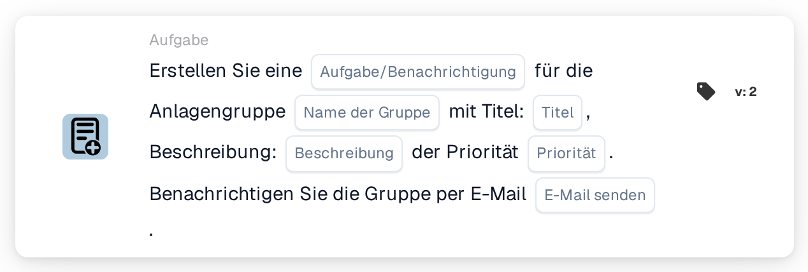

# Erstellen Sie eine neue Aufgabe und weisen Sie sie der Einrichtungsgruppe zu

<figure><figcaption>
Version 2
</figcaption></figure>

## Zweck:

Diese Workflow-Karte erstellt eine Aufgabe oder Benachrichtigung für die Gruppe, die für die Einrichtung der Bestellung des Dokuments zuständig ist. Die Einrichtung wird nicht auf der Karte ausgewählt: Sie wird aus den Bestellungen übernommen, denen das Dokument zugeordnet ist. Die Karte sucht dann nach einer Benutzergruppe, deren Name sowohl den auf der Karte eingegebenen Gruppennamen als auch den Einrichtungscode enthält, und erstellt die Aufgabe für diese Gruppe. Das Dokument selbst wird nicht neu zugewiesen.

Für eine Karte, die das Dokument im Rahmen einer sequenziellen Zuweisung zusätzlich der Einrichtungsgruppe zuweist, kann **Assign to Facility Group and Create a Task/Notification** verwendet werden.

## Bestandteile der Karte:

1. **Aufgabe/Benachrichtigung**
   * **Beschreibung:** Legt fest, ob für die Gruppe eine Aufgabe oder eine Benachrichtigung erstellt wird.
   * **Optionen:**
     * **Aufgabe:** Es wird eine Aufgabe erstellt.
     * **Benachrichtigung:** Es wird eine Benachrichtigung erstellt.
2. **Name der Gruppe**
   * **Beschreibung:** Der Namensteil, den die Einrichtungsgruppen gemeinsam haben.
   * **Detail:** Ein Text, der mit den Namen der Benutzergruppen der Organisation verglichen wird. Eine Gruppe passt, wenn ihr Name diesen Text und den Einrichtungscode der Bestellung enthält. Beim Vergleich wird Groß- und Kleinschreibung nicht beachtet. Mit dem Gruppennamen **Warehouse** und einer Bestellung für die Einrichtung **1000** würde zum Beispiel eine Gruppe namens **Warehouse 1000** passen.
3. **Titel**
   * **Beschreibung:** Der Titel der Aufgabe oder Benachrichtigung.
   * **Detail:** Ein kurzer Text, der die Aufgabe oder Benachrichtigung kennzeichnet.
4. **Beschreibung**
   * **Beschreibung:** Weitere Details zur Aufgabe oder Benachrichtigung.
   * **Detail:** Ein Text, der beschreibt, was getan werden soll oder warum die Gruppe informiert wird.
5. **Priorität**
   * **Beschreibung:** Die Dringlichkeit der Aufgabe oder Benachrichtigung.
   * **Optionen:**
     * **hohes Gewicht:** Die Aufgabe oder Benachrichtigung wird mit hoher Priorität erstellt.
     * **mittleres Gewicht:** Die Aufgabe oder Benachrichtigung wird mit mittlerer Priorität erstellt.
     * **niedriges Gewicht:** Die Aufgabe oder Benachrichtigung wird mit niedriger Priorität erstellt.
6. **E-Mail senden**
   * **Beschreibung:** Legt fest, ob die Gruppe zusätzlich per E-Mail über die Aufgabe informiert wird.
   * **Optionen:**
     * **True:** Eine E-Mail-Benachrichtigung wird an die Gruppe gesendet.
     * **False:** Es wird keine E-Mail-Benachrichtigung gesendet.

## Funktionalität:

* **Ermitteln der Einrichtung:** Die Karte liest die Bestellungen, denen das Dokument zugeordnet ist, und sammelt den Einrichtungscode (den Standort der Bestellung) jeder dieser Bestellungen.
* **Ermitteln der Gruppe:** Für jeden Einrichtungscode sucht die Karte nach Benutzergruppen, deren Name sowohl den **Name der Gruppe** von der Karte als auch den Einrichtungscode enthält. Einrichtungscodes, für die keine Gruppe gefunden wird, werden im Workflow-Protokoll aufgeführt.
* **Erstellen der Aufgabe:** Für die passende Gruppe wird eine Aufgabe oder Benachrichtigung mit Titel, Beschreibung und Priorität von der Karte erstellt und mit dem Dokument verknüpft. Passen mehrere Gruppen, wird die Aufgabe nur für eine von ihnen erstellt; für welche, wird nicht durch die Karte festgelegt.
* **Standardwerte:** Ist keine Priorität festgelegt, wird **mittleres Gewicht** verwendet. Ist **E-Mail senden** nicht festgelegt, wird keine E-Mail gesendet. Ist **Aufgabe/Benachrichtigung** nicht festgelegt, wird eine Aufgabe erstellt und das Workflow-Protokoll vermerkt die fehlende Einstellung.
* **Fehlende Daten:**
  * Ist der Gruppenname, der Titel oder die Beschreibung leer, wird die Karte nicht ausgeführt und meldet die fehlenden Daten im Workflow-Protokoll.
  * Ist das Dokument keiner Bestellung zugeordnet, meldet die Karte die fehlenden Daten, statt eine Aufgabe zu erstellen.
  * Passt keine Gruppe zu einem der Einrichtungscodes, wird keine Aufgabe erstellt und das Workflow-Protokoll vermerkt, dass keine passende Gruppe gefunden wurde.

## Einrichtung und Konfiguration:

* Die Benutzergruppen sollten so benannt sein, dass jeder Name den gemeinsamen Namensteil und den Einrichtungscode enthält, zum Beispiel **Warehouse 1000**, **Warehouse 2000**.
* Die Karte kann aus der Kategorie **Aufgabe** hinzugefügt werden. Danach können die Art (**Aufgabe** oder **Benachrichtigung**), der gemeinsame Namensteil der Gruppen, der Titel, die Beschreibung, die Priorität und die E-Mail-Einstellung konfiguriert werden.

## Fazit:

Die Workflow-Karte „Create a New Task and assign it to Facility Group“ bezieht das Team der richtigen Einrichtung in den Prozess ein, ohne zu ändern, wem das Dokument zugewiesen ist. Eine Karte deckt alle Einrichtungen ab, sofern die Benutzergruppen einem einheitlichen Namensschema mit dem Einrichtungscode im Namen folgen.
