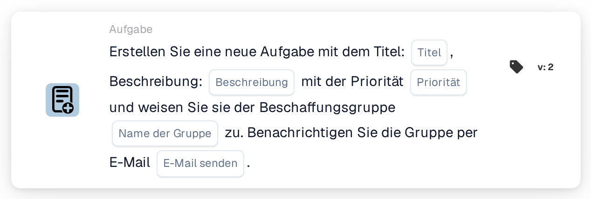
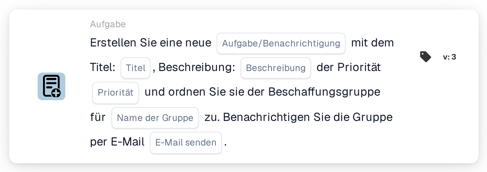

# Erstellen Sie eine neue Aufgabe und weisen Sie sie der Beschaffungsgruppe zu

<figure><figcaption>
Version 2
</figcaption></figure>

<figure><figcaption>
Version 3
</figcaption></figure>

## **Zweck:**

Die Workflow-Karte **„Aufgabe für Beschaffungsgruppe erstellen“** erstellt eine neue Aufgabe, die dynamisch der in der Konfiguration angegebenen Beschaffungsgruppe zugewiesen wird. Diese Aufgabe kann mit unterschiedlichen Prioritätsstufen zugewiesen werden, und es kann eine optionale E-Mail-Benachrichtigung gesendet werden, um die Gruppe über die Aufgabe zu informieren. Diese Karte stellt sicher, dass das richtige Team auf Basis der Workflow-Bedingungen benachrichtigt wird.

## **Bestandteile der Karte:**

1. **Titel**
   * **Beschreibung:** Gibt den Titel der Aufgabe an.
   * **Detail:** Dieses Feld kennzeichnet die erstellte Aufgabe und liefert einen prägnanten Titel zur leichten Identifizierung.
2. **Beschreibung**
   * **Beschreibung:** Liefert weitere Details zur Aufgabe.
   * **Detail:** Dieses Feld wird verwendet, um das Ziel der Aufgabe sowie notwendigen Kontext oder Anweisungen zu beschreiben.
3. **Priorität**
   * **Beschreibung:** Legt die Dringlichkeit der Aufgabe fest.
   * **Optionen:**
     * **Hoch:** Die Aufgabe erfordert sofortige Aufmerksamkeit.
     * **Mittel:** Die Aufgabe ist wichtig, aber nicht dringend.
     * **Niedrig:** Die Aufgabe kann zu einem späteren Zeitpunkt bearbeitet werden.
4. **Gruppenname**
   * **Beschreibung:** Gibt die Beschaffungsgruppe an, der die Aufgabe zugewiesen wird.
   * **Detail:** Dieses Feld bestimmt die für die Aufgabe verantwortliche Beschaffungsgruppe. Es stellt sicher, dass die Aufgabe an das richtige Team geleitet wird.
5. **E-Mail-Benachrichtigung**
   * **Beschreibung:** Konfiguriert, ob eine E-Mail-Benachrichtigung an die zugewiesene Beschaffungsgruppe gesendet werden soll.
   * **Optionen:**
     * **True:** Sendet eine E-Mail-Benachrichtigung an die Beschaffungsgruppe.
     * **False:** Es wird keine E-Mail-Benachrichtigung gesendet.

## **Funktionalität:**

* **Bedingungsauswertung:**\
  Die Karte führt ihre Aktion nur aus, wenn sowohl der **„Wenn“**- als auch der **„Und“**-Abschnitt als erfüllt ausgewertet werden.
* **Aufgabenerstellung:**\
  Die Karte erstellt eine neue Aufgabe und weist sie der im Feld "Gruppenname" definierten Beschaffungsgruppe zu. Diese Aufgabe enthält den angegebenen Titel, die Beschreibung und die Prioritätsstufe.
* **E-Mail-Benachrichtigung:**\
  Ist die Option für die E-Mail-Benachrichtigung auf true gesetzt, wird eine E-Mail an die Beschaffungsgruppe gesendet, um sie über die Aufgabe zu informieren.

## **Einrichtung und Konfiguration:**

* **Aufgabendetails definieren:**\
  Geben Sie Titel, Beschreibung und Prioritätsstufe der Aufgabe ein.
* **Beschaffungsgruppe auswählen:**\
  Wählen Sie die Beschaffungsgruppe, die für die Aufgabe verantwortlich ist.
* **E-Mail-Benachrichtigung aktivieren:**\
  Legen Sie fest, ob bei der Erstellung der Aufgabe eine E-Mail-Benachrichtigung an die Gruppe gesendet werden soll.

## **Fazit:**

Die Workflow-Karte "Create Task for Procurement Group" stellt sicher, dass Aufgaben automatisch der passenden Beschaffungsgruppe mit definierten Prioritäten zugewiesen werden. Diese Karte kann die Gruppe außerdem per E-Mail benachrichtigen, um sicherzustellen, dass Aufgaben zeitnah bearbeitet werden, und steigert so die Workflow-Effizienz und das Aufgabenmanagement.

<!-- workflow-card-practical-example-20261021 -->

## Praxisbeispiel

**Verwendungszweck:** Bitten Sie das Einkaufsteam, eine Rechnungsausnahme zu überprüfen.

**Konfiguration:** Wählen Sie `Demo Procurement`, Titel `Review order variance`, Beschreibung und Priorität.

**Erwartetes Ergebnis und Gegenbeispiel:** Für die ausgewählte Beschaffungsgruppe wird eine Aufgabe erstellt. Überprüfen Sie den Aufgabenempfänger und die Beschreibung. Die Erstellung allein bestätigt nicht, dass die Abweichung behoben wurde.

Dies ist eine beispielhafte Konfiguration und ein erwartetes Ergebnis. Verwenden Sie in Ihrer Testorganisation konfigurierte Felder, Benutzer und Gruppen. Es wird nicht behauptet, dass dieses Beispiel ausgeführt wurde.
