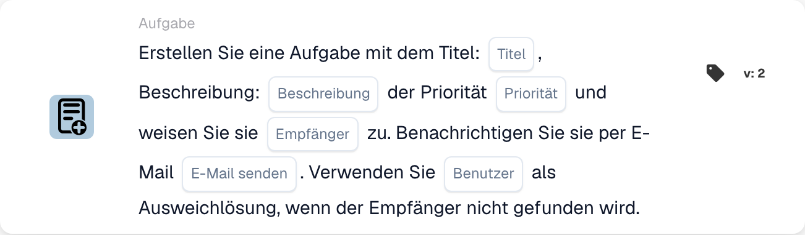

# Erstellen Sie eine neue Aufgabe und weisen Sie sie dem Empfänger zu

<figure><figcaption>
Kartenfelder in der angezeigten Version. Die Platzhalter sind noch nicht ausgefüllt.
</figcaption></figure>

## **Zweck:**

Die Workflow-Karte **„Aufgabe mit Fallback erstellen“** sorgt für eine effiziente Aufgabendelegation, indem sie Aufgaben bestimmten Rollen – Disponent oder Einkäufer – zuweist und dabei einen Ersatzmechanismus einbindet, um fehlgeschlagene Aufgabenzuweisungen zu verhindern. Diese Karte verbessert die Zuverlässigkeit und Anpassungsfähigkeit des Workflows in dynamischen Szenarien.

## **Bestandteile der Karte:**

1. **Titel**
   * **Beschreibung**: Gibt den Titel der erstellten Aufgabe an.
   * **Detailliert**: Liefert einen prägnanten Bezeichner für die Aufgabe.
2. **Beschreibung**
   * **Beschreibung**: Beschreibt den Zweck oder Kontext der Aufgabe.
   * **Detailliert**: Verdeutlicht die Details der Aufgabe.
3. **Priorität**
   * **Beschreibung**: Legt die Dringlichkeitsstufe der Aufgabe fest.
   * **Optionen**:
     * **Hoch**: Erfordert sofortige Aufmerksamkeit.
     * **Mittel**: Wichtig, aber nicht dringend.
     * **Niedrig**: Kann später bearbeitet werden.
4. **Zugewiesene Rolle**
   * **Beschreibung**: Gibt die primäre Rolle an, der die Aufgabe zugewiesen wird.
   * **Optionen**:
     * **Disponent**: Weist die Aufgabe dem Disponenten zu.
     * **Einkäufer**: Weist die Aufgabe dem Einkäufer zu.
5. **E-Mail-Benachrichtigung**
   * **Beschreibung**: Ermöglicht das Benachrichtigen des zugewiesenen Benutzers per E-Mail.
   * **Optionen**:
     * **True**: Sendet eine E-Mail-Benachrichtigung an den Benutzer.
     * **False**: Es wird keine E-Mail-Benachrichtigung gesendet.
6. **Ersatzbenutzer**
   * **Beschreibung**: Bietet eine Ersatzoption für die Aufgabenzuweisung, falls die Empfängerrolle nicht gefunden wird.
   * **Detailliert**: Ermöglicht die Auswahl eines Benutzers aus einer Dropdown-Liste, um die Aufgabendelegation sicherzustellen.

## **Funktionalität:**

* **Bedingungsauswertung**:\
  Die Karte wird nur ausgeführt, wenn die Bedingungen in den Abschnitten **„Wenn“** und **„Und“** erfüllt sind.
* **Aufgabenzuweisung**:
  * Die Aufgabe wird der ausgewählten Rolle (Disponent oder Einkäufer) zugewiesen.
  * Wird die angegebene Rolle nicht gefunden, wird die Aufgabe einem Benutzer aus der Ersatz-Dropdown-Liste zugewiesen.
* **E-Mail-Benachrichtigung**:\
  Sendet eine E-Mail an den zugewiesenen Benutzer, wenn die E-Mail-Benachrichtigung aktiviert ist.

## **Einrichtung und Konfiguration:**

1. **Aufgabendetails angeben**: Geben Sie Titel, Beschreibung und Priorität der Aufgabe ein.
2. **Primäre Rolle auswählen**: Wählen Sie die Rolle, der die Aufgabe zugewiesen wird (Disponent oder Einkäufer).
3. **Ersatzbenutzer konfigurieren**: Wählen Sie einen Ersatzbenutzer aus der Dropdown-Liste, um die Aufgabenzuweisung sicherzustellen, falls die primäre Rolle nicht gefunden wird.
4. **E-Mail-Benachrichtigung aktivieren**: Geben Sie an, ob der zugewiesene Benutzer eine E-Mail-Benachrichtigung erhalten soll.

## **Fazit:**

Die Workflow-Karte **„Aufgabe mit Fallback erstellen“** sorgt durch die Integration eines Ersatzmechanismus für eine nahtlose Aufgabendelegation. Indem sie Aufgaben auf Basis von Rollen zuweist und eine alternative Benutzeroption bietet, erhöht sie die Zuverlässigkeit und Flexibilität in den Prozessen des Aufgabenmanagements.

<!-- workflow-card-complete-example-20261021 oc_task -->

### Beispiel für eine Empfängeraufgabe

**Konfiguration:** Geben Sie den Titel `Review delivery date`, eine Beschreibung zur Identifizierung des synthetischen Dokuments, eine Priorität, die Rolle „Käufer“ und den konfigurierten Fallback-Benutzer `DEMO_REVIEWER` ein. Deaktivieren Sie die E-Mail-Benachrichtigung für diese beispielhafte Einrichtung.

**Erwartetes Ergebnis und Gegenbeispiel:** Wenn ein Käufer gelöst werden kann, wird die neue Aufgabe diesem Benutzer zugewiesen. Wenn die Rolle nicht aufgelöst werden kann, wird der konfigurierte Fallback verwendet. Überprüfen Sie den tatsächlichen Aufgabeneigentümer. Ein fehlender primärer Empfänger ist kein Beweis dafür, dass der Fallback-Benutzer existiert oder dass eine Aufgabe erstellt wurde.

Dies ist eine beispielhafte Testkonfiguration und das erwartete Ergebnis. es wurde nicht ausgeführt. Verwenden Sie die in Ihrer Testorganisation konfigurierten Daten und Empfänger.
