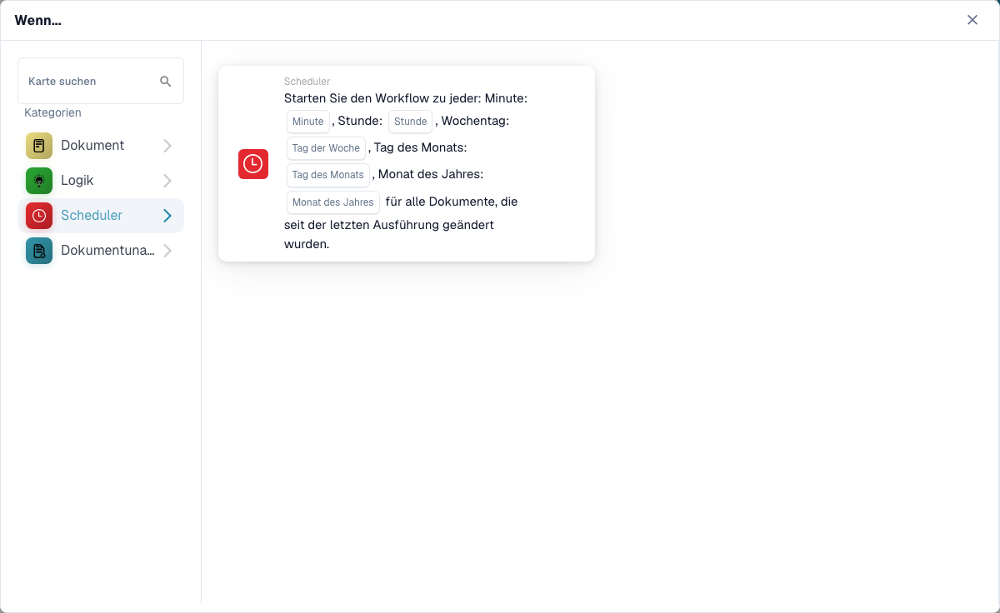

# Wenn

Die Karten in dieser Kategorie, angezeigt in der Bibliothek **Karte hinzufügen** des Workflow Builders:

<figure><figcaption>
Die Karten dieser Kategorie.
</figcaption></figure>

<figure><figcaption></figcaption></figure>

#### Das „Wann“ in Workflow-Konfigurationen verstehen

**Zweck von „Wann“**

* Der Abschnitt „Wenn“ in einer Workflow-Konfiguration definiert die Auslöserbedingungen, die eine bestimmte Workflow-Aktion auslösen. Diese Bedingungen basieren auf festgelegten Kriterien in Bezug auf Dokumentattribute oder Benutzeraktivitäten innerhalb des ERP-Systems.

**Wie es funktioniert**

* In Ihrer Benutzeroberfläche scheint „Wann“ ein Ausgangspunkt zu sein, über den Benutzer verschiedene Triggerkarten auswählen können. Jede Karte gibt Bedingungen an, unter denen nachfolgende Aktionen (definiert im Abschnitt „Und“) ausgeführt werden.

**Dokumenttyp-Bedingungskarten**

* Die im Screenshot angezeigten Karten mit dem Dokumentsymbol sind Variationen der „Dokumenttyp“-Bedingungen, die zum Auslösen von Workflows basierend auf der Art des verarbeiteten Dokuments verwendet werden. Hier ist eine Aufschlüsselung der einzelnen Arten der angezeigten Bedingungskarten:
  * **Dokumenttyp (Operator) einer von (Typ)**: Diese Karte löst eine Aktion aus, wenn der Typ eines Dokuments mit einem der angegebenen Typen in einer Liste übereinstimmt. Der Operator kann Optionen wie „ist“ oder „ist nicht“ einschließen, um einschließende oder ausschließliche Bedingungen zu ermöglichen.
  * **Dokumenttyp (Operator) (Typ)**: Diese einfachere Variante wird basierend auf einer einzelnen Dokumenttypbedingung ausgelöst. Normalerweise wird geprüft, ob es sich bei dem Dokumenttyp um einen bestimmten Typ handelt oder nicht, ohne die Möglichkeit, aus mehreren Typen auszuwählen.
  *

**Sellerie Beat**

* Die Karte mit dem Uhrensymbol im Screenshot ist eine „Celery Beat“-Bedingung, die zum Auslösen von Workflows basierend auf Datum und Uhrzeit verwendet wird.

#### Einrichten einer „Wann“-Triggerkarte

1. **Auswahl des Bedingungstyps**: Benutzer beginnen mit der Auswahl eines Bedingungstyps, der für den Workflow relevant ist, den sie automatisieren möchten. In diesem Fall stehen Dokumenttypen im Mittelpunkt.
2. **Definieren des Operators**: Benutzer müssen den logischen Operator (z. B. „ist“ oder „ist nicht“) festlegen, der die Grundlage für den Vergleich tatsächlicher Dokumenttypen mit den definierten Bedingungen bildet.
3. **Dokumenttypen festlegen**: Je nach Karte können Benutzer einen oder mehrere Dokumenttypen auswählen, die den Workflow auslösen, wenn Dokumente dieser Typen verarbeitet werden.
4. **Finalisieren des Auslösers**: Sobald die Bedingung eingerichtet ist, wird sie zur Grundlage für das Auslösen bestimmter im Workflow definierter Aktionen. Erfüllt ein Dokument die eingestellte Bedingung, werden die definierten Aktionen automatisch ausgelöst.

#### Praktische Anwendung

In der Praxis sind diese Triggerkarten von entscheidender Bedeutung für die Automatisierung von Prozessen wie Genehmigungen, Benachrichtigungen oder anderen Verfahren, die von der Art des bearbeiteten Dokuments abhängen. Wenn es sich bei einem Dokumenttyp beispielsweise um eine „Rechnung“ handelt und er den auf der Karte „Wann“ festgelegten Bedingungen entspricht, leitet der Workflow das Dokument möglicherweise automatisch zur Zahlungsabwicklung weiter.

Diese Einrichtung stellt sicher, dass Arbeitsabläufe nicht nur effizient, sondern auch auf die spezifischen betrieblichen Anforderungen der Organisation zugeschnitten sind, wodurch die manuelle Kontrolle reduziert und die Prozesse zur Dokumentenbearbeitung beschleunigt werden.

Zusammenfassend geht es beim „Wann“-Teil Ihrer Workflow-Konfiguration darum, die Voraussetzungen für automatisierte Aktionen auf der Grundlage spezifischer, vordefinierter Bedingungen zu schaffen. Es handelt sich um ein leistungsstarkes Tool, das sicherstellt, dass Ihr ERP-System dynamisch auf die Anforderungen des Unternehmens reagiert und so sowohl die Produktivität als auch die Genauigkeit der Dokumentenverwaltung steigert.

[Variablenänderungs- und Webhook-Ereignis-Trigger-Referenz](../cards-overview/logic-cards-guide.md).
