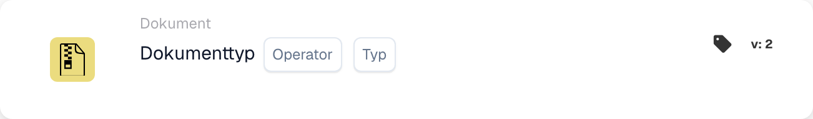
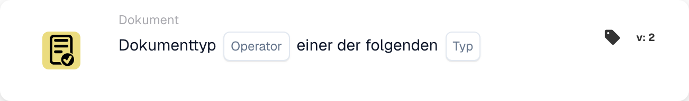

# Kartenbeschreibung

## **When Cards: Dokumenttyp**

Ein Workflow kann mit diesen beiden Karten gestartet werden. Hier können Sie entscheiden, mit welchem Dokumenttyp der Workflow beginnt oder ob er ausgewählte Dokumenttypen nicht beeinflussen soll.

\\

<figure><figcaption>
Kartenfelder in der angezeigten Version. Die Platzhalter sind noch nicht ausgefüllt.
</figcaption></figure>

<figure><figcaption>
Kartenfelder in der angezeigten Version. Die Platzhalter sind noch nicht ausgefüllt.
</figcaption></figure>

Diese Karte kann auch verwendet werden, um mehrere Dokumenttypen anzugeben, die vom Workflow beeinflusst werden sollen.
