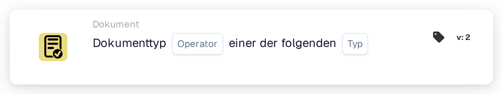

# Dokumenttyp aus einer Liste

<figure><figcaption>
Version 2
</figcaption></figure>

## **Zweck:**

Diese DocBits-Karte gewährleistet die korrekte Klassifizierung eines Dokuments, indem überprüft wird, ob es einem der angegebenen Dokumententypen entspricht. Dies ist nützlich in Situationen, in denen ein Dokument mehreren Kategorien zugeordnet werden könnte, um eine umfassendere Validierung und automatisierte Verarbeitung zu ermöglichen.

## **Funktionalität:**

* **Validierung mehrerer Dokumententypen:** Diese Karte ermöglicht es Benutzern zu überprüfen, ob ein Dokument einem Satz von angegebenen Dokumententypen entspricht, um eine flexible Kategorisierung für komplexere Dokumenten-Workflows sicherzustellen.
* **Operator:** Benutzer können Bedingungen definieren, um das Dokument gegen mehrere Typen zu validieren. Verfügbare Operatoren sind:
  * **Ist:** Bestätigt, dass das Dokument einem der angegebenen Dokumententypen entspricht.
  * **Ist nicht:** Stellt sicher, dass das Dokument keinem der ausgewählten Dokumententypen entspricht.
* **Dokumententypen:** Benutzer können aus mehreren unterstützten Dokumententypen auswählen, darunter:
  * **Rechnung:** Finanzunterlagen, die zur Zahlung eingereicht werden.
  * **Gutschrift:** Dokumente, die eine Reduzierung des geschuldeten Betrags anzeigen.
  * **Bestellung:** Dokumente, die die Bestellung eines Käufers detaillieren.
  * **Auftragsbestätigung:** Dokumente, die bestätigen, dass eine Bestellung akzeptiert wurde.
  * **Versandanzeige:** Dokumente, die über eine bevorstehende Lieferung informieren.

## **Verwendung:**

Diese Karte eignet sich für Dokumentenmanager und Administratoren, die sicherstellen müssen, dass Dokumente in eine der verschiedenen Kategorien eingeordnet werden. Sie ist besonders nützlich für Dokumenten-Workflows, in denen ein Dokument unter mehreren Kategorien klassifiziert werden kann, um Automatisierung und Klassifizierungsgenauigkeit zu verbessern.

## **Beispiel Szenario:**

* Ein Benutzer lädt ein Dokument hoch, das entweder eine "Rechnung" oder eine "Gutschrift" sein könnte. Mit dem "Ist"-Operator bestätigt die Karte, dass das Dokument einem der ausgewählten Typen entspricht, sodass das System die entsprechenden Regeln und Kategorisierung anwenden kann.

Durch die Verwendung der Karte "Validierung mehrerer Dokumententypen" können Organisationen die Flexibilität des Workflows verbessern, die Kategorisierung automatisieren und sicherstellen, dass Dokumente ordnungsgemäß behandelt werden, auch wenn mehrere Typen zutreffen.
