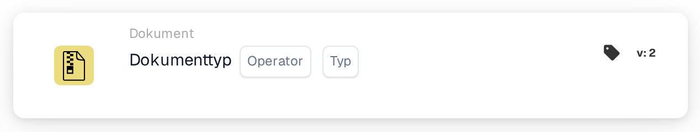

# Dokumenttyp als Auslöser prüfen

<figure><figcaption>
Version 1
</figcaption></figure>

<figure><figcaption>
Version 2
</figcaption></figure>

## **Zweck:**

Diese Workflow-Karte ist speziell darauf ausgelegt, vordefinierte Operationen an nach Typ kategorisierten Dokumenten durchzuführen. Sie optimiert die Bearbeitung verschiedener Dokumentenformen innerhalb eines ERP-Systems und stellt sicher, dass jeder Typ gemäß seinen einzigartigen Anforderungen und organisatorischen Richtlinien verarbeitet wird.

## **Funktionalität:**

* **Dokumenttyp-Validierung**: Diese Karte überprüft, ob ein Dokument einem bestimmten Typ entspricht, sodass Benutzer dessen Kategorisierung bestätigen können.
* **Operator**: Benutzer können Bedingungen festlegen, um den Dokumenttyp zu bestimmen. Verfügbare Operatoren sind:
  * **Ist**: Bestätigt, dass das Dokument dem angegebenen Dokumenttyp entspricht.
  * **Ist nicht**: Stellt sicher, dass das Dokument nicht dem angegebenen Dokumenttyp entspricht.
* **Dokumenttypen**: Unterstützte Dokumenttypen sind:
  * **Rechnung**
  * **Gutschrift**
  * **Lastschrift**
  * **Bestellung**
  * **Auftragsbestätigung**
  * **Lieferschein**

## **Verwendung**:

Diese Karte ist nützlich für Dokumentenmanager und Administratoren, die sicherstellen müssen, dass Dokumente korrekt klassifiziert werden, um die Bearbeitung zu optimieren. Die Validierung von Dokumenttypen verbessert die Workflow-Automatisierung, ermöglicht dokumentenspezifische Aktionen und hält Aufzeichnungen organisiert.

## **Beispiel-Szenario**:

* Ein Benutzer lädt ein Dokument mit der Bezeichnung "Lastschrift" hoch. Mit dem Operator "Ist" bestätigt die Karte, dass der Dokumenttyp tatsächlich "Lastschrift" ist, sodass das System relevante Verarbeitungsregeln anwenden und es entsprechend kategorisieren kann.

Durch den Einsatz der Karte "Dokumenttyp" können Organisationen die Dokumentenklassifizierung automatisieren, die Konsistenz in der Dokumentenbearbeitung sicherstellen und die Effizienz von Dokumentenmanagement-Workflows verbessern.
