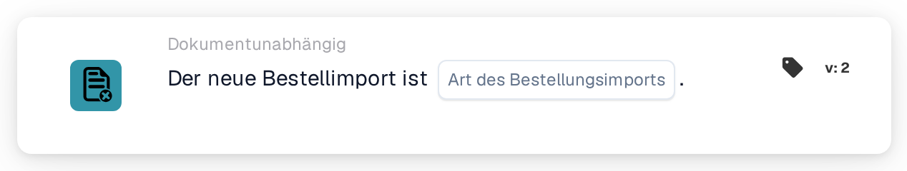

# Bestellimport

<figure><figcaption>
Version 2
</figcaption></figure>

## Zweck:

Diese Workflow-Karte startet einen Workflow (Auslöser), wenn eine Bestellung in DocBits importiert wird. Sie kann auf neu angelegte Bestellungen, auf Aktualisierungen bestehender Bestellungen oder auf beides reagieren. Der Workflow läuft ohne Dokument und kann daher genutzt werden, um Personen zu informieren oder andere Systeme aufzurufen, sobald Bestelldaten eingehen.

## Bestandteile der Karte:

1. **Art des Bestellungsimports**
   * **Beschreibung:** Legt fest, welche Art von Import den Workflow startet.
   * **Optionen:**
     * **eine neue Bestellung.** Die Bestellung existierte vorher nicht und wurde durch den Import angelegt.
     * **eine Aktualisierung einer bestehenden Bestellung.** Eine bestehende Bestellung wurde durch den Import aktualisiert.

     Beide Optionen können ausgewählt werden.

## Funktionalität:

* **Wann der Workflow startet:** Wird eine Bestellung aus dem ERP-System durch den Bestellimport verarbeitet, hält das System fest, ob sie neu war oder eine Aktualisierung. Anschließend startet es alle aktivierten dokumentunabhängigen Workflows der Organisation (außer Webhook- und zeitgesteuerten Workflows) und übergibt diese Information zusammen mit der Bestell-ID und der Bestellnummer an die Workflows. Das geschieht nur, wenn das Workflow-Modul für die Organisation aktiv ist und es aktive Workflows gibt. Eine Bestellung, die übersprungen wird, weil die eingehende Version nicht neuer ist als die gespeicherte, startet keine Workflows.
* **Bedingungsauswertung:** Die Karte prüft, ob die an den Workflow übergebene Importart eine der auf der Karte ausgewählten Arten ist.
* **Ausführung der Aktion:**
  * **True-Bedingung:**\
    Stimmt die Importart mit einer ausgewählten Option überein, wird der Workflow mit den nächsten Karten fortgesetzt.
  * **False-Bedingung:**\
    Stimmt die Importart nicht überein oder wurde der Workflow durch ein anderes dokumentunabhängiges Ereignis gestartet (zum Beispiel eine Änderung des Lieferantenstatus), ist die Karte nicht erfüllt und die nachfolgenden Schritte werden nicht ausgeführt.
* **Fehlende Daten:** Ist auf der Karte keine Importart ausgewählt, wertet die Karte die Bedingung nicht aus. Sie meldet die fehlende Eingabe (oder einen Fehler) im Workflow-Protokoll, und die nachfolgenden Schritte werden nicht ausgeführt.

## Einrichtung und Konfiguration:

* Die Karte kann aus der **WHEN**-Gruppe, Kategorie **Dokumentunabhängig**, hinzugefügt werden. Danach werden eine oder beide Importarten ausgewählt, die weiteren Bedingungen und Aktionen hinzugefügt und der Workflow wird gespeichert und aktiviert.

## Fazit:

Mit der Karte „Purchase order import“ können Workflows reagieren, sobald Bestelldaten angelegt oder aktualisiert werden, ohne auf ein Dokument zu warten. So bleiben Folgeprozesse mit den Bestellungen aus dem ERP-System im Takt.
