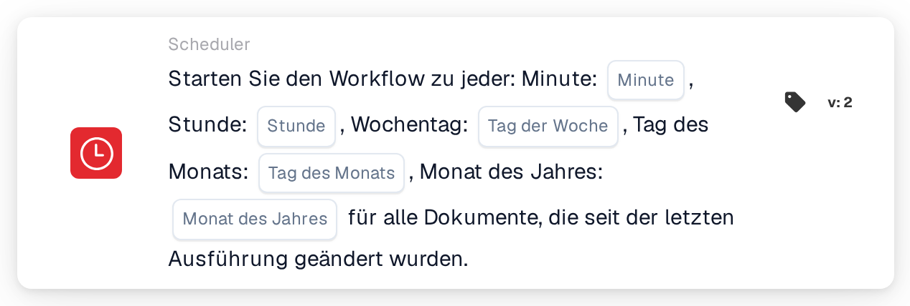

# Geplanter Workflow-Start

<figure><figcaption>
Version 2
</figcaption></figure>

## Zweck:

Diese Workflow-Karte startet einen Workflow (Auslöser) nach einem Zeitplan, ähnlich wie ein Cronjob. Zu jedem geplanten Zeitpunkt wird der Workflow für alle Dokumente ausgeführt, die sich seit der vorherigen Ausführung geändert haben. Das ist nützlich für regelmäßige Verarbeitungen wie nächtliche Prüfungen, periodische Erinnerungen oder Nachverfolgungen, die nicht sofort bei jeder Dokumentänderung laufen sollen.

## Bestandteile der Karte:

1. **Minute**
   * **Beschreibung:** Die Minute(n) der Stunde, zu der bzw. denen der Workflow startet.
   * **Detail:** Wert im Cron-Format, zum Beispiel `0`, `30`, `0,30` oder `*/15`. Ein leeres Feld bedeutet jede Minute (`*`).
2. **Stunde**
   * **Beschreibung:** Die Stunde(n) des Tages, zu der bzw. denen der Workflow startet.
   * **Detail:** Wert im Cron-Format, zum Beispiel `6` oder `8-18`. Ein leeres Feld bedeutet jede Stunde (`*`).
3. **Tag der Woche**
   * **Beschreibung:** Der oder die Wochentage, an denen der Workflow startet.
   * **Detail:** Wert im Cron-Format, zum Beispiel `1-5`. Ein leeres Feld bedeutet jeden Wochentag (`*`).
4. **Tag des Monats**
   * **Beschreibung:** Der oder die Tage des Monats, an denen der Workflow startet.
   * **Detail:** Wert im Cron-Format, zum Beispiel `1` oder `1,15`. Ein leeres Feld bedeutet jeden Tag (`*`).
5. **Monat des Jahres**
   * **Beschreibung:** Der oder die Monate, in denen der Workflow startet.
   * **Detail:** Wert im Cron-Format, zum Beispiel `1` oder `1-6`. Ein leeres Feld bedeutet jeden Monat (`*`).

## Funktionalität:

* **Zeitzone:** Alle Zeiten sind in UTC angegeben, der Zeitzone der DocBits-Server. So entspricht 6:00 UTC zum Beispiel 8:00 Uhr mitteleuropäischer Sommerzeit.
* **Wann der Workflow startet:** Wird der Workflow gespeichert und aktiviert, wird aus den fünf Feldern ein Zeitplaneintrag erstellt. Wird der Workflow deaktiviert oder gelöscht, wird der Zeitplaneintrag entfernt. Zu jedem geplanten Zeitpunkt führt das System folgende Schritte aus:
  * Es sucht nach Dokumenten der Organisation, die seit der letzten Ausführung des Workflows geändert oder gespeichert wurden oder ihren Status gewechselt haben,
  * es startet den Workflow für jedes dieser Dokumente einzeln im Hintergrund und
  * es merkt sich den Zeitpunkt dieser Ausführung als Ausgangspunkt für die nächste.

  Dokumente, die das Ausführungslimit für Workflows erreicht haben, werden übersprungen. Wird der Workflow deaktiviert, während die Dokumente verarbeitet werden, werden die verbleibenden Dokumente nicht mehr ausgeführt.
* **Bedingungsauswertung:** Die Karte prüft, ob der Workflow durch den Zeitplan gestartet wurde.
* **Ausführung der Aktion:**
  * **True-Bedingung:**\
    Wurde der Workflow durch den Zeitplan gestartet, ist die Karte erfüllt und der Workflow wird mit den nächsten Karten fortgesetzt.
  * **False-Bedingung:**\
    Wurde der Workflow auf andere Weise gestartet, zum Beispiel durch einen Dokument-Auslöser, einen Webhook oder eine Variablenänderung, ist die Karte nicht erfüllt und die nachfolgenden Schritte werden nicht ausgeführt.
* **Nur ein Zeitplan pro Workflow:** Enthält ein Workflow im Advanced Workflow Builder mehrere Zeitplankarten, wird nur die erste für den Zeitplan verwendet.
* **Speichern:** Kann der Zeitplaneintrag beim Speichern nicht aktualisiert werden, wird der Workflow trotzdem gespeichert und eine Warnung angezeigt. Durch erneutes Speichern des Workflows wird die Aktualisierung noch einmal versucht.

## Einrichtung und Konfiguration:

* Die Karte kann aus der **WHEN**-Gruppe, Kategorie **Scheduler**, hinzugefügt werden. Danach werden die Zeitfelder ausgefüllt; leer gelassene Felder bedeuten „jede(n)“. Zum Beispiel starten Minute `0`, Stunde `6`, Tag der Woche `1-5` und leere übrige Felder den Workflow werktags um 6:00 UTC. Anschließend werden die weiteren Bedingungen und Aktionen hinzugefügt und der Workflow wird gespeichert und aktiviert.

## Fazit:

Die Karte „Scheduled workflow start“ führt Workflows zu festen Zeiten aus statt bei jedem Ereignis. Da jede Ausführung nur die Dokumente erfasst, die sich seit der vorherigen Ausführung geändert haben, bleibt die regelmäßige Verarbeitung auf neue Arbeit konzentriert.
