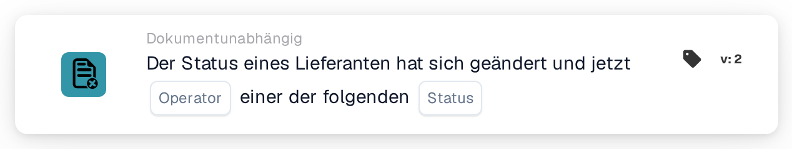

# Lieferantenstatus geändert

<figure><figcaption>
Version 2
</figcaption></figure>

## Zweck:

Diese Workflow-Karte startet einen Workflow (Auslöser), wenn sich der Status eines Lieferanten ändert, zum Beispiel wenn ein Lieferant genehmigt oder abgelehnt wird. Der Workflow läuft ohne Dokument und kann daher genutzt werden, um Personen zu benachrichtigen oder Folgeschritte im Lieferanten-Onboarding zu starten.

## Bestandteile der Karte:

1. **Operator**
   * **Beschreibung:** Legt fest, ob der neue Lieferantenstatus einer der ausgewählten Status sein soll oder keiner von ihnen.
   * **Optionen:**
     * **Ist:** Die Bedingung ist wahr, wenn der neue Status einer der ausgewählten Status ist.
     * **Ist nicht:** Die Bedingung ist wahr, wenn eine Änderung des Lieferantenstatus den Workflow gestartet hat und der neue Status keiner der ausgewählten Status ist.
2. **Status**
   * **Beschreibung:** Die Lieferantenstatus, mit denen der neue Status verglichen wird.
   * **Optionen:** Einer oder mehrere der folgenden:
     * **Genehmigt**
     * **Ausstehende AP-Genehmigung**
     * **Genehmigung ausstehend**
     * **Anstehende Registrierung**
     * **Abgelehnt**

## Funktionalität:

* **Wann der Workflow startet:** Eine Änderung des Lieferantenstatus in der Lieferantenverwaltung startet alle aktivierten dokumentunabhängigen Workflows der Organisation (außer Webhook- und zeitgesteuerten Workflows) und übergibt ihnen den neuen Status. Das geschieht zum Beispiel, wenn ein neuer Lieferant eingeladen wird (Status „Anstehende Registrierung“), wenn ein Lieferant zur Genehmigung gesendet, genehmigt oder abgelehnt wird oder wenn Lieferantendaten mit einem anderen Status gespeichert werden. Workflows werden nur für Status gestartet, die zu den für die Organisation konfigurierten Lieferantenstatus gehören; andernfalls wird kein Workflow gestartet. Workflows werden nur gestartet, wenn das Workflow-Modul für die Organisation aktiv ist und es aktive Workflows gibt.
* **Bedingungsauswertung:** Die Karte vergleicht den an den Workflow übergebenen Status mit den auf der Karte ausgewählten Status.
* **Ausführung der Aktion:**
  * **True-Bedingung:**\
    Mit **Ist** ist der neue Status einer der ausgewählten Status. Mit **Ist nicht** hat eine Änderung des Lieferantenstatus den Workflow gestartet und der neue Status ist keiner der ausgewählten Status. Der Workflow wird mit den nächsten Karten fortgesetzt.
  * **False-Bedingung:**\
    Ist die Bedingung nicht erfüllt, ist die Karte nicht erfüllt und die nachfolgenden Schritte werden nicht ausgeführt.
* **Andere dokumentunabhängige Ereignisse:** Auch ein Bestellimport startet alle dokumentunabhängigen Workflows, einschließlich Workflows mit dieser Karte. Ein solcher Lauf erfüllt die Karte mit keinem der beiden Operatoren, daher laufen die Schritte danach nur bei Änderungen des Lieferantenstatus.
* **Fehlende Daten:** Ist auf der Karte kein Status ausgewählt, wertet die Karte die Bedingung nicht aus. Sie meldet die fehlende Eingabe (oder einen Fehler) im Workflow-Protokoll, und die nachfolgenden Schritte werden nicht ausgeführt.
* **Ungültiger Operator:** Ist der Operator weder **Ist** noch **Ist nicht**, meldet die Karte einen Fehler in der Kartenkonfiguration im Workflow-Protokoll.

## Einrichtung und Konfiguration:

* Die Karte kann aus der **WHEN**-Gruppe, Kategorie **Dokumentunabhängig**, hinzugefügt werden. Danach werden der Operator und ein oder mehrere Status ausgewählt, die weiteren Bedingungen und Aktionen hinzugefügt und der Workflow wird gespeichert und aktiviert.

## Fazit:

Die Karte „Supplier status changed“ verbindet die Lieferantenverwaltung mit Workflows. Genehmigungen, Ablehnungen und andere Statusänderungen können direkt Benachrichtigungen und Folgeschritte auslösen, sodass das Lieferanten-Onboarding nicht von manuellen Prüfungen abhängt.
