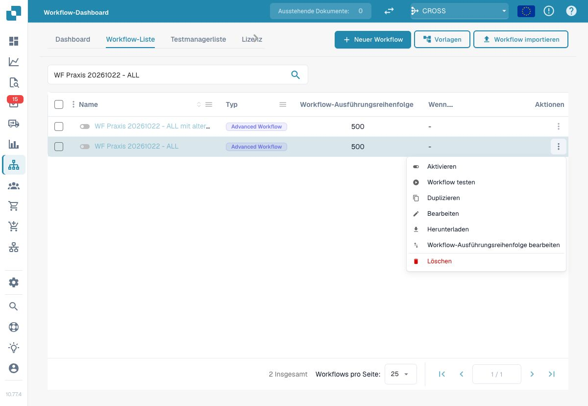
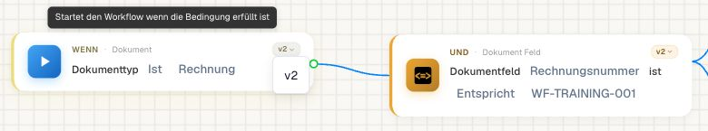
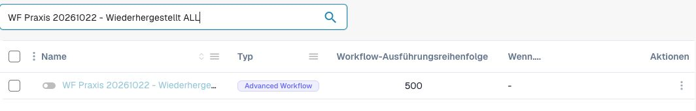
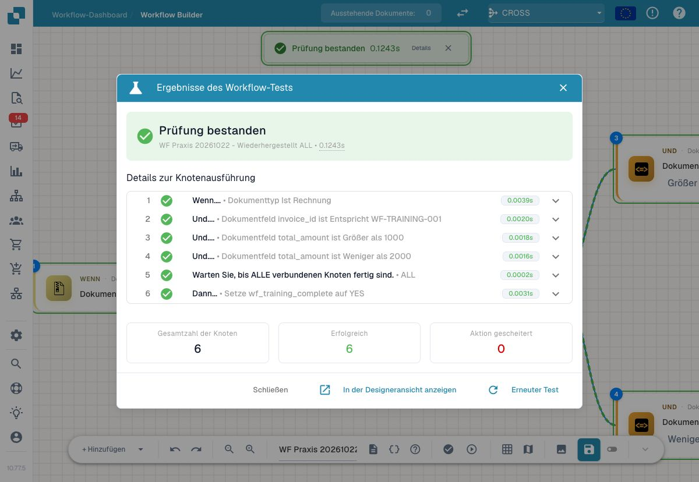

# Workflow ändern und einen gesicherten Stand wiederherstellen



[Video mit deutschen Untertiteln und Sprechertext öffnen](https://docbits-videos.fra1.cdn.digitaloceanspaces.com/settings-assistant/workflow-masterclass-13-admin/v1/de.html).

Sichern Sie vor einer Änderung den tatsächlich gespeicherten Workflow. Die Browser-Schaltfläche für Rückgängig, ein lokaler Entwurf und eine exportierte Konfiguration haben unterschiedliche Aufgaben. Keine davon nimmt bereits erzeugte Aufgaben, E-Mails oder externe Buchungen automatisch zurück.

## 1. Den gespeicherten Ausgangsstand sichern

Verwenden Sie einen eigenen Trainingsworkflow. Notieren Sie Name, Organisation, Typ, Aktivzustand, Ausführungsreihenfolge und die Version jeder betroffenen Karte. Laden Sie die angebotene Workflow-Datei herunter und bewahren Sie die unveränderten Bytes unter einem eindeutigen Dateinamen auf.

Prüfen Sie, dass der Export den erwarteten Namen, die erwarteten Karten und beim Advanced Workflow die vollständigen Knoten und Verbindungen enthält. Halten Sie Dateigröße und Prüfsumme fest. Ein neu geschriebener Beispielgraph ist keine Sicherung des gespeicherten Ausgangsstands.

Erfassen Sie Abhängigkeiten separat: Organisationsvariablen, Entscheidungstabellen, Benutzer und Gruppen, Dokumentfelder, Unterworkflows und Exportkonfigurationen. Ein Workflow-Export belegt nicht automatisch, dass alle diese Objekte mitgesichert oder in einer anderen Organisation gültig sind.

<figure><figcaption>Im Aktionsmenü des eigenen Trainingsworkflows lädt Herunterladen den gespeicherten Workflow herunter.</figcaption></figure>

Im Praxisnachweis wurde die tatsächlich heruntergeladene Datei unverändert gesichert: Exportformat `2`, Workflow-Version `3`, sechs Knoten und sechs Verbindungen. Diese Zahlen beschreiben den geprüften Export und sind keine Vorgabe, ältere Dateien von Hand umzuschreiben.

## 2. Genau eine Änderung durchführen

Schreiben Sie vor der Änderung auf, was sich fachlich ändern soll. Beispiel: Eine Rechnung mit exakt 1000 Euro soll weiterhin die Standardroute nehmen. Der Wechsel von `>` auf `>=` wäre dafür ein Fehler, auch wenn die Karte technisch ausführbar bleibt.

Ändern Sie zunächst nur den betroffenen Parameter. Kontrollieren Sie anschließend gespeicherte Kartenversion, Parameterwerte und Ergebnisausgänge. Speichern oder Importieren kann den Aktivzustand beeinflussen; prüfen Sie ihn ausdrücklich.

## 3. Mit unveränderten Erwartungen vergleichen

Wiederholen Sie Positiv-, Negativ-, Grenz- und Fehlerfälle. Nehmen Sie einen wiederholten Aufruf und betroffene Folgeworkflows hinzu. Vergleichen Sie zuerst den ersten Knoten mit abweichendem Verhalten. Ein später fehlender Export kann die Folge einer früheren falschen Bedingung sein.

Der [Regressionstest-Leitfaden mit Video](workflow-regression-tests.md) zeigt den Operatorwechsel mit unveränderten Erwartungen. Ergänzen Sie für Ihre Änderung tatsächliche Wirkungsnachweise, etwa Benutzerzuweisung am Beleg oder Empfang am eigenen Testziel.

## 4. Kartenversionen und Importmigration getrennt prüfen

Die App-Version im SDK, die Version einer Karte und die Exportversion einer Workflow-Datei sind unterschiedliche Angaben. Ändern Sie sie nicht nach Vermutung. Verwenden Sie den Export der aktuellen Oberfläche und erhalten Sie dessen Metadaten.

<figure><figcaption>Die native Versionsauswahl der Dokumenttyp-Karte zeigt im geprüften Trainingsworkflow v2.</figcaption></figure>

Hier bietet die Versionsauswahl ausschließlich `v2` an. Daraus folgt keine verfügbare ältere Version und keine automatische Wiederherstellung eines früheren Workflow-Stands. Im Beispiel wurde keine Kartenversion gewechselt.

Prüfen Sie beim Import einer älteren Datei, welche Kartenversion, Vergleichsrichtung und Optionen danach tatsächlich gespeichert sind. Besonders bei PO-Vergleichen können Referenzseite und Prozentbasis das Ergebnis verändern. Eine erfolgreiche Importantwort allein belegt keine fachliche Gleichwertigkeit.

Importieren Sie eine Übung zunächst als eigene inaktive Kopie. Vergleichen Sie Karten, Parameter, Kanten und Abhängigkeiten mit dem Original. Ein identischer Name ist kein Nachweis, dass die ursprüngliche Regel ersetzt wurde.

## 5. Wiederherstellung als eigenen Ablauf testen

Verwenden Sie die zuvor gesicherte Datei, um eine eigene inaktive Vergleichskopie anzulegen. Kontrollieren Sie nach dem Laden ihre tatsächlichen Werte und führen Sie dieselben Tests aus. Prüfen Sie, ob der eingesetzte Importweg eine neue Regel erstellt oder einen bestehenden Stand aktualisiert; nehmen Sie kein eingebautes Versions-Rollback an.

<figure><figcaption>Der importierte Workflow Wiederhergestellt ALL erscheint als eigene inaktive Regel.</figcaption></figure>

Für diese Übung wurde nur der Name in der Exportdatei ergänzt und die Datei über **Workflow importieren** hochgeladen. Nach der Dateiauswahl begann der Import unmittelbar. Das Original blieb erhalten; die neue Regel war inaktiv. Der anschließend geladene Graph enthielt dieselben Knoten, Verbindungen, Parameter und gewählten Kartenversionen. Die Ladefunktion ergänzte lediglich Informationen zu den verfügbaren Kartenversionen.

<figure><figcaption>Der Advanced Test des wiederhergestellten Workflows besteht alle sechs Knoten ohne Fehler.</figcaption></figure>

Der unveränderte Positivfall mit `invoice_id=WF-TRAINING-001` und `total_amount=1785` als `AMOUNT` bestand erneut alle sechs Schritte. Das ist ein **Advanced Test mit benutzerdefinierten Daten**. Er belegt die geprüfte Graph-Ausführung; eine gespeicherte Änderung an einem realen Beleg oder die Rücknahme früherer Aktionen ist damit nicht nachgewiesen.

Ein Wechsel auf den gesicherten Stand muss auch die Aktivzustände berücksichtigen. Zwei aktive Kopien können dieselbe Rechnung zweimal bearbeiten. Aktivieren Sie für einen vorgesehenen Vergleich nur die eindeutig begrenzte Testregel und prüfen Sie neue Dokumentläufe getrennt.

Bereits ausgeführte fachliche Aktionen benötigen eine eigene Korrektur im jeweiligen Zielprozess. Prüfen Sie vor einer erneuten Zustellung, ob das Ziel den ersten Vorgang bereits verarbeitet hat.

## Abnahmeprotokoll

| Nachweis | Festhalten |
| --- | --- |
| Ausgangsstand | Exportdatei, Prüfsumme, Karten, Versionen, Aktivzustand, Abhängigkeiten |
| Änderung | Geänderter Parameter und beabsichtigtes fachliches Ergebnis |
| Regression | Unveränderte Erwartungen und tatsächliche Einzelresultate |
| Importmigration | Gespeicherte Versionen und Bedeutungen vor/nach Import |
| Wiederherstellung | Konkrete Vergleichskopie und wiederholte Prüfergebnisse |
| Fachliche Wirkungen | Bereits erzeugte Aufgaben, Zustellungen und notwendige Korrekturen |

[Lernweg](workflow-learning-path.md) · [Kontrollierte Aktivierung](workflow-go-live.md) · [Fehlerdiagnose](workflow-troubleshooting.md) · [Toleranzen und PO](masterclass/tolerances-and-po.md)
