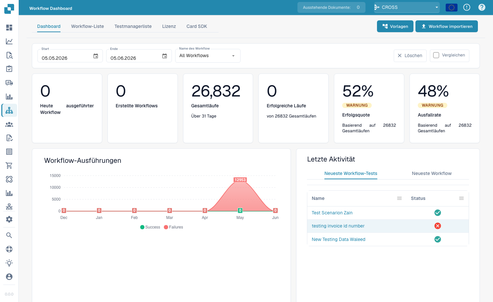
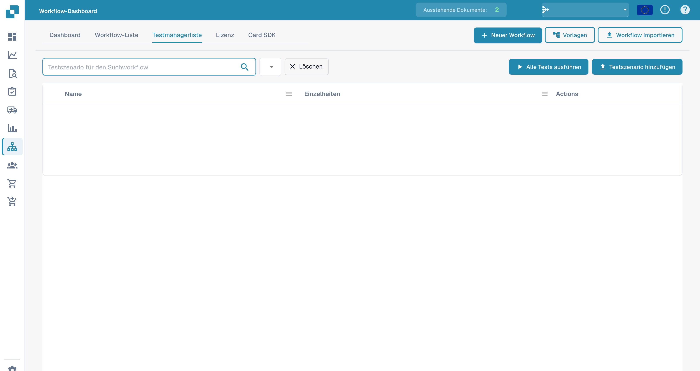

# Dashboard

Das **Workflow Dashboard** ist die Startseite des Workflow-Bereichs. Es zeigt, wie Ihre Workflows laufen – Ausführungssummen, Erfolgs- und Fehlerquoten, ein Diagramm der Ausführungen im Zeitverlauf und die letzte Aktivität – und bietet Zugriff auf die Workflow-Liste, den Test Manager und das Card SDK.

<figure><figcaption>
Das Workflow Dashboard – Ausführungssummen, Erfolgs-/Fehlerquoten und letzte Aktivität für jeden Workflow.
</figcaption></figure>

## Reiter

- **Dashboard** — Kennzahlen zu den Ausführungen und letzte Aktivität (oben dargestellt).
- **Workflow-Liste** — jeder Workflow mit Typ, Ausführungsreihenfolge und Auslöser. Einen neuen Workflow legen Sie mit **Neuer Workflow** an.
- **Testmanagerliste** — Testszenarien, die Ihre Workflows validieren; führen Sie sie mit **Alle Tests ausführen** aus.
- **Lizenz** — Informationen zur Workflow-Lizenzierung.
- **Card SDK** — eigene Workflow-Karten erstellen und hochladen (siehe [Card SDK](card-sdk.md)).

Die Symbolleiste bietet außerdem **Vorlagen**, das die Bibliothek [Workflow Templates](standard-workflow-builder.md#workflow-templates) öffnet, und **Workflow importieren**, das einen Workflow aus einer JSON-Datei importiert.

Im **Test Manager** können Sie Testszenarien pro Workflow speichern und gemeinsam ausführen, um zu bestätigen, dass Ihre Workflows sich nach Änderungen weiterhin korrekt verhalten:

<figure><figcaption>
Deutsche Testmanagerliste mit Alle Tests ausführen und Testszenario hinzufügen. Szenariodaten sind ausgeblendet; Actions bleibt ein Produktbegriff.
</figcaption></figure>

## Nächste Schritte

- Erstellen Sie mit dem Builder **Standard Workflow** eine lineare Automatisierung.
- Erstellen Sie mit dem Builder **Advanced Workflow** einen verzweigten Ablauf.
